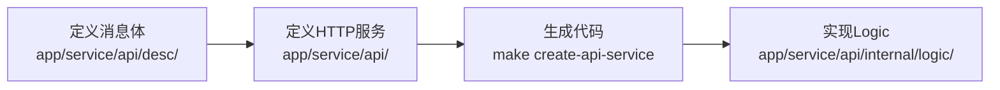
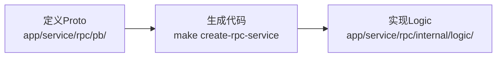

# Zeebee 后端知识库总索引

**创建时间**: 2025-11-24
**项目**: Zeebee 贷款管理系统后端
**技术栈**: Go + go-zero + gRPC + PostgreSQL
**文档类型**: 项目知识库导航中心

## 📋 概述

这是 Zeebee Backend 项目的综合文档索引，提供项目知识库的导航指南和交叉引用。项目是基于 go-zero 框架构建的微服务贷款管理系统后端。

**项目规模**: 712个Go文件，50个API定义，20个Proto文件，10个测试文件，共享domains层实现代码复用
**架构评分**: 8.2/10 ([详细分析](analysis/architecture_analysis_20250124.md))
**项目状态**: 开发阶段，核心功能已实现

## 🚀 快速导航

### 🎯 核心文档

- **[项目开发指南](CLAUDE.md)** - Claude Code 开发规范和工作流程 ⭐
- **[项目README](README.md)** - 项目概述和快速开始 ⭐
- **[最新代码分析报告](reports/code-quality/analysis_report_2025-12-22.md)** - 2025年12月综合代码质量分析 ⭐
- **[架构分析报告](analysis/architecture_analysis_20250124.md)** - 深度架构分析和改进建议
- **[API文档索引](guides/api_documentation_index.md)** - 完整API接口导航和使用说明
- **[项目结构指南](guides/project_structure_guide.md)** - 详细代码组织和架构说明
- **[域架构设计指南](guides/domain_architecture_guide.md)** - 共享数据层设计和代码复用实现
- **[README文档索引](guides/readme_index.md)** - 各模块README文档导航
- **[导航指南](guides/navigation-guide.md)** - 知识库使用和搜索指南

### 🔧 开发资源

- **[Makefile](Makefile)** - 代码生成和管理命令
- **[Go模块配置](go.mod)** - 依赖和版本管理
- **[代码质量配置](.golangci.yml)** - 代码检查规则

## 🏗️ 项目架构概览

### 微服务架构 (共享数据层)

```
┌─────────────────┐    ┌─────────────────┐
│   Borrower API  │    │   Lender API    │
│   (Port: 10000)  │    │   (Port: TBD)   │
└─────────┬───────┘    └─────────┬───────┘
          │                      │
          ▼                      ▼
┌─────────────────┐    ┌─────────────────┐
│  Borrower RPC   │    │   Lender RPC    │
│   (Port: 10001)  │    │   (Port: TBD)   │
└─────────┬───────┘    └─────────┬───────┘
          │                      │
          └──────────┬───────────┘
                     ▼
          ┌─────────────────┐
          │  Shared Layer   │
          │  (domains/zeebee)│
          │  • Models       │
          │  • Repositories │
          └─────────┬───────┘
                     ▼
          ┌─────────────────┐
          │   PostgreSQL   │
          │    + Redis     │
          │   + AWS S3     │
          └─────────────────┘
```

### 服务目录结构

```
├── app/               # 应用服务层
│   ├── borrower/      # 借款方服务
│   │   ├── api/       # HTTP API 层
│   │   │   ├── desc/  # API 消息体定义
│   │   │   └── borrower.api # HTTP 服务定义
│   │   ├── rpc/       # RPC 业务层
│   │   │   ├── pb/    # Protocol Buffers
│   │   │   └── internal/ # 业务逻辑实现
│   │   └── docs/      # 服务文档
│   └── lender/       # 贷款方服务
│       └── ...       # 类似结构
├── domains/          # 共享数据层
│   └── zeebee/        # 共享数据模型和仓储
│       ├── model/     # 共享数据模型
│       └── repo/      # 共享数据访问实现
├── common/           # 通用组件库
└── third_party/      # 第三方模板和工具
```

## 📚 文档分类

### 1. 📖 项目文档

#### 核心指南

- **[CLAUDE.md](CLAUDE.md)** - Claude Code 开发规范
    - 语言使用规范 (中文交流，英文注释)
    - 开发工作流程 (API → RPC → Database)
    - 代码风格和约定
    - 技术债务优先级

#### 项目概览

- **[README.md](README.md)** - 项目介绍
    - 开发环境设置
    - 项目结构说明
    - 快速开始指南

### 2. 🏛️ 架构文档

#### 分析报告

- **[架构分析报告](claudedocs/analysis.md)** - 详细架构评估
    - 微服务架构设计评估 ⭐
    - 数据层架构模式分析
    - API 和服务间通信设计
    - 改进建议和行动计划

#### 设计指南

- **[域架构设计指南](guides/domain_architecture_guide.md)** - 共享数据层设计
    - 共享数据层架构设计 ⭐
    - 代码复用实现模式
    - 服务间协作机制
    - 架构演进和最佳实践

#### 研究分析

- **[项目研究分析](claudedocs/research_project_analysis_20251106.md)** - 深度项目调研
    - 项目规模和复杂度分析
    - 技术栈评估
    - 业务领域分析
    - 代码质量评估

### 3. 🔧 开发文档

#### API 文档

- **[Swagger文档](app/borrower/api/swagger/)** - 自动生成的 API 文档
- **[API 定义文件](app/borrower/api/desc/)** - HTTP API 消息体和服务定义
    - `common.api` - 通用消息体
    - `loan.api` - 贷款相关消息体
    - `user.api` - 用户相关消息体
    - `property.api` - 房产相关消息体

#### 数据库文档

- **[数据库设计](app/borrower/docs/sql/)** - 数据库结构和迁移脚本
    - `20250807094911_create_us_geography.sql` - 地理数据表
- **[ER图](app/borrower/docs/diagram/er/er.puml)** - 数据库关系图

#### 配置文档

- **[服务配置](app/borrower/etc/)** - 环境配置文件
    - `config.yaml` - 开发环境配置
    - `config-staging.yaml` - 预发布环境配置

### 4. 📊 分析报告

#### 代码质量报告

- **[最新代码分析报告](reports/code-quality/analysis_report_2025-12-22.md)** ⭐ - 2025年12月综合分析
    - 整体评分: 8.2/10
    - 测试覆盖率分析 (<2% → 目标80%+)
    - 安全评估 (8.5/10)
    - 性能瓶颈识别
    - 架构和技术债务分析
    - 具体改进建议和实施计划

- **[历史代码质量分析](reports/code-quality/code_quality_analysis_20251107.md)** - 2025年11月分析
- **[性能分析报告](reports/performance/performance_analysis_report_20251107.md)** - 性能专项分析
- **[架构分析报告](reports/architecture/architecture_analysis_report_20251107.md)** - 架构专项分析
- **[综合系统分析](reports/comprehensive-system-analysis/comprehensive_analysis_report_20251107.md)** - 系统全面分析

#### 任务管理

- **[Admin用户CRUD任务](tasks/20251202_admin_user_curd_task.md)** - 管理后台用户管理任务记录

### 5. 📋 开发规范

#### 代码规范

- **[Golangci配置](.golangci.yml)** - Go 代码检查规则
- **[Git提交规范](CLAUDE.md#git-提交规范)** - Conventional Commits 标准

#### 开发工具

- **[代码生成模板](third_party/goctl_template/)** - go-zero 代码生成模板
- **[Makefile](Makefile)** - 自动化构建命令

## 🔍 开发工作流程

### 1. API 服务开发流程



### 2. RPC 服务开发流程



### 3. 数据流向

```
HTTP Request → API Handler → API Logic → RPC Call → RPC Logic → Repository → Model → Database
```

## 🏷️ 标签系统

### 状态标签

- 🔴 **高优先级** - 立即需要处理
- 🟡 **中优先级** - 计划处理
- 🟢 **低优先级** - 长期规划

### 类型标签

- **架构** - 系统架构相关
- **API** - 接口文档
- **数据库** - 数据存储相关
- **配置** - 配置文件
- **部署** - 部署和运维

### 重要度标记

- ⭐ **核心文档** - 必读文档
- 📚 **参考文档** - 开发参考资料

## 🗺️ 知识地图

### 按功能域分类

```
贷款管理系统
├── 借款方管理 (Borrower)
│   ├── 实体管理 (BorrowerEntity)
│   ├── 房产管理 (BorrowerProperty)
│   ├── 申请人管理 (BorrowerApplicant)
│   └── 贷款申请 (Loan)
├── 贷款方管理 (Lender)
│   ├── 贷款审核
│   ├── 文档管理
│   └── 审批流程
└── 通用组件 (Common)
    ├── 用户认证
    ├── 文件存储
    └── 数据验证
```

### 按技术栈分类

```
技术架构
├── 前端层
│   └── HTTP API (go-zero)
├── 业务层
│   └── RPC 服务 (gRPC)
├── 数据层
│   ├── PostgreSQL (主数据库)
│   ├── Redis (缓存)
│   └── AWS S3 (文件存储)
└── 基础设施
    ├── Docker 容器化
    └── 配置管理
```

## 📝 开发注意事项

### 当前阶段重点

1. **基础功能**: 专注于核心业务逻辑实现
2. **代码质量**: 统一错误处理和数据验证
3. **测试覆盖**: 提升单元测试覆盖率
4. **文档完善**: 补充 API 和开发文档

### 避免的复杂性

- ❌ 过早引入链路追踪 (当前阶段不需要)
- ❌ 复杂的服务发现机制 (当前使用硬编码配置)
- ❌ 过度的监控和性能优化 (业务稳定后考虑)

## 🔗 外部资源

### 框架文档

- [go-zero 官方文档](https://go-zero.dev/)
- [GORM 文档](https://gorm.io/docs/)
- [Protocol Buffers 指南](https://developers.google.com/protocol-buffers)

### 工具文档

- [goctl 工具](https://github.com/zeromicro/go-zero)
- [golangci-lint](https://golangci-lint.run/)

## 📊 项目状态

### 技术指标

- **Go 文件数量**: 712 个 (大幅增长)
    - app服务层: 借款方、贷款方、管理服务
    - domains共享层: 统一数据模型和仓储
    - common通用组件: 工具库和基础设施
- **API 定义文件**: 50 个 (HTTP API 规范)
- **Proto 文件**: 20 个 (gRPC 服务定义)
- **测试文件**: 10 个
- **测试覆盖率**: <2% (急需提升至 80%+)
- **代码质量评分**: 8.2/10 (2025年12月分析)

### 架构成熟度

| 维度   | 评分   | 状态       |
|------|------|----------|
| 可扩展性 | 8/10 | ✅ 良好     |
| 可维护性 | 8/10 | ✅ 优秀     |
| 可靠性  | 6/10 | ⚠️ 需改进   |
| 性能   | 7/10 | ✅ 基础良好   |
| 可观测性 | 4/10 | 🔴 需重点改进 |

### 联系信息

- **文档维护**: 通过 `claudedocs/` 目录管理 AI 生成文档
- **问题反馈**: 通过项目 Issue 或团队沟通渠道

---

*本文档由 /sc:index 命令自动生成，包含项目的完整知识库索引和导航指南。*