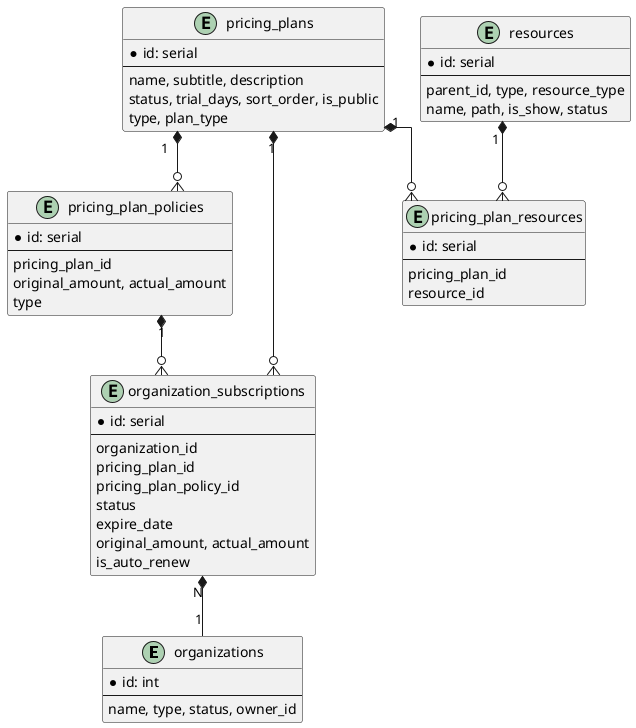

# 套餐管理 方案设计
> 来源：tasks/20260609_pricing_plan.md（重组为规范设计）

## 1. 背景与目标

### 1.1 业务背景

现有 SaaS 系统包含 Borrower / Lender / Admin 三端，已有角色与资源权限管理。为提升组织管理和产品灵活性，需要新增 套餐管理模块，实现：

1. 组织级功能控制：通过套餐绑定资源（菜单、按钮等），动态控制组织可访问功能。
2. 计费策略管理：支持月付、季付、年付，区分标准版与定制版。
3. 订阅管理：组织可创建、续期、自动续订或手动续订订阅。
4. 权限同步：套餐或订阅变更后及时通知各端，保证权限一致性。
5. 自动化支付与试用期支持：支持0元试用策略，自动切换组织状态为 Trial。

### 1.2 目标

1. 为 SaaS 系统增加 套餐与订阅管理能力。
2. 保证权限管理 实时、可控且与角色权限交集计算。
3. 通过 Redis + Casbin 高效管理权限。
4. 支持自动/手动订阅续费(目前未接入支付接口，仅支持 0元试用，续期为admin端手动操作)。

### 1.3 范围边界

（本设计未涉及）

## 2. 总体方案

### 技术架构

```
+----------------------------+
|      Borrower / Lender / Admin端      |
+----------------------------+
             |
             v
+----------------------------+
|        API Gateway         |
+----------------------------+
             |
             v
+------------------------------------+
|        业务服务 (Go)               |
|  - 套餐管理服务 (Pricing Plan)      |
|  - 订阅管理服务 (Subscription)     |
|  - 资源管理服务 (Resource)         |
+------------------------------------+
             |
             v
+----------------+   +-------------------+
| PostgreSQL DB  |   | Redis (权限缓存)   |
+----------------+   +-------------------+
             |
             v
+----------------------------+
|   Redis Pub/Sub 事件总线    |
+----------------------------+
```

### 功能架构

1. 套餐管理：
    - 创建/修改/删除套餐。
    - 绑定资源。
    - 管理计费策略（月/季/年）。
2. 订阅管理：
    - 创建订阅（可选自动续订）。
    - 续期订阅（手动或自动）。
    - 切换订阅状态（Trialing / Active / Expiring / Expired / Suspended）。
    - 自动支付验证与异常处理。
3. 权限管理：
    - 套餐资源变更、订阅变更触发 Redis 事件，通知各端刷新 Casbin 权限
4. 资源管理：
    - 资源树获取（菜单/按钮）。
    - 套餐限制范围内返回用户可访问资源。

### 模块划分

- 套餐管理服务 (Pricing Plan)
- 订阅管理服务 (Subscription)
- 资源管理服务 (Resource)

### 核心决策

（本设计未涉及）

## 3. 数据模型

### entity 关系



**说明**

* is_auto_renew 标识订阅是否自动续费。
* 用户权限最终来源 = 角色资源 ∩ 套餐资源。

### 数据库表结构

```sql
-- pricing_plans
CREATE TABLE "public"."pricing_plans"
(
    "id"          serial,
    "created_at"  timestamptz  NOT NULL DEFAULT now(),
    "updated_at"  timestamptz  NOT NULL DEFAULT now(),
    "is_del"      int2         NOT NULL DEFAULT 0,
    "name"        varchar(100) NOT NULL DEFAULT '',
    "subtitle"    varchar(255) NOT NULL DEFAULT '',
    "description" varchar(255) NOT NULL DEFAULT '',
    "status"      varchar(50)  NOT NULL DEFAULT 'Active',
    "trial_days"  int2         NOT NULL DEFAULT 0,
    "sort_order"  int2         NOT NULL DEFAULT 6,
    "is_public"   bool         NOT NULL DEFAULT false,
    "type"        varchar(50)  NOT NULL DEFAULT '',
    "plan_type"   varchar(50)  NOT NULL DEFAULT 'Standard',
    PRIMARY KEY ("id")
);

CREATE INDEX "idx_pricing_plan_name" ON "public"."pricing_plans" USING btree (
    "name"
    );

COMMENT
ON COLUMN "public"."pricing_plans"."status" IS 'Active,Disabled';
COMMENT
ON COLUMN "public"."pricing_plans"."type" IS 'Borrower,Lender,Admin';
COMMENT
ON COLUMN "public"."无pricing_plans标题"."plan_type" IS 'Standard,Custom';

-- pricing_plan_policies
CREATE TABLE "public"."pricing_plan_policies"
(
    "id"              serial,
    "created_at"      timestamptz    NOT NULL DEFAULT now(),
    "updated_at"      timestamptz    NOT NULL DEFAULT now(),
    "pricing_plan_id" int4           NOT NULL DEFAULT 0,
    "original_amount" decimal(10, 2) NOT NULL DEFAULT 0,
    "actual_amount"   decimal(10, 2) NOT NULL DEFAULT 0,
    "type"            varchar(20)    NOT NULL DEFAULT 'Monthly',
    PRIMARY KEY ("id")
)
;

CREATE INDEX "id_pr_policy_plan_id" ON "public"."pricing_plan_policies" USING btree (
    "pricing_plan_id"
    );

COMMENT
ON COLUMN "public"."pricing_plan_policies"."type" IS 'Monthly,Quarterly,Yearly';

-- pricing_plan_and_resources
CREATE TABLE "public"."pricing_plan_and_resources"
(
    "id"              serial,
    "pricing_plan_id" int4 NOT NULL DEFAULT 0,
    "resource_id"     int4 NOT NULL DEFAULT 0,
    PRIMARY KEY ("id")
)
;

CREATE INDEX "idx_pricing_plan_resource_plan_id" ON "public"."pricing_plan_and_resources" USING btree (
    "pricing_plan_id"
    );

CREATE INDEX "idx_pricing_plan_resource_resource_id" ON "public"."pricing_plan_and_resources" USING btree (
    "resource_id"
    );

-- organization_subscriptions
CREATE TABLE "public"."organization_subscriptions"
(
    "id"                     serial,
    "created_at"             timestamptz    NOT NULL DEFAULT now(),
    "updated_at"             timestamptz    NOT NULL DEFAULT now(),
    "is_del"                 int2           NOT NULL DEFAULT 0,
    "code"                   varchar(50)    NOT NULL DEFAULT '',
    "organization_id"        int4           NOT NULL DEFAULT 0,
    "pricing_plan_id"        int4           NOT NULL DEFAULT 0,
    "pricing_plan_policy_id" int4           NOT NULL DEFAULT 0,
    "status"                 varchar(50)    NOT NULL DEFAULT 'Active',
    "expire_date"            date           NOT NULL,
    "original_amount"        decimal(10, 2) NOT NULL DEFAULT 0,
    "actual_amount"          decimal(10, 2) NOT NULL DEFAULT 0,
    "is_auto_renew"          bool           NOT NULL DEFAULT false,
    PRIMARY KEY ("id")
);

CREATE UNIQUE INDEX "idx_org_subscri_code" ON "public"."organization_subscriptions" USING btree (
    "code"
    );

CREATE INDEX "idx_org_subscr_org_id" ON "public"."organization_subscriptions" USING btree (
    "organization_id"
    );

CREATE INDEX "idx_org_subscr_plan_id" ON "public"."organization_subscriptions" USING btree (
    "pricing_plan_id"
    );

CREATE INDEX "idx_org_subscr_policy_id" ON "public"."organization_subscriptions" USING btree (
    "pricing_plan_policy_id"
    );

CREATE INDEX ON "public"."organization_subscriptions" (
    );

COMMENT
ON COLUMN "public"."organization_subscriptions"."status" IS 'Trailing,Active,Expiring,Expired,Suspended';
```

## 4. 接口设计

### pricing plan

> 对pricing plan进行了写操作，需要对应服务重新加载权限

- get /api/v1/pricing_plan/page 分页获取pricing plan
- get /api/v1/pricing_plan/{id} 获取pricing plan
- post /api/v1/pricing_plan 新增pricing plan
- put /api/v1/pricing_plan/{id} 修改pricing plan
- delete /api/v1/pricing_plan/{id} 删除pricing plan
- put /api/v1/pricing_plan/{id}/resource 绑定resource，资源变动后会自动移除各个组织内不属于当前套餐的 resource
- post /api/v1/pricing_plan/{id}/pricing_plan_policy 新增pricing plan policy
- get /api/v1/pricing_plan/{id}/resource 获取套餐下resource

### pricing plan policy

- get /api/v1/pricing_plan_policy/{id} 获取pricing plan policy
- delete /api/v1/pricing_plan_policy/{id} 删除pricing plan policy
- put /api/v1/pricing_plan_policy/{id} 修改pricing plan policy

### organization subscription

> 对subscription进行了写操作，需要对应的服务重新加载权限

- get /api/v1/organization_subscription/page 分页获取organization subscription
- post /api/v1/organization_subscription 为organization添加一个organization
  subscription，如果该organization存在未过期的subscription，则将之前的subscription设置为过期状态
- post /api/v1/organization_subscription/{id}/renewal 为organization subscription续期,目前admin端的续期是直接设置过期时间expire_date
- patch /api/v1/organization_subscription/{id}/status 切换organization subscription状态

### user

> Borrower/Lender/Admin 用户获取自己的菜单接口也会收到影响
> Borrower/Lender 验证邮箱激活组织时会选择默认的pricing
> plan，如果套餐的试用时间大于0，则将组织的状态切换为trial，如果套餐有0元的付费策略，则使用第一个0元的付费策略的时间,如果没有套餐，则不做处理
>

- get /api/v1/user/menu 获取当前用户菜单
- post /api/v1/user/verify_email 验证邮箱,激活当前用户为owner的组织

### resource

> Borrower/Lender/Admin 获取自己权限内的资源tree应该限制在套餐范围内

- get /api/v1/resource/tree 获取资源tree

### organization

> admin 端创建组织的时候，会选择默认的pricing
> plan，如果套餐的试用时间大于0，则将组织的状态切换为trial，如果套餐有0元的付费策略，则使用第一个0元的付费策略的时间,如果没有套餐，则不做处理

- post /api/v1/organization/lender 创建lender组织

## 5. 核心流程

> - pricing plan 是订阅的计费计划，分为标准版与定制版，付费方式分为月付，季付，年付。每个plan都可以自定义付费方式，但是同一种付费方式只能有一种，比如说只能有一个月付的付费方式
> - pricing plan 的属性有：名称，副标题，状态，trial_days，排序，是否公开，类型，付费方式，在同一个type内名称唯一，编辑时名称不可修改，删除时需要判断当前的plan都已经过期，没有可用的plan
> - pricing plan创建好了之后需要绑定resource
> - 每次修改pricing plan的状态，执行删除操作，修改resource绑定关系后对应的服务需要重新加载权限，角色权限不可超过pricing
    plan的权限

**组织订阅**

* 激活组织 → 默认套餐 → 根据试用天数或0元策略设置 Trial 状态。
* 创建或续期订阅 → 更新 is_auto_renew 字段 → 发布 Redis 事件通知权限刷新。

**权限刷新**

* Redis 订阅发现模式通知各端。
* Casbin 加载缓存策略，刷新角色与套餐资源交集。

**自动续费**

* 检查套餐/计费策略可用性 → 若不可用 → 停止自动续订 → 通知用户选择新套餐。

**用户菜单获取**

* 限制在套餐范围内的资源。

## 6. 风险与权衡

（本设计未涉及）

## 7. 实现要点 / 测试

（本设计未涉及）
