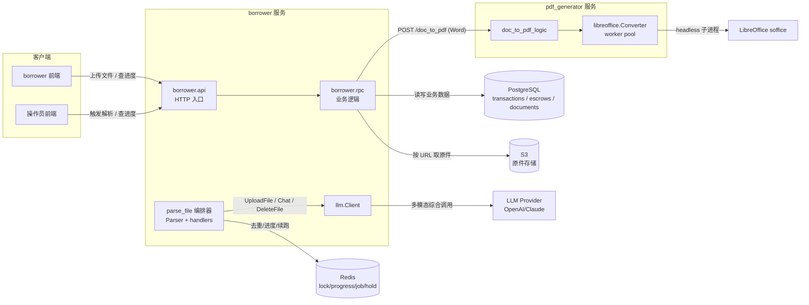
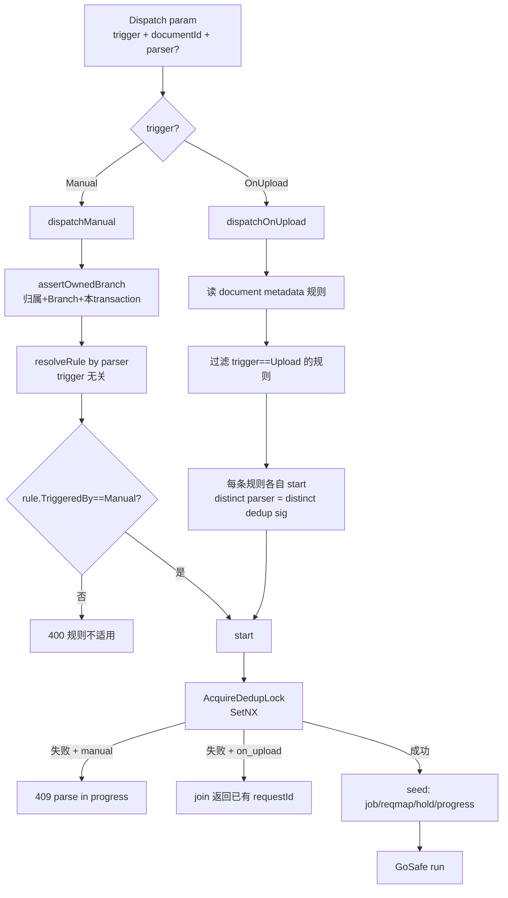
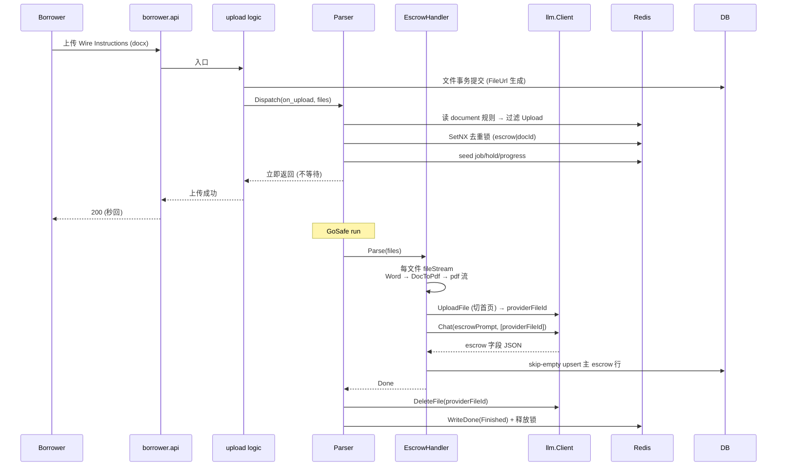
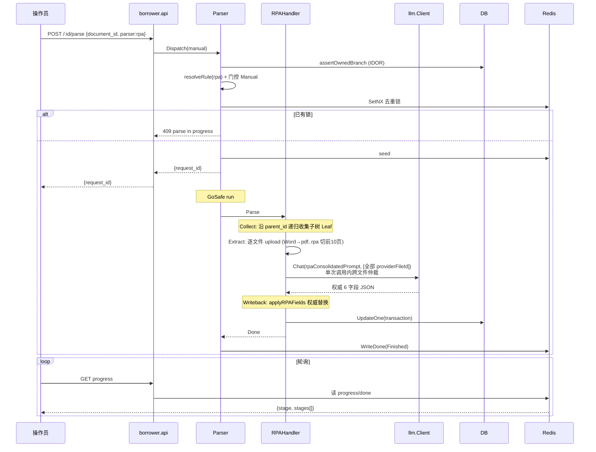
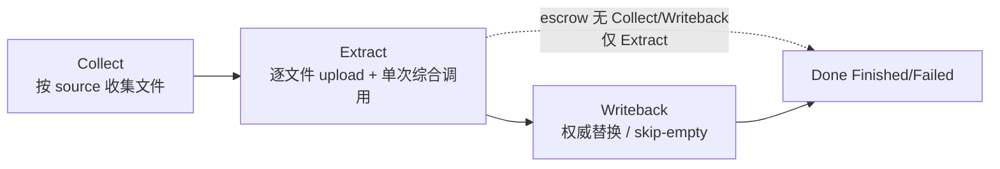
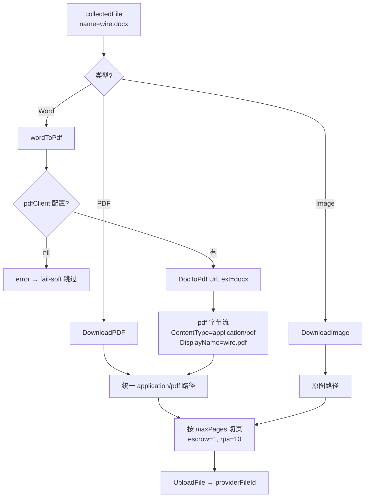
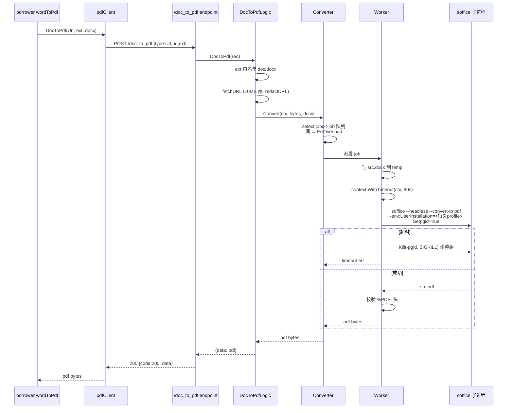
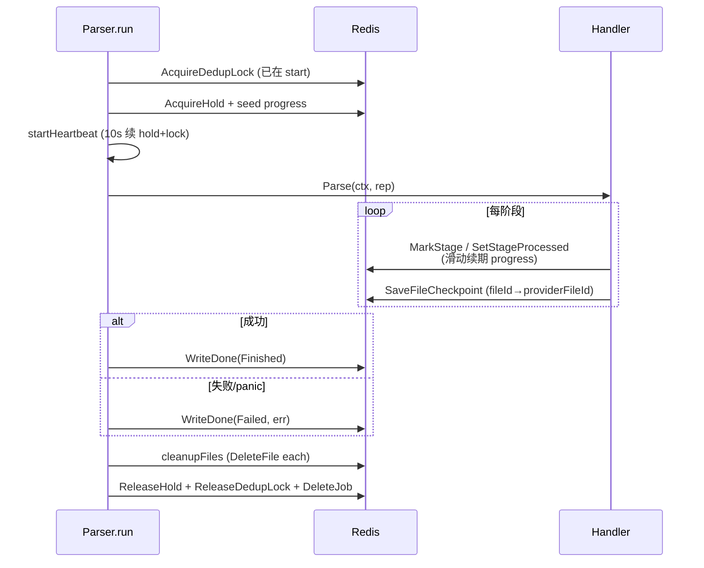
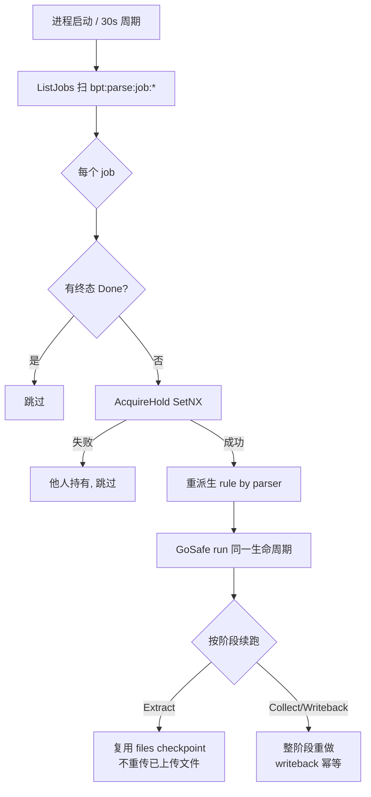

# Borrower Property Transaction 文件内容提取 — 技术方案设计（汇总结论版）

> 本文汇总 `003-property-tx-file-parse`（解析编排）与 `004-word-file-parse`（doc/docx → PDF）两条功能线的设计与实现，作为单一权威技术方案。所有结论以**已落地代码**为准；与早期 task/design 草稿的差异在文中标注。
>
> **来源**：`tasks/20260715_borrower_property_transaction_v2.md`（需求）、`..._v2_plan.md`（计划）、`specs/003-property-tx-file-parse`、`specs/004-word-file-parse`、`app/borrower/rpc/internal/biz_helper/parse_file/`、`app/pdf_generator/`。
>
> **版本**：1.0 ｜ **日期**：2026-07-30 ｜ **分支**：`003-property-tx-file-parse`、`004-word-file-parse`

---

## 1. 背景

Borrower 为 property transaction 上传文件（合同、Wire Instructions、各类报告等），文件内含 transaction 关键信息（purchase amount、EMD、COE 日期、escrow 公司/officer 等），历史上这些字段需人工逐项录入，慢且易错。

同一信息常散落在多份文件中（Original RPA、Counter Offer、Addendum…），需跨文件综合才能得到准确值；同步解析会阻塞上传响应、前端无法获知进度；此外若不支持 Word（`.doc`/`.docx`，房产场景最常见的合同格式之一）则覆盖面不足。

本方案一次性交付两条工作线：

- **解析编排**（分支 `003-property-tx-file-parse`）：异步化 + 分阶段进度 + 去重 + 崩溃续跑 + 多场景（上传即解析 / 整目录综合 / 标签圈定）。
- **Word 解析**（分支 `004-word-file-parse`）：在 `pdf_generator` 新增 doc/docx → PDF 能力，转换产物以 PDF 形态无缝复用解析管线。

---

## 2. 目标与非目标

### 2.1 目标

| # | 目标 |
|---|------|
| G1 | **上传即解析**：上传 Wire Instructions（PDF/doc/docx/图片）后异步自动回填 escrow 行，不阻塞上传响应。 |
| G2 | **手动整树综合**：在 Contract 文件夹节点点「解析」，异步综合该子树全部文件，跨文件择优仲裁回填合同关键字段。 |
| G3 | **进度可见 + 去重**：手动触发返回 `requestId`，前端轮询分阶段进度；同 transaction 同规则进行中 → 拒绝重复触发。 |
| G4 | **崩溃续跑**：进程重启/节点崩溃后，未完成任务由任一节点竞争领取、按阶段断点续跑，不丢任务、不重复回写、不重复上传计费。 |
| G5 | **Word 复用 PDF 管线**：doc/docx → PDF 后走现成切页/上传/综合调用路径，原件不动，行为与 PDF 一致。 |
| G6 | **静默失败**：解析/转换失败不影响上传响应或 borrower 其他操作，仅记日志 + 进度标记 `Failed`。 |

### 2.2 非目标

- 不做独立 metrics 体系（复用 go-zero `logx` 结构化日志即可定位）。
- 不做持久化任务表（进度/任务元数据全部 Redis，接受重启窗口内的丢任务风险，由恢复扫描兜底）。
- 不并行转换同一任务内的多个 Word 文件（串行优先简单鲁棒）。
- 纯手动字段（`title_holder`、`tc`、`cost_allocation`）本期不被任何解析器触碰。

---

## 3. 总体方案

### 3.1 系统架构



两个服务职责正交：`borrower.rpc` 负责解析编排（何时解析、解析哪些文件、如何综合回写），`pdf_generator` 负责把 Word 转成 PDF（仅供解析用，产物临时态）。二者仅通过一个 HTTP 端点耦合。

### 3.2 功能架构

系统由两个子系统组成：

**A. 解析编排子系统（`borrower.rpc/parse_file`）** —— 003

- **触发**：上传事件（`on_upload`）或手动按钮（`manual`）。
- **路由**：`Parser.Dispatch` 按 `parser` 名解析规则、按 `TriggeredBy` 门控、按 `Source` 收集文件。
- **执行**：per-parser `Handler`（escrow / rpa）跑分阶段流水线，经 `threading.GoSafe` 异步。
- **韧性**：Redis 去重锁 + 持有锁心跳 + 终态记录 + 启动/周期恢复扫描 + 每阶段独立重试。

**B. 文档转换子系统（`pdf_generator`）** —— 004

- **入口**：`POST /api/v1/doc_to_pdf`（`{type: Url|Data, url?, data?, ext}`）。
- **转换**：headless LibreOffice worker pool，每 worker 持久化 hardened profile。
- **边界**：输入 ≤10MB、单文件 ≤90s、满载快速失败（`ErrOverload`），转换时禁外链/远程图/宏。

### 3.3 模块划分

| 模块 | 路径 | 职责 |
|------|------|------|
| 编排器 | `parse_file/parser.go` | `Dispatch`（on_upload/manual）、`start`（去重锁+seed）、`run`（心跳+finalize+终态）、`cleanupFiles`（删除 provider 文件） |
| 路由 | `parse_file/rule.go` | `effectiveRules`、`ruleMatchesTrigger`、`onUploadRules`、`resolveRule`、`docFileParseConfig` |
| 恢复 | `parse_file/recover.go` | `StartRecovery`（启动扫描 + 30s 周期 sweep）、`tryReclaim`（抢持有锁、重派生规则、续跑） |
| 进度/Redis | `parse_file/progress/progress.go` | 去重锁、持有锁、分阶段进度、终态、reqmap、job 描述符、files checkpoint |
| 重试 | `parse_file/progress/retry.go` | `RetryDo`：每阶段独立、计数持久化、3 次上限、2/4s 指数退避 |
| Handler 接口 | `parse_file/handler/handler.go` | `Handler{Stages, Parse}` + `Reporter`（handler 看进度的窗口） |
| 共享基座 | `parse_file/handler/base.go` | `fileStream`（按类型取流，Word→pdf）、`uploadOne`（切页+上传+缓存+重试）、`resolveFiles`（按 Source 收集） |
| Escrow Handler | `parse_file/handler/escrow.go` | on_upload；单 Extract 阶段；逐文件 upload→综合调用→skip-empty upsert |
| RPA Handler | `parse_file/handler/rpa.go` | manual；Collect→Extract→Writeback；单次综合调用内仲裁；权威替换回写 |
| 文件工具 | `parse_file/file/*.go` | `pdf.go`/`image.go`/`word.go`/`doc.go`：类型识别、下载、切页、`PdfDisplayName` |
| 转换客户端 | `pdf_generator/client/client.go` | `DocToPdf(ctx, typ, url, data, ext)` → `POST /doc_to_pdf` |
| 转换逻辑 | `pdf_generator/.../doc_to_pdf_logic.go` | `sourceBytes`（ext 白名单 + cap）、`fetchURL`（URL 脱敏）、`redactURL` |
| 转换引擎 | `pdf_generator/.../libreoffice/converter.go` | worker pool、持久 profile、Setpgid+SIGKILL、满载 ErrOverload |
| Profile 加固 | `pdf_generator/.../libreoffice/profile.go` | macro 安全级 VeryHigh 的 `registrymodifications.xcu` |

> **设计纪律**：handler 是「纯工人」（只含解析逻辑，不做生命周期判断）；编排器独占锁/心跳/finalize/终态。加一个 parser = 写一个 `Handler` + `Register`，不碰编排器。

### 3.4 关键概念

- **Document 树（邻接表）**：`documents` 按 `parent_id` 物化为行，文件夹 = `DocumentTypeBranch`，文件挂 `DocumentTypeLeaf`。每行有稳定主键 `id`，建交易时把 template 的 `file_parse_config` + `tags` 快照进 `metadata`。手动解析的「目标目录」即某个 Branch 行的 `id`——稳定、唯一、不依赖文件名/路径。
- **规则配置 `file_parse_config`**：`{rules: [{parser, trigger, source, selector?}]}`。`trigger ∈ {Upload, Manual}`（何时触发）；`source ∈ {SingleFile, Files, Directory, TagFiltered}`（取哪些文件）。**trigger 与 source 正交**——这是路由的核心不变量（FR-031）。
- **parser 隐含输出目标**：`escrow_info` → escrow 行；`rpa` → transaction 合同字段。一对一，无需在规则里声明输出。
- **requestId**：`google/uuid`，标识一次异步解析生命周期。
- **阶段（Stage）**：`Collect → Extract → Writeback`（rpa 三阶段；escrow 仅 `Extract`）。进度**不返回整体百分比**，只返回当前阶段 + 阶段内子进度，整体由前端合成。

---

## 4. 数据模型与存储

### 4.1 数据表

**(a）`borrower_property_transactions` —— 新增列**（已部署）

| 列 | 类型 | 回写方 |
|----|------|--------|
| `title_holder` | varchar(100) | 纯手动 |
| `contract_date` | date | **rpa 回写**（修正：草稿列为纯手动，代码实际提取） |
| `emd_due_date` | date | rpa 回写 |
| `contingency_removal_date` | date | rpa 回写 |
| `tc` | varchar(50) | 纯手动 |
| `cost_allocation` | varchar(255) | 纯手动 |

> 另有既存列 `purchase_amount`、`emd_amount`、`coe_date` 也由 rpa 回写。故 **rpa 实际回写 6 个字段**：`purchase_amount`、`emd_amount`、`coe_date`、`contract_date`、`emd_due_date`、`contingency_removal_date`。纯手动仅 `title_holder`、`tc`、`cost_allocation`。

**(b）`property_transaction_escrows`**（已部署）

```sql
CREATE TABLE "property_transaction_escrows" (
    "id" serial PRIMARY KEY,
    "borrower_property_transaction_id" int4 NOT NULL,
    "no"             varchar(50),
    "escrow_company" varchar(100),
    "officer_name"   varchar(30),
    "officer_phone"  varchar(20),
    "officer_email"  varchar(50),
    "checklist"      jsonb NOT NULL DEFAULT '{}'
);
CREATE INDEX "bpt_escrow_transaction_id" ON ... (borrower_property_transaction_id);
CREATE INDEX "bpt_escrow_no"             ON ... (no);  -- 为未来 1:N 预留
```

> 当前 1:1：`create_logic` 建交易时 seed 一行空 escrow，`escrow_info` 解析实际更新该 seed 行（min-id 主行）。`no` btree 为未来 1:N 保留。

**(c）`document_templates.structure` —— 配置源**

全局单行（`type=BorrowerPropertyTransaction`），每个节点携带 `file_parse_config` + `tags`。建交易时快照进 document `metadata`。例：

```jsonc
// Wire Instructions 叶子：上传即解析 escrow
{"file_parse_config":{"rules":[{"parser":"escrow_info","trigger":"Upload","source":"Files"}]}}

// Contract 文件夹：手动整树综合 rpa
{"file_parse_config":{"rules":[{"parser":"rpa","trigger":"Manual","source":"Directory"}]}}
```

### 4.2 Redis 键（无新 DB 表）

| 用途 | key | value | TTL |
|------|-----|-------|-----|
| 去重锁 | `bpt:parse:lock:{txId}:{ruleSig}` | `requestId` | 600s（心跳续期） |
| 持有锁 | `bpt:parse:hold:{requestId}` | `nodeId` | 30s（心跳 10s 续期，过期可被他节点抢） |
| 分阶段进度 | `bpt:parse:progress:{requestId}` | `{status, stage, stages[], error?}` | 600s |
| 终态 | `bpt:parse:done:{requestId}` | `{status, error?}` | 3600s |
| ruleSig→requestId 映射 | `bpt:parse:reqmap:{txId}:{ruleSig}` | `requestId` | 3600s |
| 恢复任务描述符 | `bpt:parse:job:{requestId}` | `{requestId, txId, ruleSig, parser, source, documentId}` | 3600s |
| Extract 上传映射 | `bpt:parse:files:{requestId}` | `{fileId: {provider, providerFileId, maxPages}}` | 3600s（job TTL，跨进度过期存活） |

`ruleSig = parser|documentId`。files checkpoint 独立 job-TTL key：进度记录可能先过期，但上传映射存活，续跑不重传已上传文件（省计费）。

### 4.3 配置

**`pdf_generator`（`app/pdf_generator/etc/config-*.yaml`）**

```yaml
Name: pdf_generator.api
Host: 0.0.0.0
Port: 10300
LibreOffice:
  ConcurrentCap: 4        # worker pool 大小 + 并发闸
  TimeoutSec: 90          # 单文件 soffice 超时
  MaxInputBytes: 10485760 # 输入上限 10MB
```

**`borrower.rpc`**

```yaml
PdfGeneratorBaseUrl: http://127.0.0.1:10300/api/v1
LlmConf:
  Providers: [{Name: openai, ApiKey: ..., BaseUrl: ...}, ...]
  TransactionFileParseConf: {Provider: openai, Model: gpt-4o}
```

> ApiKey 写在 `etc/*.yaml` 是本仓库有意部署模式（私有仓），`HARDCODED_SECRETS` 告警按已接受处理；日志中禁止打印。

---

## 5. 接口设计

### 5.1 解析触发与进度（borrower）

| 端点 | 说明 |
|------|------|
| `POST /api/v1/borrower_property_transaction/:id/parse` | body `{document_id, parser}` → 校验归属+规则 → 去重 → 异步派发 → `{request_id}`；进行中 → 409 |
| `GET /api/v1/borrower_property_transaction/parse/:request_id/progress` | → `{status, stage, stages[], error?}`；终态窗口内可查，过期 404 |
| 上传文件端点 | 提交后异步派发 `trigger=Upload` 规则（fire-and-forget，不阻塞、不改返回体） |
| `GET .../:id`（detail） | checklist 节点带 `parse_rules`，前端按 `Manual` 规则渲染按钮 |

对应 RPC：`ParseFileExtract`、`GetFileExtractProgress`（proto 改完 `make create-service borrower` 重生成）。

### 5.2 doc_to_pdf（pdf_generator）

`POST /api/v1/doc_to_pdf`

```jsonc
// 请求
{"type": "Url", "url": "https://s3.../wire.docx", "ext": "docx"}
// 或
{"type": "Data", "data": "<base64>", "ext": "doc"}

// 响应（HTTP 恒 200，body code 表示成败）
{"code": 200, "data": {"data": "<pdf bytes>"}}
```

- `ext` 白名单：`doc`/`docx`，否则 400。
- URL 模式：`fetchURL` GET，`Content-Length`/`LimitReader` 双层 10MB 闸，错误信息经 `redactURL` 脱敏（去掉 presigned S3 的签名 query）。
- Data 模式：直接 `req.Data`，超 10MB 拒绝。
- **注意**：handler 对所有 logic 错误统一 `response.BadRequest`（HTTP 200 + body `code != 200`），**不区分过载/永久失败**——故调用方（borrower）对转换错误**无条件重试**（见 §8）。

### 5.3 file_parse_config schema

```go
type DocumentTemplateFileParseConfig struct {
    Rules []DocumentTemplateFileParseRule
}
type DocumentTemplateFileParseRule struct {
    Parser   constants.DocumentTemplateParser   // escrow_info | rpa
    Trigger  constants.FileParseTriggeredType   // Upload | Manual
    Source   constants.DocumentTemplateFileParseSource // SingleFile|Files|Directory|TagFiltered
    Selector *dto.DocumentTemplateTagSelector   // 仅 TagFiltered
}
type DocumentTemplateTagSelector struct{ Tags []string } // AND 语义
```

> trigger（何时）/source（哪些）正交。`SingleFile`/`Files` 用传入批次；`Directory` 收集子树；`TagFiltered` 按 `metadata.tags ⊇ selector.tags` 圈定。

---

## 6. 核心流程

### 6.1 Dispatch 路由（FR-031）



> 路由只在分发层判断 trigger；handler 只按 `source` 收集文件，不含触发判断。

### 6.2 上传即解析（escrow，on_upload）



### 6.3 手动整树综合（rpa，manual_tree）



### 6.4 分阶段状态机



- 阶段名/状态为常量、首字母大写（`Collect`/`Extract`/`Writeback`，`Pending`/`Running`/`Done`）。
- 进度只返回**当前阶段 + 阶段内子进度**（Collect 的 processed/total；Extract 的 uploaded/total），**无整体百分比**。
- 每阶段独立 `RetryDo`（3 次、2/4s 退避），计数持久化到 job TTL，崩溃续跑继续计数。

### 6.5 Word 文件进入解析管线



> **关键不变量**：Word 转 pdf 后以 `application/pdf` 形态进入下游，文件名经 `PdfDisplayName` 改 `.pdf`（provider 按扩展名分类，`.docx` 名带 pdf 字节会误分类）。原件永不被修改——转换产物是临时态。

### 6.6 doc → PDF 转换（pdf_generator 内部）



### 6.7 去重 + 进度 + 续跑生命周期



### 6.8 崩溃恢复



> 恢复任务只携带 `parser`（不携带 trigger），故 `resolveRule` 按 parser 解析、trigger 无关。持有锁过期（节点崩溃）→ 他节点 `SetNX` 抢领。files checkpoint 跨进度 TTL 存活，续跑不重传、不重复计费。

---

## 7. 回写规则

| Parser | 字段 | 规则 | 实现 |
|--------|------|------|------|
| rpa | 6 合同字段 | **权威替换**：提取非空/非 0 覆盖原值（含人工值）；空/0 跳过 | `applyRPAFields`（`rpa.go`） |
| escrow_info | escrow 行 5 字段 | **skip-empty**：提取为空保留原字段 | `ApplyEscrowFields`（`escrow.go`） |

> 两 parser 因输出目标不同互不冲突。rpa 多文件冲突由 LLM 在**单次综合调用内**仲裁（`rpaConsolidatedPrompt`），无法定夺时该字段返回 `null`，回写时 skip-empty 保留既有值——**宁可不写也不写错**。

---

## 8. 风险与权衡

| 风险 | 权衡 | 缓解 |
|------|------|------|
| **Redis-only / 无持久化任务表** | 实现简；代价：无历史、无失败重试，重启窗口内 in-flight 丢失 | 启动 + 30s 周期恢复扫描兜底；job/hold/lock TTL 内可续跑 |
| **goroutine-per-job / 无背压** | 简单；突发上传/手动可能起大量 goroutine | LLM 超时（60s）+ 去重锁（同 doc/rule 串行）+ 综合调用单次化天然限流 |
| **LLM 仲裁不可解释** | 灵活适应现实不确定性；代价：偶有偏差 | 不可定夺时返回 null（不猜测）；prompt 强调权威源优先 |
| **Word 转换冷启动慢** | LibreOffice 首启慢 | worker 持久化 profile 跳过 bootstrap；90s 超时 + fail-soft 跳过单文件 |
| **过载契约不区分** | pdf_generator 对所有错误统一 BadRequest，调用方无法区分过载/永久失败 | borrower 对转换错误**无条件重试**（3 次、2s 退避），耗尽 fail-soft 跳过（`base.go` 注释明示） |
| **SSRF（fetchURL 任意 URL）** | URL 来自调用方 | pdf_generator 容器无出站 egress（仅 S3），网络层为首要控制；profile macro 加固为补充 |
| **soffice 子进程僵尸/孤儿** | headless 偶发 fork oosplash | `Setpgid` 新建进程组 + ctx 超时 `Kill(-pgid, SIGKILL)` 杀整组 |
| **配置迁移兼容** | 既有 transaction doc metadata 是旧形态 | `effectiveRules` normalize；新交易写新形态；既有靠兼容直至文档树重建 |
| **进度粗粒度** | 简单；大文件/仲裁阶段进度在某档停留 | 不报整体百分比，只报阶段 + 子进度，避免造虚假停滞数字 |

---

## 9. 实现要点

### 9.1 关键不变量（改动前必读）

1. **trigger ⊥ source**：路由只按 `TriggeredBy` 门控；handler 只按 `Source` 收集。加规则/加 parser 不得破坏此正交。
2. **handler 是纯工人**：不持锁、不写终态、不做触发判断；生命周期全归 `Parser`。
3. **Word 走 PDF 路径**：转换后 `ContentType=application/pdf` + `DisplayName=.pdf`，原件不动。
4. **files checkpoint 跨 TTL**：续跑依据 `{fileId→providerFileId}`，不重传、不重复计费。
5. **writeback 幂等**：权威替换/skip-empty 使重做不重复回写。

### 9.2 构建顺序

1. 配置：`DocumentTemplateFileParseConfig`（rules）+ `effectiveRules`；`LibreOfficeConf`。
2. `parse_file/progress`：Redis 锁/进度/终态/job/files checkpoint + `RetryDo`。
3. `parse_file` 编排器：`Dispatch`/`start`/`run`/`recover`。
4. handler：escrow（on_upload）+ rpa（manual）+ 共享 `base`。
5. Word：`file/word.go` + `base.wordToPdf` + `pdfClient.DocToPdf`。
6. `pdf_generator`：`libreoffice`（converter + profile）+ `doc_to_pdf_logic` + 路由。
7. Proto + `make create-service borrower`；新端点（API+RPC）+ `buildChecklistNode.parse_rules`。
8. 端到端接线、build、lint。

### 9.3 测试覆盖

| 层 | 测试 |
|----|------|
| 路由 | `effectiveRules` 归一化；`ruleMatchesTrigger` 门控；`resolveRule` by parser |
| 收集 | `CollectSubtree`（整树）/ `CollectBySelector`（tags AND、跨树） |
| 回写 | rpa 权威替换 + 空/0 跳过；escrow skip-empty |
| 进度/锁 | `SetNX` 冲突→409；每阶段重试计数持久化；终态 key + 释放锁 |
| 恢复 | 持有锁过期→他节点抢领；files checkpoint 复用不重传 |
| 转换 | converter（live soffice）；ext 白名单；URL 脱敏；10MB 闸；90s 超时 |
| parser | mock `llm.Client`，断言 rpa 6 字段 / escrow 5 字段解析 + skip |

> pdfium 纯 Go（wazero），CI 无 CGO。LLM 用 mock/stub，不打真实 API。

---

## 10. 附录：与早期草稿的差异（以代码为准）

| 项 | 草稿 | 实际代码 |
|----|------|----------|
| rpa 输出字段 | 5 字段（不含 contract_date） | **6 字段**（含 `contract_date`，`rpa.go:31,157`） |
| 纯手动列 | 4 列 | **3 列**（`title_holder`/`tc`/`cost_allocation`） |
| 独立 Arbitrate 阶段 | 四阶段 Collect→Extract→Arbitrate→Writeback | **三阶段**（仲裁并入 Extract 单次综合调用，spec 2026-07-24 决策） |
| 转换产物缓存 | 缓存转换字节 | 缓存 **provider file id**（同 003 上传映射思路，不缓存字节） |
| `manual_node`/`excluded_parsers` | 曾设计 | **已取消**（整树=Directory source；部分/跨树=TagFiltered+tags） |
| 过载 503 契约 | client 区分 ErrOverload | **已删**（handler 统一 BadRequest，client 无条件重试） |
