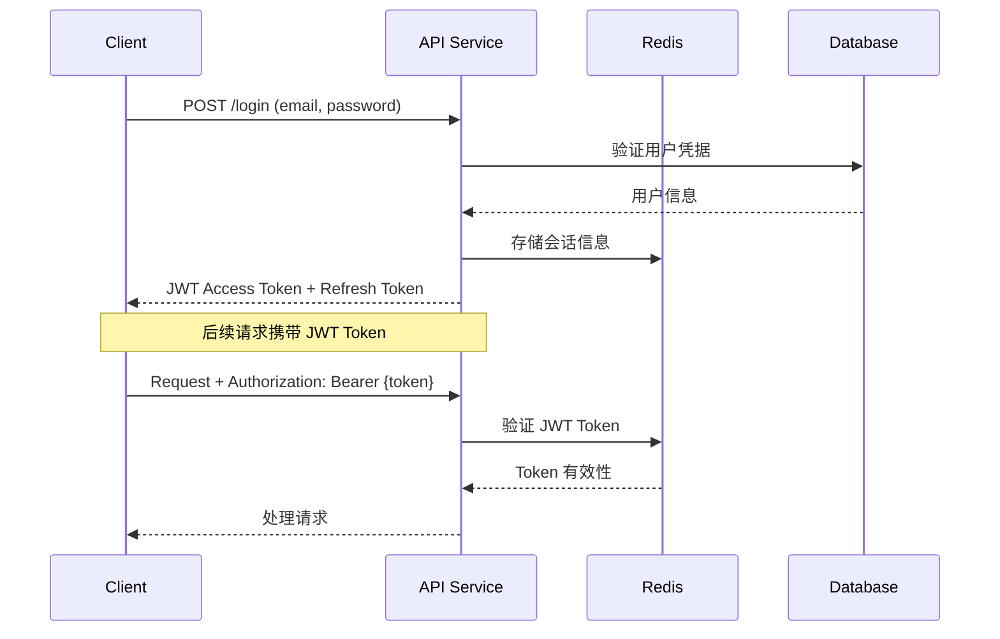

# API 文档索引

**文档创建时间**: 2025-11-24
**文档类型**: 开发指导文档
**维护状态**: 活跃

## 概述

本文档提供 Zeebee 贷款管理系统 API 接口的完整索引和导航指南。系统采用微服务架构，包含借款方 (Borrower) 和贷款方 (Lender)
两个主要服务，通过 RESTful API 和 gRPC 服务提供完整的功能支持。

## 服务架构概览

```
┌─────────────────────────────────────────────────────────────┐
│                    API 服务架构图                              │
├─────────────────────────────────────────────────────────────┤
│                                                             │
│  ┌─────────────────┐    ┌─────────────────┐                │
│  │  Borrower API   │    │   Lender API    │                │
│  │  (Port: 10000)  │    │   (Port: TBD)   │                │
│  │                 │    │                 │                │
│  │ • 用户认证       │    │ • 用户认证       │                │
│  │ • 贷款申请       │    │ • 贷款审核       │                │
│  │ • 房产管理       │    │ • 文档管理       │                │
│  │ • 实体管理       │    │ • 状态管理       │                │
│  └─────────┬───────┘    └─────────┬───────┘                │
│            │                      │                        │
│            ▼                      ▼                        │
│  ┌─────────────────┐    ┌─────────────────┐                │
│  │  Borrower RPC   │    │   Lender RPC    │                │
│  │  (Port: 10001)  │    │   (Port: TBD)   │                │
│  │                 │    │                 │                │
│  │ • 业务逻辑       │    │ • 审核逻辑       │                │
│  │ • 数据操作       │    │ • 文档处理       │                │
│  └─────────────────┘    └─────────────────┘                │
└─────────────────────────────────────────────────────────────┘
```

## API 服务端点

### 借款方服务 (Borrower API)

#### 服务基本信息

- **服务地址**: `http://localhost:10000`
- **API 版本**: v1
- **认证方式**: JWT Bearer Token
- **文档路径**: `app/borrower/api/swagger/`

#### API 端点分组

##### 🔐 用户管理 (`/api/v1/user`)

| 方法   | 端点                                 | 功能描述     | 认证要求 |
|------|------------------------------------|----------|------|
| POST | `/api/v1/user/register`            | 用户注册     | ❌    |
| POST | `/api/v1/user/login`               | 用户登录     | ❌    |
| POST | `/api/v1/user/refresh`             | 刷新访问令牌   | ❌    |
| POST | `/api/v1/user/verify_email`        | 邮箱验证     | ❌    |
| POST | `/api/v1/user/send_verify_email`   | 发送验证邮件   | ❌    |
| POST | `/api/v1/user/reset_password`      | 重置密码     | ❌    |
| POST | `/api/v1/user/send_reset_password` | 发送重置密码邮件 | ❌    |
| GET  | `/api/v1/user/info`                | 获取用户信息   | ✅    |

##### 💰 贷款管理 (`/api/v1/loan`)

| 方法     | 端点                                                 | 功能描述     | 认证要求 |
|--------|----------------------------------------------------|----------|------|
| POST   | `/api/v1/loan/pre_approval`                        | 贷款预审批    | ❌    |
| POST   | `/api/v1/loan/send_pre_approval_loan_notification` | 发送预审批通知  | ❌    |
| POST   | `/api/v1/loan`                                     | 创建贷款     | ✅    |
| PUT    | `/api/v1/loan/:id`                                 | 更新贷款     | ✅    |
| PUT    | `/api/v1/loan/:id/pending_status`                  | 更新贷款状态   | ✅    |
| DELETE | `/api/v1/loan/:id`                                 | 删除贷款     | ✅    |
| GET    | `/api/v1/loan/lender_companies`                    | 获取贷款公司列表 | ✅    |
| GET    | `/api/v1/loan/:id`                                 | 获取贷款详情   | ✅    |
| POST   | `/api/v1/loan/page`                                | 分页查询贷款   | ✅    |
| POST   | `/api/v1/loan/apply`                               | 申请贷款     | ✅    |
| POST   | `/api/v1/loan/draft`                               | 创建贷款草稿   | ✅    |
| PUT    | `/api/v1/loan/:id/draft`                           | 更新贷款草稿   | ✅    |
| PUT    | `/api/v1/loan/:id/update_apply`                    | 更新贷款申请   | ✅    |
| POST   | `/api/v1/loan/import`                              | 导入贷款     | ✅    |
| GET    | `/api/v1/loan/import/template`                     | 下载导入模板   | ✅    |

##### 🏠 房产管理 (`/api/v1/property`)

| 方法     | 端点                             | 功能描述   | 认证要求 |
|--------|--------------------------------|--------|------|
| POST   | `/api/v1/property/page`        | 分页查询房产 | ✅    |
| GET    | `/api/v1/property/all`         | 获取所有房产 | ✅    |
| GET    | `/api/v1/property/:id/summary` | 获取房产摘要 | ✅    |
| GET    | `/api/v1/property/:id`         | 获取房产详情 | ✅    |
| POST   | `/api/v1/property`             | 创建房产   | ✅    |
| PUT    | `/api/v1/property/:id`         | 更新房产   | ✅    |
| DELETE | `/api/v1/property/:id`         | 删除房产   | ✅    |

##### 🏢 借款实体管理 (`/api/v1/borrower_entity`)

| 方法     | 端点                                      | 功能描述     | 认证要求 |
|--------|-----------------------------------------|----------|------|
| POST   | `/api/v1/borrower_entity/page`          | 分页查询借款实体 | ✅    |
| GET    | `/api/v1/borrower_entity/all`           | 获取所有借款实体 | ✅    |
| GET    | `/api/v1/borrower_entity/check_existed` | 检查实体是否存在 | ✅    |
| GET    | `/api/v1/borrower_entity/:id`           | 获取借款实体详情 | ✅    |
| POST   | `/api/v1/borrower_entity`               | 创建借款实体   | ✅    |
| PUT    | `/api/v1/borrower_entity/:id`           | 更新借款实体   | ✅    |
| DELETE | `/api/v1/borrower_entity/:id`           | 删除借款实体   | ✅    |

##### 👥 借款申请人管理 (`/api/v1/borrower_applicant`)

| 方法     | 端点                                         | 功能描述      | 认证要求 |
|--------|--------------------------------------------|-----------|------|
| POST   | `/api/v1/borrower_applicant/page`          | 分页查询借款申请人 | ✅    |
| GET    | `/api/v1/borrower_applicant/all`           | 获取所有借款申请人 | ✅    |
| GET    | `/api/v1/borrower_applicant/:id`           | 获取借款申请人详情 | ✅    |
| POST   | `/api/v1/borrower_applicant`               | 创建借款申请人   | ✅    |
| PUT    | `/api/v1/borrower_applicant/:id`           | 更新借款申请人   | ✅    |
| DELETE | `/api/v1/borrower_applicant/:id`           | 删除借款申请人   | ✅    |
| GET    | `/api/v1/borrower_applicant/check_existed` | 检查申请人是否存在 | ✅    |

##### 📄 贷款申请人服务 (`/api/v1/applicant`)

| 方法   | 端点                           | 功能描述      | 认证要求 |
|------|------------------------------|-----------|------|
| POST | `/api/v1/applicant/borrower` | 获取借款人姓名列表 | ✅    |

##### 📑 PDF 服务 (`/api/v1/pdf`)

| 方法   | 端点                       | 功能描述      | 认证要求 |
|------|--------------------------|-----------|------|
| POST | `/api/v1/pdf/apply_form` | 生成申请表 PDF | ✅    |

##### ☁️ 存储服务 (`/api/v1/storage`)

| 方法   | 端点                            | 功能描述              | 认证要求 |
|------|-------------------------------|-------------------|------|
| POST | `/api/v1/storage/presign_url` | 创建 AWS S3 预签名 URL | ✅    |

##### 🗂️ 文件服务 (`/api/v1/file`)

| 方法     | 端点                 | 功能描述 | 认证要求 |
|--------|--------------------|------|------|
| DELETE | `/api/v1/file/:id` | 删除文件 | ✅    |

##### 📋 贷款文档服务 (`/api/v1/loan_document`)

| 方法   | 端点                                | 功能描述     | 认证要求 |
|------|-----------------------------------|----------|------|
| POST | `/api/v1/loan_document/:id/files` | 添加贷款文档文件 | ✅    |

##### 🔧 通用服务 (`/api/v1`)

| 方法  | 端点                       | 功能描述     | 认证要求 |
|-----|--------------------------|----------|------|
| GET | `/api/v1/select_options` | 获取选择项    | ❌    |
| GET | `/api/v1/us_states`      | 获取美国州列表  | ❌    |
| GET | `/api/v1/us_cities`      | 获取美国城市列表 | ❌    |
| GET | `/api/v1/uuid`           | 生成 UUID  | ❌    |

### 贷款方服务 (Lender API)

#### 服务基本信息

- **服务地址**: `http://localhost:{port}` (具体端口见配置文件)
- **API 版本**: v1
- **认证方式**: JWT Bearer Token
- **文档路径**: `app/lender/api/swagger/`

#### API 端点分组

##### 🔐 用户管理 (`/api/v1/user`)

| 方法   | 端点                                   | 功能描述     | 认证要求 |
|------|--------------------------------------|----------|------|
| POST | `/api/v1/user/register`              | 用户注册     | ❌    |
| POST | `/api/v1/user/login`                 | 用户登录     | ❌    |
| POST | `/api/v1/user/refresh`               | 刷新访问令牌   | ❌    |
| POST | `/api/v1/user/reset_password`        | 重置密码     | ❌    |
| POST | `/api/v1/user/send_reset_password`   | 发送重置密码邮件 | ❌    |
| GET  | `/api/v1/user/info`                  | 获取用户信息   | ✅    |
| POST | `/api/v1/user/switch_lender_company` | 切换贷款公司   | ✅    |

##### 💰 贷款管理 (`/api/v1/loan`)

| 方法    | 端点                                       | 功能描述      | 认证要求 |
|-------|------------------------------------------|-----------|------|
| GET   | `/api/v1/loan/:id`                       | 获取贷款详情    | ✅    |
| POST  | `/api/v1/loan/page`                      | 分页查询贷款    | ✅    |
| PUT   | `/api/v1/loan/:id`                       | 更新贷款      | ✅    |
| PATCH | `/api/v1/loan/:id/stage`                 | 更新贷款阶段    | ✅    |
| PATCH | `/api/v1/loan/:id/pending_status`        | 更新贷款待处理状态 | ✅    |
| POST  | `/api/v1/loan/:id/review_pending_status` | 审核待处理状态   | ✅    |
| GET   | `/api/v1/loan/:id/loan_documents_opts`   | 获取贷款文档选项  | ✅    |

##### 📄 贷款文档管理 (`/api/v1/loan_document`)

| 方法     | 端点                                    | 功能描述     | 认证要求 |
|--------|---------------------------------------|----------|------|
| POST   | `/api/v1/loan_document`               | 创建贷款文档   | ✅    |
| DELETE | `/api/v1/loan_document/:id/request`   | 删除贷款文档请求 | ✅    |
| POST   | `/api/v1/loan_document/send_requests` | 发送贷款文档请求 | ✅    |
| PATCH  | `/api/v1/loan_document/:id/comment`   | 更新文档评论   | ✅    |
| POST   | `/api/v1/loan_document/:id/files`     | 添加文档文件   | ✅    |

##### 🗂️ 文件服务 (`/api/v1/file`)

| 方法     | 端点                 | 功能描述 | 认证要求 |
|--------|--------------------|------|------|
| DELETE | `/api/v1/file/:id` | 删除文件 | ✅    |

##### ☁️ 存储服务 (`/api/v1/storage`)

| 方法   | 端点                            | 功能描述              | 认证要求 |
|------|-------------------------------|-------------------|------|
| POST | `/api/v1/storage/presign_url` | 创建 AWS S3 预签名 URL | ✅    |

##### 🔧 通用服务 (`/api/v1`)

| 方法  | 端点                       | 功能描述     | 认证要求 |
|-----|--------------------------|----------|------|
| GET | `/api/v1/select_options` | 获取选择项    | ❌    |
| GET | `/api/v1/us_states`      | 获取美国州列表  | ❌    |
| GET | `/api/v1/us_cities`      | 获取美国城市列表 | ❌    |

## gRPC 服务接口

### 借款方 RPC 服务 (Borrower RPC)

#### 服务配置

- **服务地址**: `localhost:10001`
- **协议**: gRPC
- **Proto 文件**: `app/borrower/rpc/pb/borrower.proto`

#### RPC 服务分组

##### 🔧 通用服务 (common)

```protobuf
service common {
  rpc GetOpt(OptionRequest) returns(OptionResponse);
  rpc GetUsState(EmptyRequest) returns(StringSliceResponse);
  rpc GetUsCities(UsCitiesRequest) returns(StringSliceResponse);
  rpc GetUuid(EmptyRequest) returns(GetUuidResponse);
}
```

##### 👤 用户服务 (user)

```protobuf
service user {
  rpc Login(UserLoginRequest) returns(UserLoginResponse);
  rpc Register(UserRegisterRequest) returns(UserRegisterResponse);
  rpc RefreshToken(RefreshTokenRequest) returns(RefreshTokenResponse);
  rpc UserInfo(UserInfoRequest) returns(UserinfoResponse);
  rpc VerifyEmail(VerifyEmailRequest) returns(VerifyEmailResponse);
  rpc SendVerifyEmail(SendVerifyEmailRequest) returns(SendVerifyEmailResponse);
  rpc ResetPassword(ResetPasswordRequest) returns(ResetPasswordResponse);
  rpc SendResetPasswordEmail(SendResetPasswordEmailRequest) returns(SendResetPasswordEmailResponse);
}
```

##### 💰 贷款服务 (Loan)

```protobuf
service Loan {
  rpc CreateBorrowerLoan(LoanCreateRequest) returns(LoanCreateResponse);
  rpc UpdateBorrowerLoan(LoanUpdateRequest) returns(EmptyResponse);
  rpc UpdateBorrowerLoanPendingStatus(LoanUpdatePendingStatusRequest) returns(EmptyResponse);
  rpc DeleteBorrowerLoan(LoanDeleteRequest) returns(EmptyResponse);
  rpc BorrowerLoanDetail(LoanDetailRequest) returns(LoanDetailResponse);
  rpc BorrowerLoanPage(LoanPageRequest) returns(LoanPageResponse);
  rpc BorrowerLoanLenderCompanies(LoanLenderCompaniesRequest) returns(LoanLenderCompaniesResponse);
  rpc ApplyLoan(LoanApplyRequest) returns(LoanApplyResponse);
  rpc SaveDraftLoan(LoanApplyRequest) returns(LoanApplyResponse);
  rpc UpdateApplyLoan(LoanApplyRequest) returns(EmptyResponse);
  rpc ImportPendingLoans(ImportPendingLoansRequest) returns(ImportPendingLoansResponse);
  rpc PreApprovalLoan(LoanPreApprovalRequest) returns(LoanPreApprovalResponse);
  rpc SendPreApprovalNotification(LoanSendPreApprovalNotificationRequest) returns(EmptyResponse);
}
```

##### 🏠 借款房产服务 (BorrowerProperty)

```protobuf
service BorrowerProperty {
  rpc Page(PropertyPageRequest) returns(PropertyPageResponse);
  rpc DetailSummary(PropertyDetailRequest) returns(PropertyDetailSummaryResponse);
  rpc Create(PropertyCreateRequest) returns(PropertyCreateResponse);
  rpc Update(PropertyUpdateRequest) returns(EmptyResponse);
  rpc Delete(PropertyDeleteRequest) returns(EmptyResponse);
  rpc Detail(PropertyDetailRequest) returns(PropertyDetailResponse);
  rpc All(PropertyAllRequest) returns(PropertyAllResponse);
}
```

##### 🏢 借款实体服务 (BorrowerEntity)

```protobuf
service BorrowerEntity {
  rpc Create(BorrowerEntityCreateRequest) returns(BorrowerEntityCreateResponse);
  rpc Update(BorrowerEntityUpdateRequest) returns(EmptyResponse);
  rpc Detail(BorrowerEntityDetailRequest) returns(BorrowerEntityDetailResponse);
  rpc Delete(BorrowerEntityDeleteRequest) returns(EmptyResponse);
  rpc Page(BorrowerEntityPageRequest) returns(BorrowerEntityPageResponse);
  rpc CheckExisted(BorrowerEntityCheckExistedRequest) returns(BorrowerEntityCheckExistedResponse);
  rpc All(BorrowerEntityAllRequest) returns(BorrowerEntityAllResponse);
}
```

##### 👥 借款申请人服务 (BorrowerApplicant)

```protobuf
service BorrowerApplicant {
  rpc Create(BorrowerApplicantCreateRequest) returns(BorrowerApplicantCreateResponse);
  rpc Update(BorrowerApplicantUpdateRequest) returns(EmptyResponse);
  rpc Detail(BorrowerApplicantDetailRequest) returns(BorrowerApplicantDetailResponse);
  rpc Delete(BorrowerApplicantDeleteRequest) returns(EmptyResponse);
  rpc Page(BorrowerApplicantPageRequest) returns(BorrowerApplicantPageResponse);
  rpc CheckExisted(BorrowerApplicantCheckExistedRequest) returns(BorrowerApplicantCheckExistedResponse);
  rpc All(BorrowerApplicantAllRequest) returns(BorrowerApplicantAllResponse);
}
```

##### 👤 贷款申请人服务 (LoanApplicant)

```protobuf
service LoanApplicant {
  rpc BorrowerNames(BorrowerNamesRequest) returns(BorrowerNamesResponse);
}
```

##### 📄 贷款文档服务 (LoanDocument)

```protobuf
service LoanDocument {
  rpc AddFiles(LoanDocumentAddFilesRequest) returns(EmptyResponse);
}
```

##### 🗂️ 文件服务 (File)

```protobuf
service File {
  rpc DeleteFile(FileDeleteRequest) returns(EmptyResponse);
}
```

##### ☁️ 存储服务 (Storage)

```protobuf
service Storage {
  rpc CreatePresignedUrl(StorageCreatePresignedUrlRequest) returns(StorageCreatePresignedUrlResponse);
}
```

### 贷款方 RPC 服务 (Lender RPC)

#### 服务配置

- **服务地址**: `localhost:{port}` (具体端口见配置文件)
- **协议**: gRPC
- **Proto 文件**: `app/lender/rpc/pb/lender.proto`

#### RPC 服务分组

##### 🔧 通用服务 (common)

```protobuf
service common {
  rpc GetOpt(OptionRequest) returns(OptionResponse);
  rpc GetUsState(EmptyRequest) returns(StringSliceResponse);
  rpc GetUsCities(UsCitiesRequest) returns(StringSliceResponse);
}
```

##### 👤 用户服务 (user)

```protobuf
service user {
  rpc Login(UserLoginRequest) returns(UserLoginResponse);
  rpc Register(UserRegisterRequest) returns(UserRegisterResponse);
  rpc RefreshToken(RefreshTokenRequest) returns(RefreshTokenResponse);
  rpc ResetPassword(ResetPasswordRequest) returns(ResetPasswordResponse);
  rpc SendResetPasswordEmail(SendResetPasswordEmailRequest) returns(SendResetPasswordEmailResponse);
  rpc UserInfo(UserInfoRequest) returns(UserinfoResponse);
  rpc SwitchLenderCompany(SwitchLenderCompanyRequest) returns(RefreshTokenResponse);
}
```

##### 💰 贷款服务 (Loan)

```protobuf
service Loan {
  rpc LoanDetail(LoanDetailRequest) returns(LoanDetailResponse);
  rpc LoanPage(LoanPageRequest) returns(LoanPageResponse);
  rpc UpdateLoan(LoanUpdateRequest) returns(LoanUpdateResponse);
  rpc UpdateLoanDocuments(LoanUpdateDocumentsRequest) returns(EmptyResponse);
  rpc UpdateLoanStage(LoanUpdateStageRequest) returns(EmptyResponse);
  rpc UpdateLoanPendingStatus(LoanUpdatePendingStatusRequest) returns(EmptyResponse);
  rpc PendingStatusReview(LoanPendingStatusReviewRequest) returns(EmptyResponse);
  rpc LoanDocumentOpts(LoanDocumentOptsRequest) returns(LoanDocumentOptsResponse);
}
```

##### 📄 贷款文档服务 (LoanDocument)

```protobuf
service LoanDocument {
  rpc Create(LoanDocumentCreateExtendTypeRequest) returns(LoanDocumentCreateExtendTypeResponse);
  rpc SendRequests(LoanDocumentSendRequestsRequest) returns(EmptyResponse);
  rpc DeleteFile(LoanDocumentDeleteFileRequest) returns(EmptyResponse);
  rpc DeleteRequest(LoanDocumentDeleteRequestRequest) returns(EmptyResponse);
  rpc UpdateComment(LoanDocumentUpdateCommentRequest) returns(EmptyResponse);
  rpc AddFiles(LoanDocumentAddFilesRequest) returns(EmptyResponse);
}
```

##### 🗂️ 文件服务 (File)

```protobuf
service File {
  rpc DeleteFile(FileDeleteRequest) returns(EmptyResponse);
}
```

##### ☁️ 存储服务 (Storage)

```protobuf
service Storage {
  rpc CreatePresignedUrl(StorageCreatePresignedUrlRequest) returns(StorageCreatePresignedUrlResponse);
}
```

## 认证和授权

### JWT 认证流程



### 认证中间件

- **中间件名称**: `AuthMiddleware`
- **保护范围**: 大部分 API 端点（见上表认证要求）
- **Token 类型**: Bearer Token
- **Token 刷新**: 通过 `/refresh` 端点实现

### 权限控制

- **用户角色**: 借款方用户、贷款方用户
- **数据隔离**: 基于 `borrower_id` 和 `lender_company_id` 的数据访问控制
- **操作权限**: 不同角色对应不同的 API 访问权限

## 请求和响应格式

### 标准 HTTP 响应格式

```json
{
  "code": 0,
  "msg": "success",
  "data": {
    // 具体数据内容
  }
}
```

### 错误响应格式

```json
{
  "code": 1001,
  "msg": "参数验证失败",
  "data": null
}
```

### 分页响应格式

```json
{
  "code": 0,
  "msg": "success",
  "data": {
    "page": 1,
    "limit": 20,
    "total": 100,
    "total_page": 5,
    "list": [
      // 数据列表
    ]
  }
}
```

## 数据模型

### 核心业务实体

#### 贷款 (Loan)

```json
{
  "id": 12345,
  "code": "LOAN202501240001",
  "borrower_id": 1001,
  "lender_company_id": 2001,
  "stage": "active",
  "pending_status": "approved",
  "loan_purpose": "Purchase",
  "loan_type": "FixAndFlip",
  "total_amount": 500000.00,
  "principal_amount": 450000.00,
  "initial_amount": 400000.00,
  "rate": 8.5,
  "loan_term": 12,
  "ltv": 75.0,
  "est_credit_score": 720,
  "created_at": "2025-01-24T10:30:00Z",
  "updated_at": "2025-01-24T15:45:00Z"
}
```

#### 房产 (Property)

```json
{
  "id": 1001,
  "property_type": "SingleFamily",
  "total_amount": 600000.00,
  "unit": 1,
  "living_area_sqft": 1800.5,
  "bedrooms": 3,
  "bathrooms": 2,
  "address": {
    "state": "CA",
    "city": "Los Angeles",
    "address1": "123 Main St",
    "address2": "Apt 4B",
    "zip_code": "90001"
  },
  "created_at": "2025-01-20T09:00:00Z",
  "updated_at": "2025-01-24T14:20:00Z"
}
```

#### 借款实体 (BorrowerEntity)

```json
{
  "id": 2001,
  "borrower_id": 1001,
  "type": "LLC",
  "name": "Real Estate Investment LLC",
  "tin_type": "EIN",
  "tin": "12-3456789",
  "mailing_address": {
    "state": "CA",
    "city": "Los Angeles",
    "address1": "456 Business Ave",
    "zip_code": "90002"
  },
  "contact_email": "contact@realestate.com",
  "contact_phone": "+1-555-0123-4567",
  "contact_name": "John Manager",
  "created_at": "2025-01-15T11:30:00Z",
  "updated_at": "2025-01-24T16:10:00Z"
}
```

## API 使用示例

### 用户认证示例

```bash
# 用户登录
curl -X POST http://localhost:10000/api/v1/user/login \
  -H "Content-Type: application/json" \
  -d '{
    "email": "user@example.com",
    "password": "securePassword123"
  }'

# 响应
{
  "code": 0,
  "msg": "success",
  "data": {
    "access_token": "eyJhbGciOiJIUzI1NiIs...",
    "refresh_token": "eyJhbGciOiJIUzI1NiIs...",
    "access_token_expire": 1643051200,
    "refresh_token_expire": 1645643200
  }
}
```

### 创建贷款示例

```bash
# 创建贷款
curl -X POST http://localhost:10000/api/v1/loan \
  -H "Authorization: Bearer {access_token}" \
  -H "Content-Type: application/json" \
  -d '{
    "loan_purpose": "Purchase",
    "loan_type": "FixAndFlip",
    "total_amount": 500000.00,
    "principal_amount": 450000.00,
    "initial_amount": 400000.00,
    "rate": 8.5,
    "loan_term": 12,
    "ltv": 75.0,
    "est_credit_score": 720
  }'
```

### 分页查询示例

```bash
# 分页查询贷款
curl -X POST http://localhost:10000/api/v1/loan/page \
  -H "Authorization: Bearer {access_token}" \
  -H "Content-Type: application/json" \
  -d '{
    "page": 1,
    "limit": 20,
    "filter": {
      "stage": "active",
      "loan_purpose": ["Purchase", "Refinance"]
    },
    "sorter": {
      "column": "created_at",
      "sort": "desc"
    }
  }'
```

## 错误代码

### 通用错误代码

| 代码   | 描述        | HTTP 状态码 |
|------|-----------|----------|
| 0    | 成功        | 200      |
| 1001 | 参数验证失败    | 400      |
| 1002 | 认证失败      | 401      |
| 1003 | 权限不足      | 403      |
| 1004 | 资源不存在     | 404      |
| 1005 | 业务规则验证失败  | 422      |
| 2001 | 服务器内部错误   | 500      |
| 2002 | 数据库操作失败   | 500      |
| 2003 | 第三方服务调用失败 | 502      |

### 业务特定错误代码

| 代码   | 描述         | 适用场景   |
|------|------------|--------|
| 3001 | 贷款状态不允许此操作 | 贷款状态变更 |
| 3002 | 房产已被其他贷款占用 | 房产分配   |
| 3003 | 借款申请人信息不完整 | 申请人管理  |
| 3004 | 文档类型不匹配    | 文档上传   |
| 3005 | 预审批评分不通过   | 预审批流程  |

## 测试和调试

### API 测试工具

1. **Swagger UI**: `http://localhost:10000/swagger/`
2. **Postman**: 导入 API 定义文件进行测试
3. **cURL**: 命令行测试工具
4. **go-swagger**: 生成客户端 SDK

### 调试建议

1. **日志查看**: 使用 go-zero logx 记录关键操作
2. **性能分析**: 使用 pprof 工具分析性能瓶颈
3. **数据库调试**: 使用 GORM Debug 模式查看 SQL 执行
4. **网络调试**: 使用 wireshark 分析 HTTP/gRPC 通信

## 版本管理

### API 版本策略

- **当前版本**: v1
- **版本控制**: URL 路径版本控制 (`/api/v1/`)
- **向后兼容**: v1 版本保持向后兼容
- **版本迁移**: 新版本发布时提供迁移指南

### 版本更新流程

1. **新功能开发**: 在当前版本基础上添加新功能
2. **破坏性变更**: 创建新的主版本 (v2)
3. **版本标记**: 使用语义化版本控制
4. **文档更新**: 同步更新 API 文档

## 相关文档

- **系统架构分析**: `claudedocs/analysis/architecture_analysis_20250124.md`
- **项目导航指南**: `claudedocs/guides/navigation-guide.md`
- **开发最佳实践**: `claudedocs/guides/best-practices/`
- **故障排除指南**: `claudedocs/guides/troubleshooting/`

## 联系和支持

- **技术支持**: 查看 `claudedocs/guides/troubleshooting/` 获取常见问题解决方案
- **文档反馈**: 通过项目 Issue 提交文档改进建议
- **API 问题**: 查看 Swagger 文档或联系开发团队

---

*本文档最后更新时间: 2025-01-24*