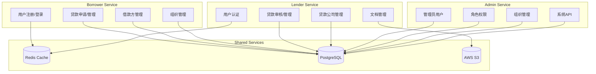

# Zeebee API 文档索引

**更新时间**: 2025-12-22
**API 版本**: v1.0
**服务数量**: 3个主要服务 (Borrower, Lender, Admin)

---

## 📋 概述

Zeebee 系统采用微服务架构，包含 50 个 API 定义文件，涵盖贷款管理的完整业务流程。本文档提供所有 API 的完整索引和导航。

## 🏗️ 服务架构

```
┌─────────────────────────────────────────────────────────┐
│                    Zeebee API Gateway                   │
├─────────────────┬─────────────────┬─────────────────────┤
│   Borrower API  │    Lender API   │     Admin API        │
│   (借款方服务)   │   (贷款方服务)   │    (管理后台)         │
│   Port: 10000   │    Port: TBD    │    Port: TBD         │
└─────────────────┴─────────────────┴─────────────────────┘
```

## 📚 服务文档索引

### 1. Borrower API (借款方服务)

**服务配置**: `app/borrower/api/etc/borrower-api.yaml`
**端口**: 10000
**Swagger**: `app/borrower/api/swagger/borrower.json`

#### 核心 API 定义

- **[borrower.api](../../app/borrower/api/borrower.api)** - 主要 HTTP 服务定义

#### 消息体定义 (desc/)

**用户管理**

- **[user.api](../../app/borrower/api/desc/user.api)** - 用户相关 API
    - 用户注册、登录、认证
    - 密码重置和邮箱验证
    - 用户信息管理

**贷款管理**

- **[loan.api](../../app/borrower/api/desc/loan.api)** - 贷款核心 API
    - 贷款创建和更新
    - 贷款状态管理
    - 贷款导入和预审批
    - 发送报价邮件

- **[loan_applicant.api](../../app/borrower/api/desc/loan_applicant.api)** - 贷款申请人 API
- **[loan_borrower.api](../../app/borrower/api/desc/loan_borrower.api)** - 贷款借款人 API
- **[loan_demographic.api](../../app/borrower/api/desc/loan_demographic.api)** - 贷款人口统计 API
- **[loan_document.api](../../app/borrower/api/desc/loan_document.api)** - 贷款文档 API
- **[loan_experience.api](../../app/borrower/api/desc/loan_experience.api)** - 贷款经验 API
- **[loan_property.api](../../app/borrower/api/desc/loan_property.api)** - 贷款房产 API
- **[loan_third_service.api](../../app/borrower/api/desc/loan_third_service.api)** - 第三方服务 API

**借款方实体管理**

- **[borrower_applicant.api](../../app/borrower/api/desc/borrower_applicant.api)** - 借款申请人 API
- **[borrower_entity.api](../../app/borrower/api/desc/borrower_entity.api)** - 借款实体 API
- **[borrower_property.api](../../app/borrower/api/desc/borrower_property.api)** - 借款房产 API

**组织管理**

- **[organization.api](../../app/borrower/api/desc/organization.api)** - 组织 API
- **[organization_user.api](../../app/borrower/api/desc/organization_user.api)** - 组织用户 API
- **[organization_email.api](../../app/borrower/api/desc/organization_email.api)** - 组织邮箱 API
- **[email_authorization.api](../../app/borrower/api/desc/email_authorization.api)** - 邮箱授权 API

**通用功能**

- **[common.api](../../app/borrower/api/desc/common.api)** - 通用消息体
- **[address.api](../../app/borrower/api/desc/address.api)** - 地址 API
- **[us_geography.api](../../app/borrower/api/desc/us_geography.api)** - 美国地理数据 API
- **[file.api](../../app/borrower/api/desc/file.api)** - 文件管理 API
- **[pdf.api](../../app/borrower/api/desc/pdf.api)** - PDF 生成 API
- **[resource.api](../../app/borrower/api/desc/resource.api)** - 资源 API
- **[role.api](../../app/borrower/api/desc/role.api)** - 角色权限 API
- **[storage.api](../../app/borrower/api/desc/storage.api)** - 存储服务 API

### 2. Lender API (贷款方服务)

**服务配置**: `app/lender/api/etc/lender-api.yaml`
**Swagger**: `app/lender/api/swagger/lender.json`

#### 核心 API 定义

- **[lender.api](../../app/lender/api/lender.api)** - 主要 HTTP 服务定义

#### 消息体定义 (desc/)

**用户管理**

- **[user.api](../../app/lender/api/desc/user.api)** - 用户相关 API
    - 用户认证和登录
    - 组织切换
    - 密码管理

**贷款管理**

- **[loan.api](../../app/lender/api/desc/loan.api)** - 贷款审核 API
    - 贷款详情查询
    - 贷款列表和分页
    - 贷款状态更新
    - 贷款阶段管理

- **[loan_applicant.api](../../app/lender/api/desc/loan_applicant.api)** - 贷款申请人 API
- **[loan_borrower.api](../../app/lender/api/desc/loan_borrower.api)** - 贷款借款人 API
- **[loan_demographic.api](../../app/lender/api/desc/loan_demographic.api)** - 贷款人口统计 API
- **[loan_document.api](../../app/lender/api/desc/loan_document.api)** - 贷款文档 API
    - 文档添加和管理
    - 文档请求发送
    - 评论和状态更新
- **[loan_experience.api](../../app/lender/api/desc/loan_experience.api)** - 贷款经验 API
- **[loan_property.api](../../app/lender/api/desc/loan_property.api)** - 贷款房产 API
- **[loan_third_service.api](../../app/lender/api/desc/loan_third_service.api)** - 第三方服务 API

**组织管理**

- **[organization.api](../../app/lender/api/desc/organization.api)** - 组织 API
- **[lender_company.api](../../app/lender/api/desc/lender_company.api)** - 贷款公司 API

**通用功能**

- **[common.api](../../app/lender/api/desc/common.api)** - 通用消息体
- **[address.api](../../app/lender/api/desc/address.api)** - 地址 API
- **[us_geography.api](../../app/lender/api/desc/us_geography.api)** - 美国地理数据 API
- **[file.api](../../app/lender/api/desc/file.api)** - 文件管理 API
- **[storage.api](../../app/lender/api/desc/storage.api)** - 存储服务 API

### 3. Admin API (管理后台)

**服务配置**: `app/admin/api/etc/admin-api.yaml`
**Swagger**: `app/admin/api/swagger/admin.json`

#### 核心 API 定义

- **[admin.api](../../app/admin/api/admin.api)** - 主要 HTTP 服务定义

#### 消息体定义 (desc/)

**用户管理**

- **[user.api](../../app/admin/api/desc/user.api)** - 管理后台用户 API
    - 用户信息查询
    - 用户资料编辑
    - 登录和认证管理

**系统管理**

- **[api.api](../../app/admin/api/desc/api.api)** - 系统 API 管理
- **[resource.api](../../app/admin/api/desc/resource.api)** - 资源管理 API
- **[role.api](../../app/admin/api/desc/role.api)** - 角色权限 API
- **[organization.api](../../app/admin/api/desc/organization.api)** - 组织管理 API
- **[organization_user.api](../../app/admin/api/desc/organization_user.api)** - 组织用户管理 API

## 🔗 API 关系图



## 📊 API 统计

### 服务分布

| 服务       | API 文件数 | 主要功能      | 状态     |
|----------|---------|-----------|--------|
| Borrower | 35+     | 借款方完整业务流程 | ✅ 开发完成 |
| Lender   | 15+     | 贷款方审核和管理  | ✅ 开发完成 |
| Admin    | 6+      | 系统管理和配置   | ✅ 开发完成 |

### 功能域分布

| 功能域   | API 数量 | 服务归属              | 复杂度   |
|-------|--------|-------------------|-------|
| 用户管理  | 6      | All Services      | 🟡 中等 |
| 贷款管理  | 20     | Borrower + Lender | 🔴 高  |
| 借款方管理 | 6      | Borrower          | 🟡 中等 |
| 组织管理  | 8      | All Services      | 🟡 中等 |
| 文档管理  | 6      | All Services      | 🟢 低  |
| 通用功能  | 4      | All Services      | 🟢 低  |

## 🔧 API 开发指南

### 1. API 开发流程

```bash
# 1. 定义消息体
vim app/borrower/api/desc/new_feature.api

# 2. 定义 HTTP 服务
vim app/borrower/api/borrower.api

# 3. 生成代码
make create-api-service borrower

# 4. 实现业务逻辑
vim app/borrower/api/internal/logic/new_feature_logic.go

# 5. 测试 API
curl -X POST http://localhost:10000/api/new-feature \
  -H "Authorization: Bearer {token}" \
  -H "Content-Type: application/json" \
  -d '{"param": "value"}'
```

### 2. API 认证

所有 API 都使用 JWT Bearer Token 认证：

```bash
# 获取 Token
curl -X POST http://localhost:10000/api/user/login \
  -H "Content-Type: application/json" \
  -d '{"email": "user@example.com", "password": "password"}'

# 使用 Token
curl -X GET http://localhost:10000/api/user/info \
  -H "Authorization: Bearer {jwt_token}"
```

### 3. 错误处理

```json
{
  "code": 400,
  "msg": "Invalid input parameters",
  "data": null
}
```

### 4. 分页响应

```json
{
  "code": 0,
  "msg": "success",
  "data": {
    "list": [...],
    "total": 100,
    "page": 1,
    "pageSize": 10
  }
}
```

## 🧪 API 测试

### Swagger 文档

- **Borrower API**: http://localhost:10000/swagger/
- **Lender API**: http://localhost:lender-port/swagger/
- **Admin API**: http://localhost:admin-port/swagger/

### 测试脚本

```bash
# 运行 API 测试
cd app/borrower
go test ./api/internal/...

# 生成测试覆盖率
go test ./... -coverprofile=coverage.out
go tool cover -html=coverage.out
```

## 📝 API 变更日志

### v1.0 (2025-12-22)

- ✅ 完成所有核心 API 定义
- ✅ 实现 50 个 API 文件规范
- ✅ 添加 Swagger 文档生成
- ✅ 统一错误处理和响应格式
- ✅ 集成 JWT 认证机制

### 计划中的更新

- 🔄 API 版本管理策略
- 🔄 接口限流和熔断机制
- 🔄 API 监控和日志增强
- 🔄 自动化 API 测试覆盖

## 🔍 故障排除

### 常见问题

**1. API 401 Unauthorized**

```bash
# 检查 Token 是否有效
curl -X GET http://localhost:10000/api/user/info \
  -H "Authorization: Bearer {token}"
```

**2. API 404 Not Found**

- 检查路由定义是否正确
- 确认 HTTP 方法匹配
- 验证消息体定义

**3. API 500 Internal Server Error**

- 检查服务日志
- 验证数据库连接
- 确认 RPC 服务状态

### 调试工具

```bash
# 查看服务日志
go run cmd/main.go -f etc/config.yaml

# 检查 API 路由
curl -X OPTIONS http://localhost:10000/api/user/info

# 测试数据库连接
go test ./... -v
```

---

**文档维护**: 此索引随 API 变更自动更新
**最后更新**: 2025-12-22
**联系方式**: 通过项目 Issue 提交 API 相关问题