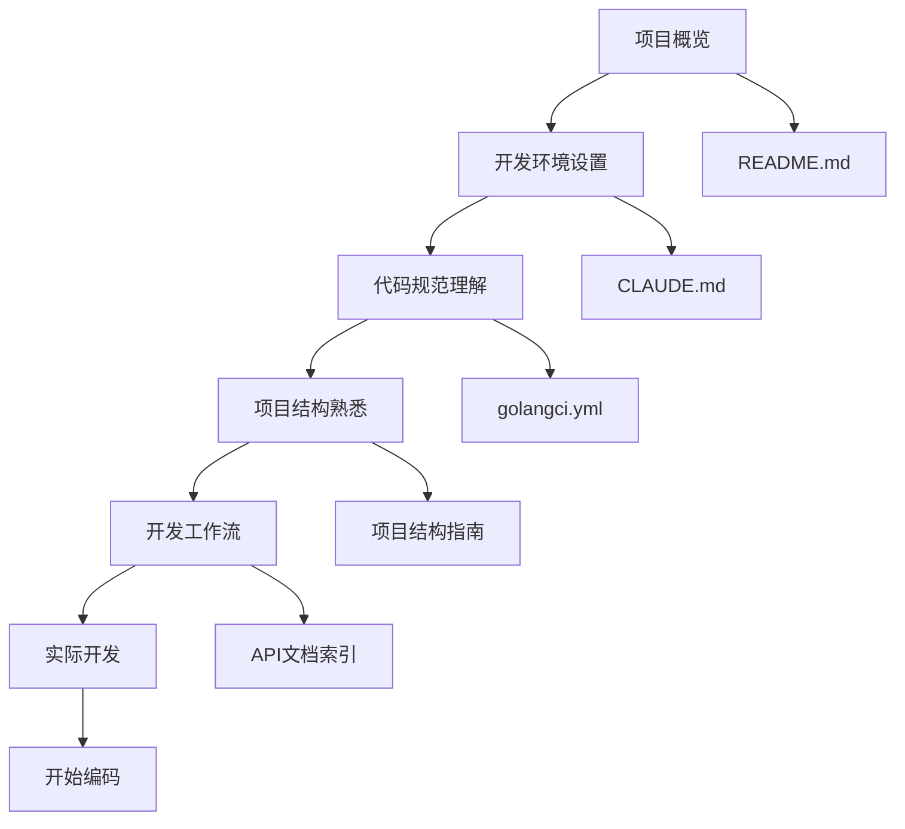
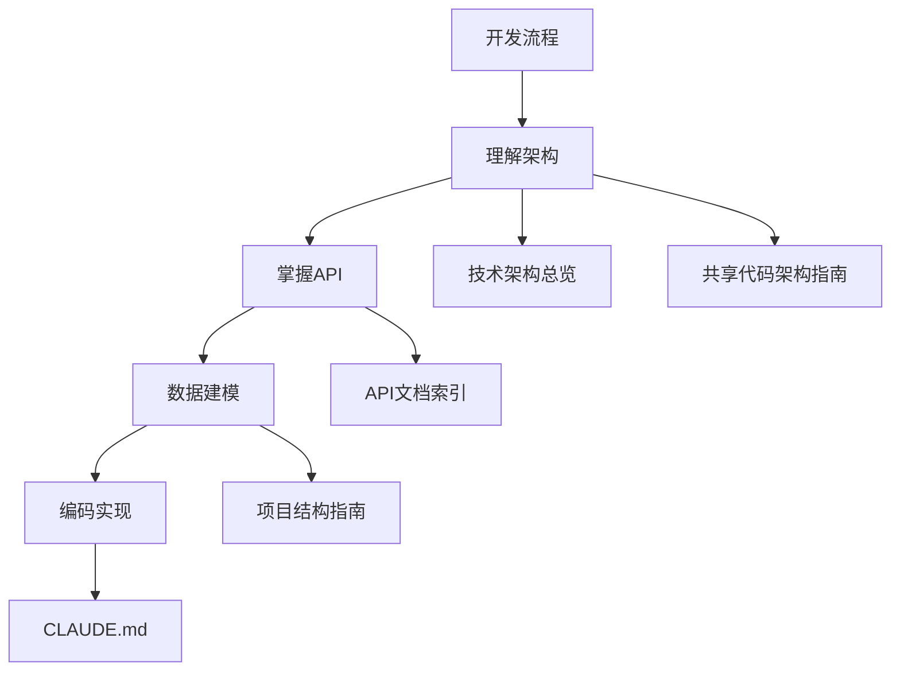
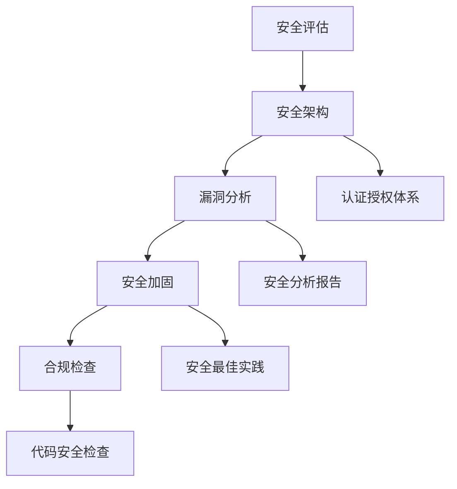
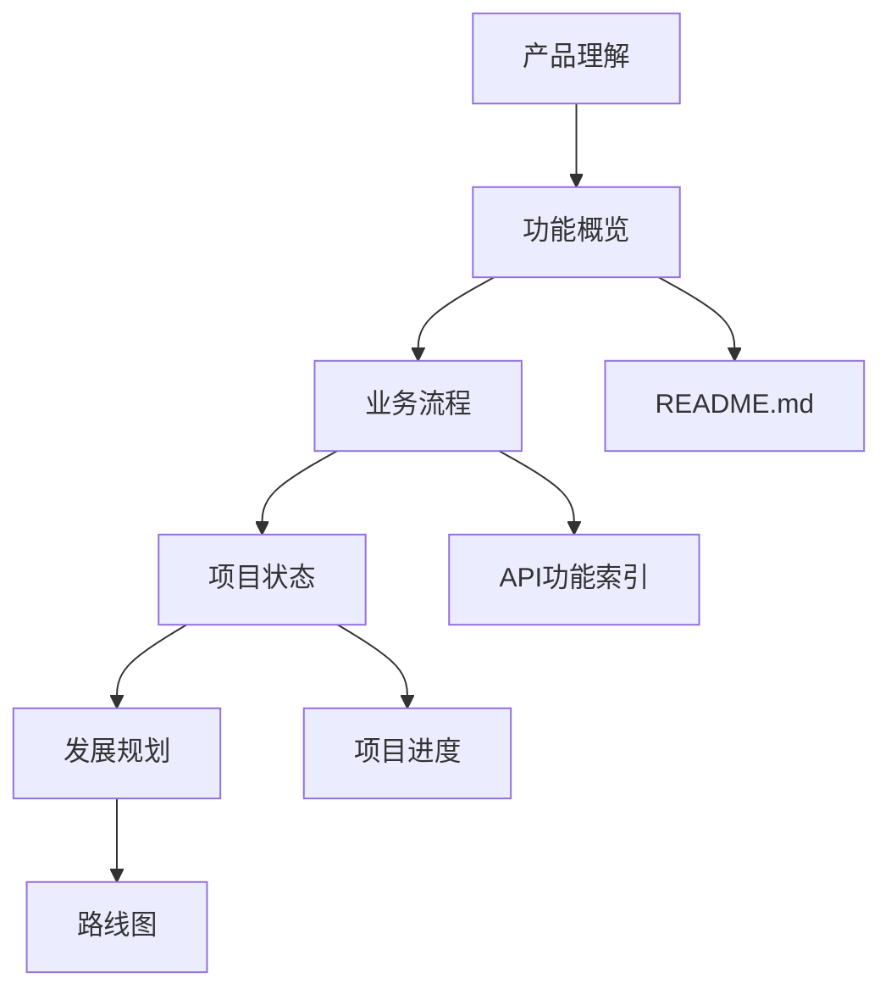
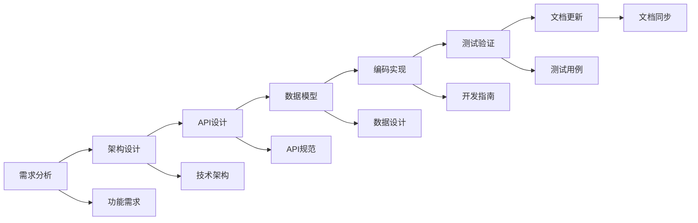
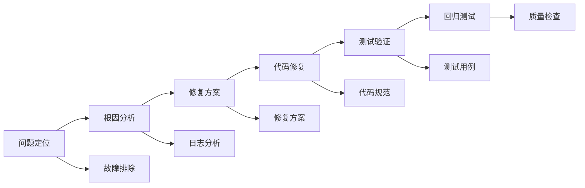
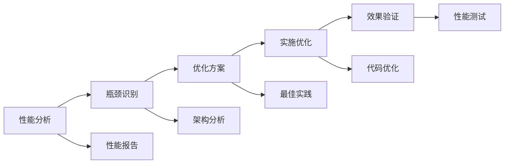
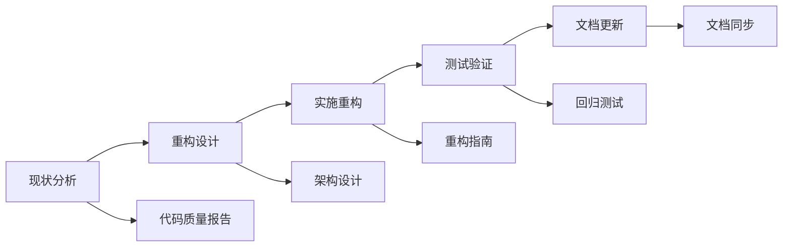
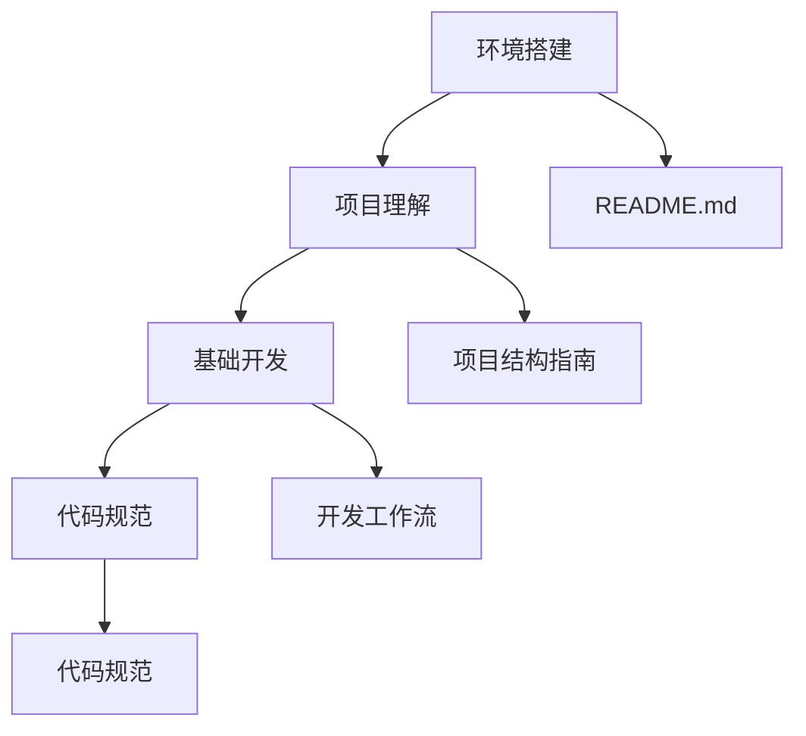
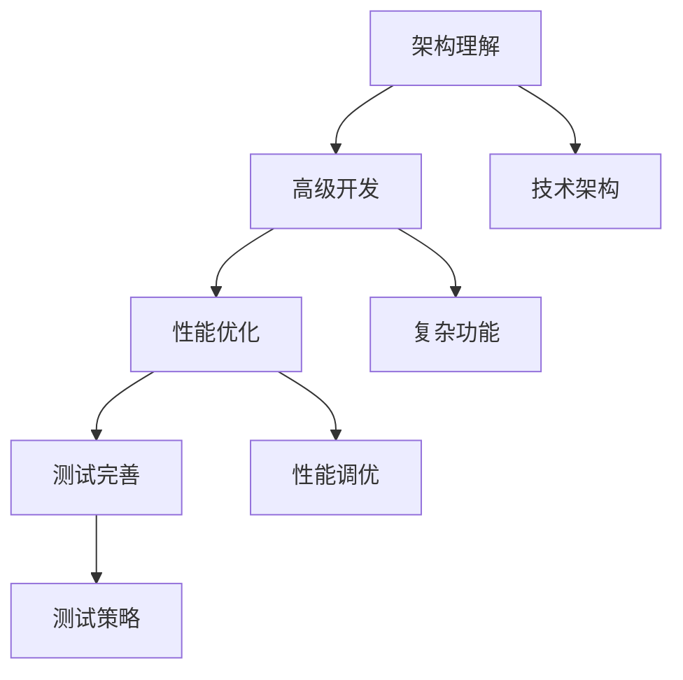

# 文档导航指南

**文档创建时间**: 2025-12-02
**文档类型**: 导航指南
**维护状态**: 活跃
**最后更新**: 2025-12-02

## 🎯 快速开始

### 新开发者入门路径

如果你是新加入项目的开发者，建议按以下顺序阅读文档：



### 推荐阅读顺序

1. **📋 项目概览** - [README.md](../../README.md)
2. **🤖 AI 开发指南** - [CLAUDE.md](../../CLAUDE.md)
3. **🏗️ 项目结构** - [项目结构指南](project_structure_guide.md)
4. **📡 API 文档** - [API文档索引](api_documentation_index.md)
5. **🏗️ 架构设计** - [共享代码架构指南](domain_architecture_guide.md)
6. **🏗️ 技术架构** - [技术架构总览](technical_architecture_overview.md)

## 🗂️ 文档结构导航

### 📚 核心文档路径

```
.claudedocs/
├── 📄 INDEX.md                    # 🗂️ 总索引 - 入口文档
│
├── 📖 guides/                     # 👥 开发指导文档
│   ├── 🗺️ navigation-guide.md     # 📍 当前文档 - 导航指南
│   ├── 🏗️ project_structure_guide.md     # 🏗️ 项目组织架构
│   ├── 📡 api_documentation_index.md    # 📡 API接口索引
│   ├── 🏗️ domain_architecture_guide.md   # 🏗️ 共享代码架构指南
│   ├── 🏗️ technical_architecture_overview.md # 🏗️ 技术架构详解
│   ├── 📋 readme_index.md         # 📖 README文档导航
│   ├── ✅ best-practices/        # ✅ 最佳实践集合
│   └── 🔧 troubleshooting/        # ❓ 问题解决指南
│
├── 📊 analysis/                   # 🔍 系统分析文档
│   ├── 📊 analysis.md              # 📊 系统架构分析
│   └── 📂 project-research/       # 🔬 项目研究分析
│
├── 📈 reports/                     # 📋 专业分析报告
│   ├── 🔍 code-quality/           # 📏 代码质量报告
│   ├── 🔒 security-analysis/      # 🔒 安全分析报告
│   └── ⚡ performance/            # ⚡ 性能分析报告
│
├── 📋 planning/                    # 📅 项目规划文档
│   ├── 📝 task-lists/             # ✅ 任务清单
│   ├── 📈 progress-tracker/       # 📊 进度跟踪
│   └── 🗺️ roadmap/                # 🗺️ 项目路线图
│
└── 🛠️ tools/                       # 🛠️ 开发工具文档
    ├── 🔄 workflows/              # 🔁 工作流程
    └── 🤖 automation/             # 🤖 自动化工具
```

## 🎯 按角色导航

### 👨‍💻 后端开发人员

**关注内容**: 架构设计、API接口、数据模型、开发规范



**必读文档**:

- [🤖 AI 开发指南](../../CLAUDE.md) - 开发规范和工作流程
- [🏗️ 技术架构总览](technical_architecture_overview.md) - 系统架构详解
- [📡 API文档索引](api_documentation_index.md) - 接口使用指南
- [🏗️ 共享代码架构指南](domain_architecture_guide.md) - 共享数据层设计
- [🏗️ 项目结构指南](project_structure_guide.md) - 代码组织规范

**推荐文档**:

- [📊 系统架构分析](../analysis/analysis.md) - 深度架构分析
- [📏 代码质量报告](../reports/code-quality/) - 代码质量评估
- [✅ 最佳实践](best-practices/) - 编码最佳实践

### 🔧 DevOps 工程师

**关注内容**: 部署配置、监控运维、性能优化


**必读文档**:

- [🐳 部署配置](../../deploy/) - Docker和环境配置
- [⚡ 性能分析报告](../reports/performance/) - 性能优化指南
- [🔧 故障排除指南](troubleshooting/) - 运维问题解决
- [🏗️ 技术架构总览](technical_architecture_overview.md) - 部署架构理解

### 🔒 安全工程师

**关注内容**: 安全架构、漏洞分析、安全最佳实践



**必读文档**:

- [🔒 安全分析报告](../reports/security-analysis/) - 安全风险评估
- [🏗️ 技术架构总览](technical_architecture_overview.md) - 安全架构设计
- [📏 代码质量报告](../reports/code-quality/) - 安全相关代码检查
- [✅ 安全最佳实践](best-practices/security.md) - 安全编码规范

### 📋 产品经理

**关注内容**: 功能概览、业务流程、项目状态



**必读文档**:

- [📋 项目README](../../README.md) - 产品功能和特性
- [📡 API功能索引](api_documentation_index.md) - 功能接口概览
- [📊 项目研究分析](../analysis/project-research/) - 业务领域分析
- [🗺️ 项目路线图](../planning/roadmap/) - 发展规划

## 🎯 按任务类型导航

### 🚀 新功能开发



**文档路径**:

1. **需求分析**: [API功能索引](api_documentation_index.md)
2. **架构设计**: [技术架构总览](technical_architecture_overview.md)
3. **API设计**: [API文档索引](api_documentation_index.md)
4. **数据模型**: [共享代码架构指南](domain_architecture_guide.md)
5. **编码实现**: [AI开发指南](../../CLAUDE.md)
6. **测试验证**: [最佳实践](best-practices/testing.md)
7. **文档更新**: [导航指南](navigation-guide.md)

### 🐛 问题修复



**文档路径**:

1. **问题定位**: [故障排除指南](troubleshooting/)
2. **根因分析**: [系统分析](../analysis/)
3. **修复方案**: [最佳实践](best-practices/)
4. **代码修复**: [代码质量报告](../reports/code-quality/)
5. **测试验证**: [测试最佳实践](best-practices/testing.md)

### ⚡ 性能优化



**文档路径**:

1. **性能分析**: [性能分析报告](../reports/performance/)
2. **瓶颈识别**: [技术架构总览](technical_architecture_overview.md)
3. **优化方案**: [性能最佳实践](best-practices/performance.md)
4. **实施优化**: [代码质量指南](../reports/code-quality/)

### 📊 代码重构



**文档路径**:

1. **现状分析**: [代码质量分析](../reports/code-quality/)
2. **重构设计**: [技术架构总览](technical_architecture_overview.md)
3. **实施重构**: [重构最佳实践](best-practices/refactoring.md)
4. **测试验证**: [测试策略](best-practices/testing.md)

## 🎯 按学习深度导航

### 🌱 初级开发者

**学习目标**: 理解项目结构，掌握基础开发流程

**推荐学习路径**:



**必读文档** (预计2-3小时):

- [📋 项目README](../../README.md) - 项目概览和环境设置
- [🤖 AI开发指南](../../CLAUDE.md) - 开发规范和流程
- [🏗️ 项目结构指南](project_structure_guide.md) - 代码组织理解
- [📡 API文档索引](api_documentation_index.md) - 基础API使用

**实践任务**:

- 搭建开发环境
- 创建简单的API接口
- 理解数据模型关系
- 遵循代码规范

### 🌿 中级开发者

**学习目标**: 掌握架构设计，能够独立完成功能开发

**推荐学习路径**:



**必读文档** (预计4-6小时):

- [🏗️ 技术架构总览](technical_architecture_overview.md) - 系统架构深入理解
- [🏗️ 共享代码架构指南](domain_architecture_guide.md) - 共享数据层设计
- [📊 系统架构分析](../analysis/analysis.md) - 架构评估和改进
- [⚡ 性能分析报告](../reports/performance/) - 性能优化策略
- [✅ 最佳实践合集](best-practices/) - 各类开发最佳实践

**实践任务**:

- 设计复杂业务功能
- 性能优化实践
- 完善测试覆盖率
- 参与代码审查

### 🌳 高级开发者/架构师

**学习目标**: 架构设计决策，技术选型，团队技术指导

**推荐学习路径**:


**必读文档** (预计6-8小时):

- [📊 综合系统分析](../reports/comprehensive-system-analysis/) - 全面系统评估
- [🏗️ 技术架构总览](technical_architecture_overview.md) - 架构决策和演进
- [📊 项目研究分析](../analysis/project-research/) - 技术选型依据
- [✅ 企业级最佳实践](best-practices/enterprise/) - 架构级实践指导
- [🔄 工作流程](../tools/workflows/) - 团队协作流程

**实践任务**:

- 架构设计和决策
- 技术方案评估
- 团队技术培训
- 代码质量把控

## 🔍 快速查找指南

### 按技术栈查找

#### Go语言相关

- **Go基础**: [CLAUDE.md - Go语言规范](../../CLAUDE.md#go-语言规范)
- **Go-zero框架**: [技术架构总览 - go-zero](technical_architecture_overview.md#后端技术栈)
- **数据库操作**: [项目结构指南 - GORM](project_structure_guide.md#数据库操作规范)
- **测试框架**: [项目结构指南 - 测试结构](project_structure_guide.md#测试结构)
- **依赖管理**: [go.mod](../../go.mod) - 项目依赖

#### 数据库相关

- **PostgreSQL**: [技术架构总览 - 数据库层](technical_architecture_overview.md#数据库技术)
- **数据模型**: [共享代码架构指南 - 数据模型设计](domain_architecture_guide.md#数据模型设计)
- **数据库迁移**: [数据库脚本](../../app/borrower/docs/sql/) - SQL迁移文件
- **查询优化**: [性能分析报告 - 数据库性能](../reports/performance/)

#### 微服务相关

- **gRPC**: [API文档索引 - gRPC服务](api_documentation_index.md#grpc-服务接口)
- **服务发现**: [技术架构总览 - 服务治理](technical_architecture_overview.md#服务治理)
- **负载均衡**: [部署架构 - 负载均衡](technical_architecture_overview.md#部署架构)
- **熔断降级**: [最佳实践 - 微服务治理](best-practices/microservices.md)

#### DevOps相关

- **Docker**: [部署配置](../../deploy/) - 容器化配置
- **CI/CD**: [工作流程](../tools/workflows/) - 自动化流程
- **监控告警**: [技术架构总览 - 监控架构](technical_architecture_overview.md#监控架构)
- **配置管理**: [项目结构指南 - 配置管理](project_structure_guide.md#配置管理)

### 按问题类型查找

#### 开发环境问题

1. **环境搭建失败**:
    - 查看: [README.md - 开发环境设置](../../README.md#开发环境设置)
    - 检查: [CLAUDE.md - 常见问题解决](../../CLAUDE.md#常见问题解决)

2. **依赖安装问题**:
    - 查看: [go.mod](../../go.mod) - 依赖版本
    - 参考: [Go模块管理](project_structure_guide.md#依赖管理)

3. **编译错误**:
    - 查看: [golangci.yml](../../.golangci.yml) - 代码检查规则
    - 参考: [代码质量报告](../reports/code-quality/) - 常见代码问题

#### 功能开发问题

1. **API设计疑问**:
    - 参考: [API文档索引](api_documentation_index.md) - 现有API设计模式
    - 查看: [API定义文件](../../app/borrower/api/desc/) - 消息体定义

2. **数据模型设计**:
    - 参考: [共享代码架构指南](domain_architecture_guide.md) - 数据模型设计原则
    - 查看: [数据模型定义](../../domains/zeebee/model/) - 现有模型结构

3. **业务逻辑实现**:
    - 参考: [CLAUDE.md - 开发工作流程](../../CLAUDE.md#开发工作流程)
    - 查看: [API层实现示例](../../app/borrower/api/internal/logic/) - 具体实现

#### 性能问题

1. **API响应慢**:
    - 查看: [性能分析报告](../reports/performance/) - 性能优化建议
    - 参考: [技术架构总览 - 缓存策略](technical_architecture_overview.md#缓存架构设计)

2. **数据库查询慢**:
    - 查看: [性能分析报告 - 数据库性能](../reports/performance/)
    - 参考: [项目结构指南 - 数据库操作规范](project_structure_guide.md#数据库操作规范)

3. **内存使用过高**:
    - 查看: [代码质量报告 - 内存分析](../reports/code-quality/)
    - 参考: [性能最佳实践](best-practices/performance.md)

#### 部署运维问题

1. **部署失败**:
    - 查看: [部署配置](../../deploy/) - Docker和环境配置
    - 参考: [技术架构总览 - 部署架构](technical_architecture_overview.md#部署架构)

2. **服务启动失败**:
    - 查看: [常见问题解决](../../CLAUDE.md#常见问题解决)
    - 检查: [服务配置](../../app/borrower/etc/) - 配置文件

3. **监控告警**:
    - 查看: [技术架构总览 - 监控架构](technical_architecture_overview.md#监控架构)
    - 参考: [故障排除指南](troubleshooting/monitoring.md)

## 🎯 文档使用技巧

### 📖 阅读技巧

#### 1. 🎯 明确目标导向

- **问题导向**: 先明确要解决的问题，再查找相关文档
- **任务导向**: 根据当前任务类型选择相应文档
- **学习导向**: 按角色和学习深度选择合适的文档路径

#### 2. 🔗 善用交叉引用

- **文档间链接**: 充分利用文档间的交叉引用链接
- **代码关联**: 将文档内容与实际代码实现关联理解
- **问题追溯**: 通过文档引用链深入理解设计决策

#### 3. 📝 做好阅读笔记

- **关键决策记录**: 记录重要的架构决策和设计理由
- **实践总结**: 记录实际开发中的经验和教训
- **问题收集**: 记录遇到的待解决问题和建议

### 🔍 搜索技巧

#### 1. 🏷️ 标签化搜索

```yaml
开发相关: [开发, 编码, API, 数据模型, 业务逻辑]
架构相关: [架构, 设计, 模式, 原则, 决策]
性能相关: [性能, 优化, 缓存, 数据库, 内存]
运维相关: [部署, 监控, 日志, 故障, 配置]
```

#### 2. 🔑 关键词搜索

- **技术关键词**: go-zero, gRPC, PostgreSQL, Redis, JWT
- **业务关键词**: 贷款, 借款方, 贷款方, 房产, 申请人
- **架构关键词**: 微服务, 共享数据层, 认证授权, 缓存策略

#### 3. 📂 目录结构搜索

- **按功能域**: 查找特定业务域的相关文档
- **按技术层**: 查找特定技术层的设计和实现
- **按文档类型**: 查找分析报告、指南或规范

### 🔄 文档更新技巧

#### 1. 📅 定期检查更新

- **技术变更**: 架构或技术栈变更时及时更新文档
- **功能迭代**: 新功能开发完成后同步更新相关文档
- **问题修复**: 重大问题修复后更新故障排除指南

#### 2. 🤝 协作维护

- **反馈收集**: 收集团队成员的文档使用反馈
- **责任分工**: 明确不同文档的维护责任人
- **定期评审**: 定期评审文档的准确性和完整性

#### 3. 📊 质量把控

- **准确性检查**: 确保文档内容与实际实现一致
- **完整性验证**: 确保文档覆盖所有重要方面
- **易用性优化**: 改进文档的导航和可读性

## 🆘 获取帮助

### 📞 联系方式

- **技术问题**: 通过项目Issue提交技术问题
- **文档反馈**: 通过项目Issue提交文档改进建议
- **紧急支持**: 联系项目维护人员或技术负责人

### 📚 学习资源

- **go-zero官方文档**: [https://go-zero.dev/](https://go-zero.dev/)
- **GORM文档**: [https://gorm.io/docs/](https://gorm.io/docs/)
- **PostgreSQL文档**: [https://www.postgresql.org/docs/](https://www.postgresql.org/docs/)
- **Redis文档**: [https://redis.io/documentation](https://redis.io/documentation)

### 🛠️ 工具推荐

- **API测试**: Postman, Insomnia, curl
- **数据库管理**: pgAdmin, DBeaver, TablePlus
- **代码编辑**: VS Code, GoLand, Vim
- **容器工具**: Docker, Docker Compose, Kubernetes

---

## 📋 文档维护说明

### 📅 更新频率

- **核心文档**: 项目重大变更时更新
- **分析报告**: 每月或重大版本发布时更新
- **导航指南**: 文档结构变更时更新
- **API文档**: API变更时及时更新

### 👥 维护责任

- **技术文档**: 技术负责人和架构师
- **API文档**: 后端开发团队
- **导航文档**: 技术写作负责人
- **质量把控**: 全体开发团队

### 📝 贡献指南

- **文档改进**: 欢迎提交文档改进建议和PR
- **错误修正**: 发现文档错误请及时反馈
- **内容补充**: 欢迎补充缺失的文档内容
- **格式统一**: 遵循既定的文档格式和风格

---

*本文档最后更新时间: 2025-12-02*
*下次更新时间: 2026-01-02 或文档结构变更时*
*维护责任人: 技术团队*