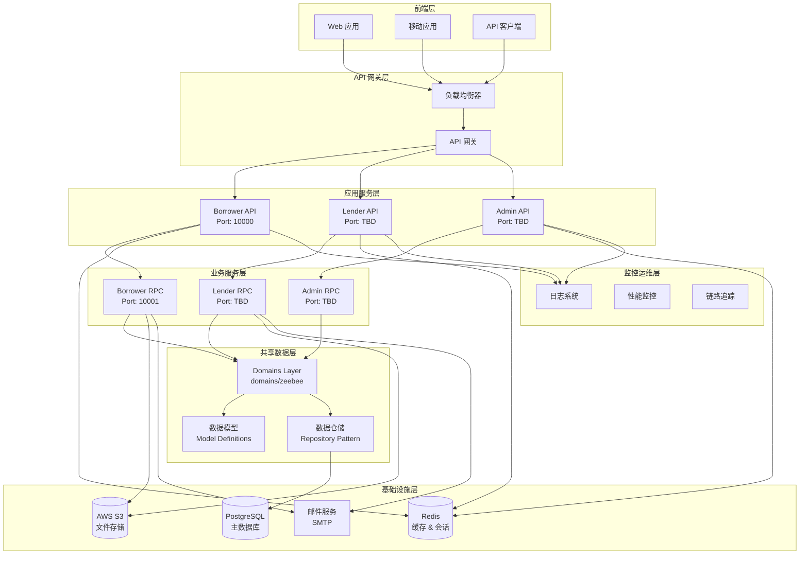
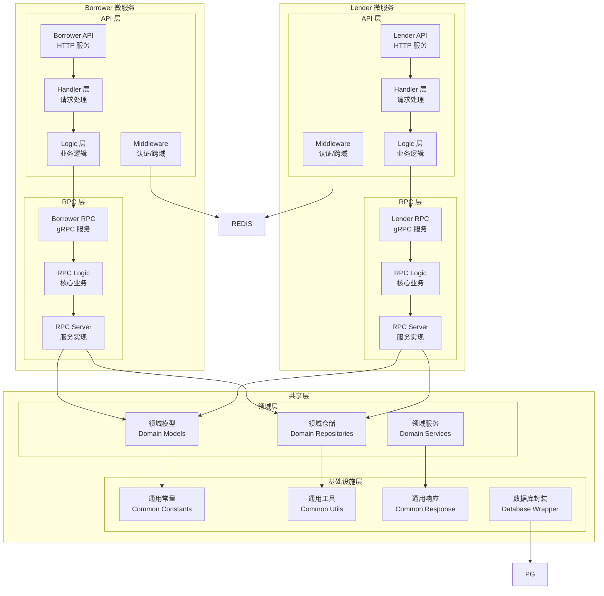
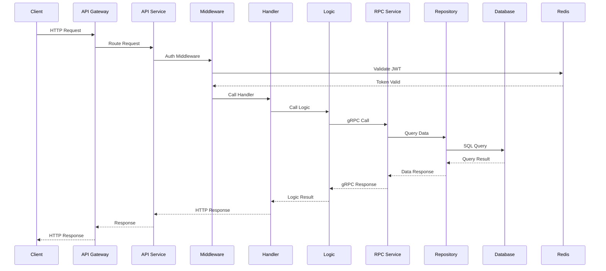
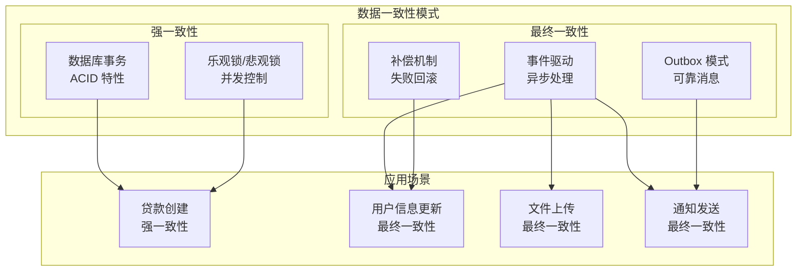
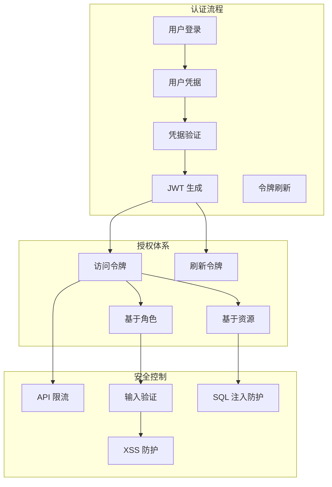
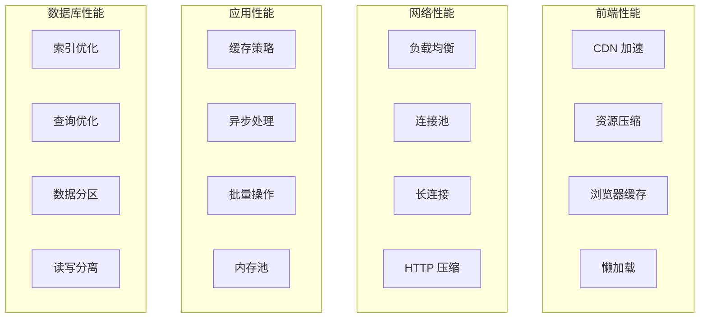
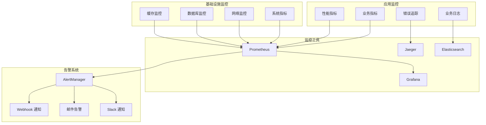

# 技术架构总览

**文档创建时间**: 2025-12-02
**文档类型**: 技术架构文档
**维护状态**: 活跃
**更新频率**: 每月或架构变更时

## 📋 概述

Zeebee 贷款管理系统采用现代化的微服务架构，基于 go-zero
框架构建，具有高可扩展性、可维护性和可靠性。系统采用共享代码层模式，实现了清晰的分层架构和模块化设计，确保borrower和lender服务间的代码复用和数据一致性。

### 核心架构特性

- **微服务架构**: 借款方 (Borrower) 和贷款方 (Lender) 独立服务
- **共享数据层**: 统一的领域模型和数据访问层，实现代码复用
- **RESTful API**: 标准化的 HTTP 接口设计
- **gRPC 通信**: 高性能的服务间通信
- **数据库抽象**: 基于 GORM 的统一数据访问层
- **云原生**: 支持 Docker 容器化部署
- **安全认证**: JWT 令牌认证和权限控制

## 🏗️ 系统架构图

### 整体架构视图



### 微服务详细架构



## 🔄 数据流架构

### 请求处理流程



### 数据一致性策略



## 🏛️ 分层架构设计

### 1. 表现层 (Presentation Layer)

#### API 服务层

```yaml
功能: HTTP 接口暴露
职责:
  - 请求参数验证
  - 数据格式转换
  - 认证和授权
  - 响应格式标准化
技术栈: go-zero + JWT + CORS

组件结构:
  - Handler: HTTP 请求处理器
  - Logic: API 层业务逻辑
  - Middleware: 认证、跨域、日志中间件
  - Routes: 路由注册和管理
```

#### 网关层 (规划中)

```yaml
功能: 统一入口和路由
职责:
  - 请求路由分发
  - 负载均衡
  - 限流和熔断
  - API 版本管理
技术栈: Nginx/Kong + 服务发现

实施优先级: 低优先级 (业务稳定后)
```

### 2. 应用层 (Application Layer)

#### RPC 服务层

```yaml
功能: 核心业务逻辑处理
职责:
  - 业务规则实现
  - 数据操作协调
  - 事务管理
  - 业务流程编排
技术栈: gRPC + Protocol Buffers

设计模式:
  - 服务接口模式
  - 事务脚本模式
  - 领域服务模式
```

#### 应用服务层

```yaml
功能: 用例协调和流程控制
职责:
  - 用例实现
  - 服务编排
  - 数据转换
  - 异常处理
技术栈: Go + gRPC Client

核心服务:
  - 贷款申请服务
  - 用户认证服务
  - 文件管理服务
  - 预审批服务
```

### 3. 领域层 (Domain Layer)

#### 领域模型

```yaml
功能: 业务概念和规则建模
职责:
  - 实体和值对象定义
  - 业务规则封装
  - 领域事件定义
  - 聚合根设计

核心聚合:
  - Loan (贷款聚合根)
  - Borrower (借款方聚合根)
  - Property (房产聚合根)
  - User (用户聚合根)
```

#### 领域仓储

```yaml
功能: 数据访问抽象
职责:
  - 聚合持久化
  - 查询接口定义
  - 数据映射
  - 事务边界管理
技术栈: GORM + Repository Pattern

实现特点:
  - 泛型基础仓储
  - 统一 CRUD 操作
  - 复杂查询支持
  - 软删除支持
```

### 4. 基础设施层 (Infrastructure Layer)

#### 数据访问层

```yaml
功能: 数据存储和检索
职责:
  - 数据库连接管理
  - SQL 查询执行
  - 连接池管理
  - 事务支持
技术栈: PostgreSQL + GORM

特性:
  - 多数据库支持 (PostgreSQL/MySQL)
  - 数据库迁移
  - 查询优化
  - 连接池配置
```

#### 缓存层

```yaml
功能: 高性能数据缓存
职责:
  - 会话存储
  - 热点数据缓存
  - 分布式锁
  - 限流计数
技术栈: Redis

应用场景:
  - JWT 会话管理
  - 用户信息缓存
  - 预审批结果缓存
  - API 限流控制
```

#### 文件存储层

```yaml
功能: 云端文件存储
职责:
  - 文件上传下载
  - 预签名 URL 生成
  - 文件权限控制
  - 存储空间管理
技术栈: AWS S3

存储类型:
  - 用户文档
  - 贷款资料
  - 系统文件
  - 临时文件
```

## 🔧 技术栈详解

### 后端技术栈

#### 核心框架

```yaml
框架: go-zero
特点:
  - 微服务架构支持
  - 自动代码生成
  - 内置中间件系统
  - 高性能 gRPC 支持
版本: 1.8.4

优势:
  - 开发效率高
  - 性能优秀
  - 文档完善
  - 社区活跃
```

#### 数据库技术

```yaml
主数据库: PostgreSQL
版本: 13+
特性:
  - ACID 事务支持
  - 丰富的数据类型
  - JSON 字段支持
  - 全文搜索
连接池: 内置连接池管理

ORM 框架: GORM v2
特性:
  - 自动迁移
  - 关联查询
  - 事务支持
  - 软删除
```

#### 缓存技术

```yaml
缓存方案: Redis
版本: 6+
数据结构:
  - String: 基础数据缓存
  - Hash: 对象缓存
  - Set: 集合操作
  - ZSet: 排序和限流

应用模式:
  - Cache-Aside Pattern
  - Write-Through Pattern
  - Write-Behind Pattern
```

#### 通信协议

```yaml
外部通信: HTTP/HTTPS
  - RESTful API 设计
  - JSON 数据格式
  - JWT 认证
  - CORS 跨域支持

内部通信: gRPC
  - Protocol Buffers 序列化
  - 高性能二进制协议
  - 流式传输支持
  - 负载均衡友好
```

### 开发工具栈

#### 代码生成

```yaml
工具: goctl
功能:
  - API 服务代码生成
  - RPC 服务代码生成
  - 模型代码生成
  - Dockerfile 生成

模板系统:
  - 自定义代码模板
  - 项目级模板配置
  - 第三方模板集成
```

#### 代码质量

```yaml
检查工具: golangci-lint
配置文件: .golangci.yml
检查项目:
  - 代码风格 (gofmt, golint)
  - 错误检查 (errcheck, gosec)
  - 性能检查 (ineffassign, prealloc)
  - 复杂度检查 (cyclop)
```

#### 测试框架

```yaml
测试框架: Go Testing
覆盖率: go test -cover
基准测试: Go Benchmarking
集成测试: Testify

当前状态: 10个测试文件
目标覆盖率: 80%+
```

## 🔐 安全架构

### 认证授权体系



### 数据安全策略

#### 敏感数据保护

```yaml
密码安全:
  - 哈希算法: bcrypt
  - 盐值加密: 自动盐值生成
  - 密码强度: 最小8位，包含大小写和数字

传输安全:
  - HTTPS 强制: TLS 1.2+
  - 证书管理: Let's Encrypt
  - HSTS 策略: 启用

存储安全:
  - 数据库加密: 透明数据加密 (TDE)
  - 备份加密: AES-256 加密
  - 访问控制: 最小权限原则
```

#### API 安全控制

```yaml
认证机制:
  - JWT 令牌认证
  - 令牌过期: 24小时
  - 刷新机制: 7天有效期
  - 黑名单机制: 支持令牌撤销

授权控制:
  - 基于角色的访问控制 (RBAC)
  - 资源级权限控制
  - 数据隔离: 用户数据隔离
  - 操作审计: 关键操作日志记录
```

## 📊 性能架构

### 性能优化策略



### 缓存架构设计

#### 多级缓存策略

```yaml
L1 缓存 (应用内):
  - 类型: 内存缓存
  - 容量: 100MB
  - 过期时间: 5分钟
  - 用途: 热点数据缓存

L2 缓存 (Redis):
  - 类型: 分布式缓存
  - 容量: 2GB
  - 过期时间: 30分钟
  - 用途: 会话存储、查询结果缓存

L3 缓存 (数据库):
  - 类型: 查询缓存
  - 容量: 自动管理
  - 过期时间: 自动失效
  - 用途: 查询结果缓存
```

#### 缓存模式应用

```yaml
Cache-Aside 模式:
  - 应用场景: 用户信息、配置数据
  - 实现方式: 应用代码控制缓存逻辑
  - 优势: 灵活性高，适合复杂场景

Write-Through 模式:
  - 应用场景: 计数器、统计数据
  - 实现方式: 写入时同步更新缓存
  - 优势: 数据一致性好

Write-Behind 模式:
  - 应用场景: 日志记录、非关键数据
  - 实现方式: 异步写入数据库
  - 优势: 写入性能高
```

### 数据库性能优化

#### 索引策略

```sql
-- 核心业务索引
CREATE INDEX idx_loans_borrower_id ON loans(borrower_id);
CREATE INDEX idx_loans_status_stage ON loans(status, stage);
CREATE INDEX idx_loans_created_at ON loans(created_at DESC);

-- 复合索引
CREATE INDEX idx_loan_applicants_loan_applicant
ON loan_applicants(loan_id, applicant_id);

-- 唯一索引
CREATE UNIQUE INDEX idx_users_email ON users(email);
CREATE UNIQUE INDEX idx_loans_code ON loans(code);
```

#### 查询优化

```yaml
分页优化:
  - 游标分页: 替代 OFFSET
  - 覆盖索引: 减少回表查询
  - 预加载: 减少 N+1 查询问题

关联查询优化:
  - 预加载策略: GORM Preload
  - 批量查询: 减少 SQL 调用次数
  - 延迟加载: 按需加载数据
```

## 🚀 部署架构

### 容器化部署

```yaml
服务容器化:
  Borrower API:
    镜像: zeebee/borrower-api:latest
    端口: 10000
    资源限制: 512MB CPU, 1GB RAM

  Borrower RPC:
    镜像: zeebee/borrower-rpc:latest
    端口: 10001
    资源限制: 1GB CPU, 2GB RAM

  Lender API:
    镜像: zeebee/lender-api:latest
    端口: 10002
    资源限制: 512MB CPU, 1GB RAM

基础设施容器:
  PostgreSQL:
    镜像: postgres:13
    端口: 5432
    数据卷: /var/lib/postgresql/data

  Redis:
    镜像: redis:6-alpine
    端口: 6379
    数据卷: /data

  Nginx:
    镜像: nginx:alpine
    端口: 80, 443
    配置卷: /etc/nginx/conf.d
```

### 环境架构

#### 开发环境

```yaml
配置管理:
  - 配置文件: config-dev.yaml
  - 环境变量: .env.dev
  - 热重载: 支持
  - 调试模式: 启用

数据管理:
  - 数据库: 本地 PostgreSQL
  - 缓存: 本地 Redis
  - 文件存储: 本地目录
  - 日志级别: DEBUG
```

#### 生产环境

```yaml
配置管理:
  - 配置文件: config-production.yaml
  - 环境变量: 生产环境变量
  - 配置中心: 环境变量/ConfigMap
  - 调试模式: 禁用

高可用设计:
  - 负载均衡: Nginx + 多实例
  - 数据库: 主从复制
  - 缓存: Redis Cluster
  - 文件存储: AWS S3 多区域

监控运维:
  - 日志收集: ELK Stack (规划)
  - 性能监控: Prometheus + Grafana (规划)
  - 链路追踪: Jaeger (规划)
  - 告警系统: AlertManager (规划)
```

## 🔍 监控架构

### 可观测性设计



### 关键性能指标 (KPI)

#### 业务指标

```yaml
贷款业务:
  - 贷款申请数量: 每日/每周/每月
  - 贷款审批通过率: 审批数/申请数
  - 平均审批时间: 从申请到审批的时长
  - 贷款发放成功率: 发放数/审批数

用户活跃度:
  - 日活跃用户数 (DAU)
  - 周活跃用户数 (WAU)
  - 月活跃用户数 (MAU)
  - 用户留存率: 次日留存/周留存/月留存
```

#### 技术指标

```yaml
API 性能:
  - 请求响应时间: P50/P95/P99
  - API 成功率: 2xx 响应比例
  - 错误率: 4xx/5xx 响应比例
  - 吞吐量: 每秒请求数 (RPS)

系统资源:
  - CPU 使用率: 平均/峰值
  - 内存使用率: 平均/峰值
  - 磁盘使用率: 存储空间占用
  - 网络带宽: 入站/出站流量

数据库性能:
  - 查询响应时间: 平均/慢查询
  - 数据库连接数: 活跃/最大连接数
  - 慢查询数量: 执行时间超过阈值
  - 数据库锁等待: 锁竞争频率
```

## 🔮 架构演进规划

### 短期优化 (1-3个月)

```yaml
代码质量提升:
  - 测试覆盖率: 提升至 80%+
  - 代码审查流程: 标准化
  - 错误处理: 统一化
  - 日志规范: 结构化

性能优化:
  - 数据库索引优化: 核心查询优化
  - 缓存策略完善: 热点数据缓存
  - API 响应时间: 优化至 200ms 内
  - 内存使用优化: 减少 GC 压力

安全加固:
  - 输入验证: 全面化
  - SQL 注入防护: 增强
  - XSS 防护: 完善
  - 权限控制: 细粒度化
```

### 中期规划 (3-6个月)

```yaml
服务治理:
  - API 网关: Kong/Nginx
  - 服务发现: Consul/Etcd
  - 配置中心: 统一配置管理
  - 熔断降级: Hystrix 模式

监控体系:
  - 指标监控: Prometheus + Grafana
  - 日志系统: ELK Stack
  - 链路追踪: Jaeger
  - 告警系统: AlertManager

CI/CD 完善:
  - 自动化测试: 单元/集成/E2E
  - 代码质量检查: SonarQube
  - 自动化部署: Docker + Kubernetes
  - 蓝绿部署: 零停机发布
```

### 长期规划 (6-12个月)

```yaml
云原生架构:
  - 容器编排: Kubernetes
  - 服务网格: Istio
  - 无服务器: Serverless 架构探索
  - 多云部署: AWS + 阿里云

数据架构升级:
  - 读写分离: 主从数据库架构
  - 数据分片: 按业务维度分片
  - 数据湖: 大数据分析平台
  - 实时计算: Stream Processing

智能化运维:
  - AIOps: 智能运维平台
  - 自动扩缩容: HPA/VPA
  - 故障自愈: 自动恢复机制
  - 容量规划: 预测性扩容
```

## 📚 架构决策记录 (ADR)

### 关键架构决策

#### ADR-001: 选择 go-zero 框架

```yaml
决策时间: 2025-01-24
状态: 已采用
背景: 需要选择适合的 Go 微服务框架
选项:
  - go-zero (已选择)
  - Gin + 手工实现
  - gRPC-Gateway
  - Kratos
决策理由:
  - 内置微服务支持
  - 自动代码生成
  - 高性能 gRPC 集成
  - 丰富的中间件生态
后果:
  - 正: 开发效率高，性能优秀
  - 负: 框架绑定，学习成本
```

#### ADR-002: 共享数据层设计

```yaml
决策时间: 2025-01-24
状态: 已采用
背景: Borrower 和 Lender 服务需要数据共享
选项:
  - 共享数据层 (已选择)
  - 每服务独立数据库
  - 数据同步机制
  - CQRS 模式
决策理由:
  - 数据一致性保证
  - 代码复用最大化
  - 开发复杂度适中
  - 维护成本较低
后果:
  - 正: 数据一致，代码复用
  - 负: 服务耦合，扩展受限
```

#### ADR-003: 使用 JWT 认证

```yaml
决策时间: 2025-01-24
状态: 已采用
背景: API 认证授权机制选择
选项:
  - JWT (已选择)
  - Session + Cookie
  - OAuth 2.0
  - API Key
决策理由:
  - 无状态认证
  - 微服务友好
  - 跨域支持
  - 实现简单
后果:
  - 正: 扩展性好，无状态
  - 负: 令牌管理复杂
```

## 📖 相关文档

### 架构文档

- **[系统架构分析](analysis/architecture_analysis_20250124.md)** - 详细架构评估
- **[域架构设计指南](guides/domain_architecture_guide.md)** - 共享数据层设计
- **[API 文档索引](guides/api_documentation_index.md)** - 完整 API 接口文档

### 开发指南

- **[项目结构指南](guides/project_structure_guide.md)** - 代码组织和架构说明
- **[开发最佳实践](guides/best-practices/)** - 编码规范和最佳实践
- **[故障排除指南](guides/troubleshooting/)** - 常见问题和解决方案

### 技术报告

- **[代码质量分析](reports/code-quality/code_quality_analysis_20251107.md)** - 代码质量评估
- **[性能分析报告](reports/performance/performance_analysis_report_20251107.md)** - 性能优化建议
- **[安全分析报告](reports/security-analysis/)** - 安全风险评估

---

*本文档最后更新时间: 2025-12-02*
*下次更新时间: 2026-01-02 或架构重大变更时*