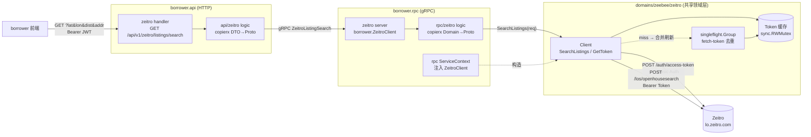
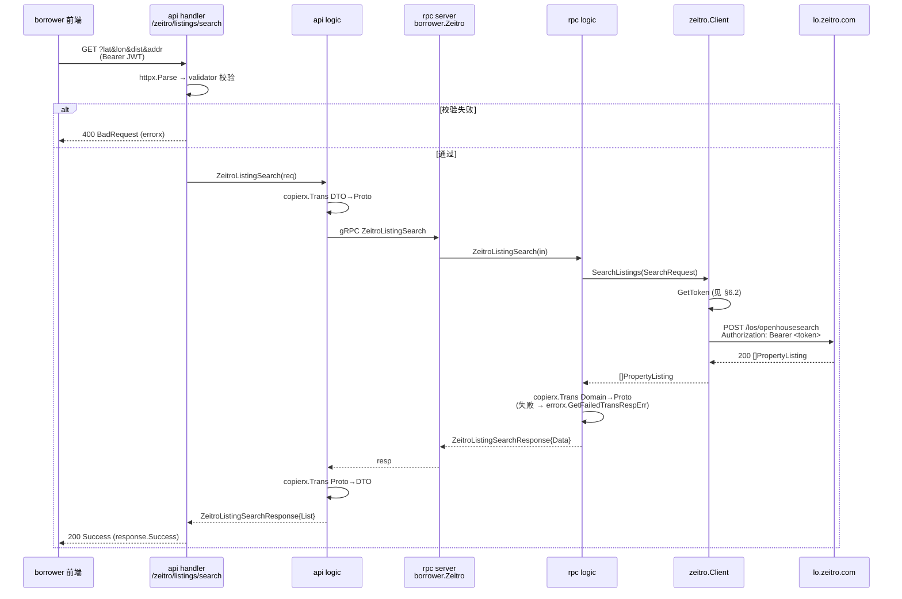
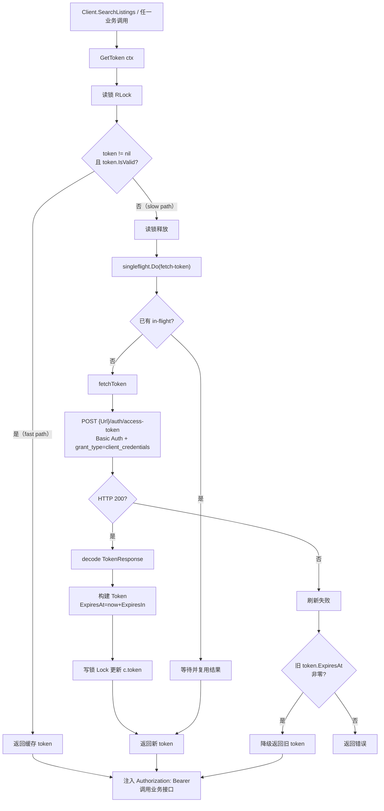
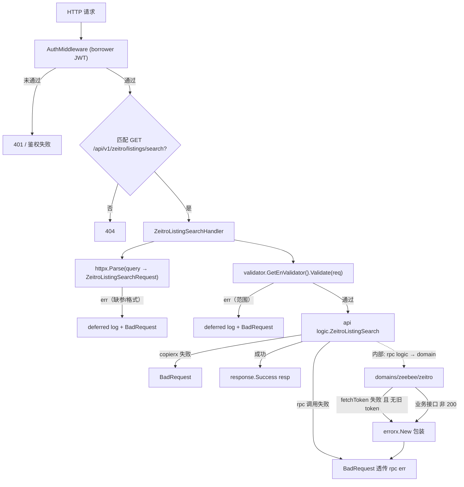

# Zeitro Listing 接口转发 — 技术方案设计

> **来源**：`tasks/20260109_borrower_zertrio_api_proxy.md`（重组为规范设计）｜ **版本**：1.0 ｜ **日期**：2026-01-09
>
> 本文以**已落地代码**为准。源设计草稿中的偏差（如 YAML 配置键名、对外暴露端点）在文中相应位置标注。

---

## 1. 背景

Borrower 前端需要展示 Zeitro 提供的房源（listing）相关数据。Zeitro 对外暴露一套独立的 HTTP 接口，鉴权方式（Basic Auth 换 OAuth2 `client_credentials` token）与数据结构（PascalCase 字段）都与本项目不同。若由各业务服务直接对接 Zeitro，将出现三份重复逻辑：鉴权 / token 刷新、HTTP 调用与错误转换、字段映射。

此外，Zeitro access token 默认 3600 秒过期，若每次请求都重新换取，既增加延迟也放大外部依赖的失败面。因此需要一层共享封装统一处理鉴权缓存与转换，并把 Zeitro 能力以与 borrower 既有模块一致的 `web → api → rpc → domain` 双层调用链暴露给前端。

---

## 2. 目标与非目标

### 2.1 目标

| # | 目标 |
|---|------|
| G1 | **共享封装**：在 `domains/zeebee/zeitro` 集中 Zeitro 的鉴权、HTTP 调用与字段转换，作为共享领域层独立可复用、可测试。 |
| G2 | **双层透明转发**：borrower 通过既有 `web → borrower.api → borrower.rpc → domains/zeebee/zeitro → Zeitro` 调用链获取数据，风格与 borrower 既有模块一致。 |
| G3 | **token 缓存 + 并发安全刷新**：封装层缓存 access token，过期前复用；并发请求下 token 刷新只触发一次（singleflight），对调用方透明。 |
| G4 | **失败降级**：token 刷新失败时，若旧 token 仍存在则降级复用，避免单次刷新失败直接击穿业务请求。 |
| G5 | **统一错误处理与转换**：所有 Zeitro 错误经 `common/errorx/` 包装返回；DTO ↔ Proto ↔ Domain 之间用 `copierx.Trans` 转换。 |

### 2.2 非目标

- 不在 borrower 侧持久化 Zeitro 数据（房源数据实时性强，每次请求直接代理）。
- 不引入消息队列或异步任务（同步代理即可，响应体小）。
- 不做多租户/多 Zeitro 账号支持（当前只有一套凭证）。
- 不在本设计内扩展其他 Zeitro 业务接口（先落地 `openhousesearch`；新增接口 = 在 domain 层加方法）。
- 不在文档中固化 Zeitro 响应字段（接口文档明确标注「数据结构不一定准确」，以实际响应为准）。

---

## 3. 总体方案

### 3.1 系统架构



三个职责层正交：`borrower.api` 只做 HTTP 解析与校验；`borrower.rpc` 只做 Proto/Domain 转换与业务编排；`domains/zeebee/zeitro` 独占 Zeitro 的鉴权、HTTP 细节与字段转换。上层不感知 Zeitro 的鉴权存在。

### 3.2 功能架构

系统由两层子系统组成：

**A. 转发通道（borrower.api + borrower.rpc）** —— 把 Zeitro 能力以与既有模块一致的形态暴露给前端。

- **入口**：`GET /api/v1/zeitro/listings/search`，挂载在 `AuthMiddleware`（borrower JWT）之下。
- **校验**：`validator.GetEnValidator()` 对 query 参数做范围校验（见 §5）。
- **转换**：API 层 DTO ↔ Proto、RPC 层 Domain ↔ Proto 均走 `copierx.Trans`，禁止手写逐字段赋值。
- **编排**：RPC logic 仅调用 `ZeitroClient.SearchListings` + 转换，不写业务分支。

**B. Zeitro 共享封装（`domains/zeebee/zeitro`）** —— 对外只暴露 `Client.SearchListings`，内部独占鉴权与 HTTP。

- **鉴权**：`GetToken` 读多锁、写独占锁 + `singleflight.Group` 合并并发刷新；失败降级到旧 token。
- **调用**：`SearchListings` 注入 `Authorization: Bearer <token>`，POST `/los/openhousesearch`，JSON body。
- **复用**：HTTP 客户端由 `rpc/internal/svc` 注入，连接池参数（`MaxIdleConns`/`MaxIdleConnsPerHost`/`IdleConnTimeout`）在服务级统一设置。

### 3.3 模块划分

| 模块 | 路径 | 职责 |
|------|------|------|
| API 定义 | `app/borrower/api/desc/zeitro.api` | `ZeitroListingSearchRequest` / `ZeitroPropertyEntity` / `ZeitroListingSearchResponse` 类型定义 |
| 路由 | `app/borrower/api/internal/handler/routes.go` | 注册 `GET /zeitro/listings/search`（经 `AuthMiddleware`，前缀 `/api/v1`） |
| API Handler | `app/borrower/api/internal/handler/zeitro/zeitro_listing_search_handler.go` | `httpx.Parse` + `validator` 校验 + 调 logic + `response.Success/BadRequest`；defer 错误日志（`errorx.GetErrorStack`） |
| API Logic | `app/borrower/api/internal/logic/zeitro/zeitro_listing_search_logic.go` | `copierx.Trans` DTO→Proto、调 `ZeitroRpcClient.ZeitroListingSearch`、`copierx.Trans` Proto→DTO |
| API ServiceContext | `app/borrower/api/internal/svc/service_context.go` | `ZeitroRpcClient: borrower.NewZeitroClient(rpcClient.Conn())` |
| RPC Client | `app/borrower/rpc/client/zeitro/zeitro.go` | goctl 生成；`Zeitro` interface + `defaultZeitro`，转发到 `borrower.NewZeitroClient(conn)` |
| RPC Server | `app/borrower/rpc/internal/server/zeitro/zeitro_server.go` | goctl 生成；`ZeitroServer.ZeitroListingSearch` 委派到 logic |
| RPC Logic | `app/borrower/rpc/internal/logic/zeitro/zeitro_listing_search_logic.go` | 调 `svcCtx.ZeitroClient.SearchListings`、`copierx.Trans` Domain→Proto（失败用 `errorx.GetFailedTransRespErr`） |
| RPC ServiceContext | `app/borrower/rpc/internal/svc/service_context.go` | 构造 `zeitro.Client`（注入 `Config` + `*http.Client`，10s 超时 + 连接池） |
| Domain 封装 | `domains/zeebee/zeitro/client.go` | `Client` / `NewClient` / `Config.Validate` / `GetToken` / `fetchToken` / `SearchListings` |
| Token 模型 | `domains/zeebee/zeitro/token.go` | `Token` 结构、`IsExpired`（10% lifetime 阈值）、`IsValid` |
| Domain 测试 | `domains/zeebee/zeitro/client_test.go` | client 单元测试 |
| Proto 产物 | `app/borrower/rpc/pb/borrower/borrower_zeitro.pb.go`、`borrower_zeitro_grpc.pb.go` | 由 `borrower_zeitro.proto` 生成 |

> **设计纪律**：domain 层是唯一持有 Zeitro 鉴权 / HTTP 细节的位置。RPC logic 只调用 `SearchListings`；API handler 只做解析与校验。新增 Zeitro 接口 = 在 `domains/zeebee/zeitro/client.go` 加一个方法 + RPC method + 端点，不碰既有转发通道。

### 3.4 关键概念

- **`Client`（共享单例）**：在 `rpc/internal/svc.NewServiceContext` 构造一次，存入 `ServiceContext.ZeitroClient`，全进程复用。内置 `*http.Client`、`Token` 缓存与 `singleflight.Group`。
- **`Token` 生命周期**：`ExpiresAt = CreatedAt + ExpiresIn`；`IsValid` 要求 `AccessToken != ""` 且剩余寿命 > 10% `ExpiresIn`（10% 的安全余量应对时钟漂移与请求在途）。
- **singleflight key `fetch-token`**：并发 miss 时同一 key 合并为一次实际 HTTP 调用，避免 token 过期瞬间多个请求同时打 `/auth/access-token`。
- **降级语义**：刷新失败但旧 token 的 `ExpiresAt` 非零值时，`GetToken` 仍返回旧 token——单次刷新失败不直接击穿业务（实际是否可用由 Zeitro 校验）。
- **HTTP 客户端注入**：`*http.Client` 由调用方（`rpc/internal/svc`）构造注入，domain 层不自己 `http.DefaultClient`，便于在测试中替换。
- **`copierx.Trans[T,U]`**：项目唯一的类型转换通道（见 backend `CLAUDE.md` §Data Conversion），T/U 为非指针类型。

---

## 4. 数据模型与存储

本设计不新增数据表、不使用 Redis。只涉及**运行时配置**与**进程内 token 缓存**。

### 4.1 配置（borrower.rpc）

`app/borrower/config/config.go` 中 `RpcConf.ZeitroConf`：

```go
type ZeitroConf struct {
    Url      string
    Username string
    Password string
}
```

`app/borrower/etc/config-local.yaml` / `config-prod.yaml`：

```yaml
ZeitroConf:
  Url: https://lo.zeitro.com
  Username: cli_hu4tKiltzCfQfheOa3
  Password: sec_8SyshMSf1ZORJrH6mT38FMtDAItSLAox8ysd
```

> Username / Password 走 `etc/*.yaml` 注入是本仓库有意部署模式（私有仓），`HARDCODED_SECRETS` 告警按已接受处理；日志中禁止打印（见 §7）。
>
> 与源草稿差异：草稿中 YAML 键写作 `Zeitro:`，**实际代码键为 `ZeitroConf:`**（`config.go:47`、`RpcConf` 嵌套字段）。本文以代码为准。

### 4.2 进程内 Token 缓存

| 用途 | 位置 | 失效条件 |
|------|------|----------|
| access token 缓存 | `Client.token`（`*Token`，`sync.RWMutex` 保护） | `Token.IsExpired()`：剩余寿命 < 10% `ExpiresIn` |
| 并发刷新去重 | `Client.sf`（`golang.org/x/sync/singleflight`，key `fetch-token`） | 单次刷新返回即释放 |
| HTTP 连接池 | `rpc/internal/svc` 注入的 `*http.Client`（`MaxIdleConns=100`、`MaxIdleConnsPerHost=10`、`IdleConnTimeout=90s`、`Timeout=10s`） | 进程生命周期 |

> 不持久化：进程重启重新换 token；同一进程内 token 复用至临近过期。

---

## 5. 接口设计

### 5.1 对外暴露端点（borrower）

| 端点 | 鉴权 | 说明 |
|------|------|------|
| `GET /api/v1/zeitro/listings/search` | borrower JWT（`AuthMiddleware`） | 房源搜索代理；query 参数经 handler 校验后透传到 Zeitro `/los/openhousesearch` |

> 与源草稿差异：草稿把上游路径 `POST /los/openhousesearch` 同时作为对外端点。**实际对外端点是 `GET /api/v1/zeitro/listings/search`**（`routes.go:914-927`），由 handler 层承担方法转换与参数校验。

**Query 参数（`ZeitroListingSearchRequest`，`zeitro.api`）**：

| 字段 | 类型 | 校验 |
|------|------|------|
| `lat` | float64 | `required,min=-90,max=90` |
| `lon` | float64 | `required,min=-180,max=180` |
| `dist` | float64 | `required,min=0,max=100` |
| `addr` | string | `optional` |

**响应（`ZeitroListingSearchResponse`）**：

```go
type ZeitroListingSearchResponse struct {
    List []ZeitroPropertyEntity `json:"list"`
}
```

`ZeitroPropertyEntity` 字段（snake_case JSON tag）见 `zeitro.api`：`full_address`、`state`、`county`、`city`、`zip_code`、`property_type`、`price`、`income_indicator`、`minority_percent`、`total_population`、`hispanic`、`black`、`asian`、`pacific`、`msa_code`、`days_on_market`、`agent_name`、`agent_phone`、`agent_email`、`distance`。

### 5.2 上游 Zeitro 接口（由 domain 层调用）

> 文档中给出的数据结构不一定准确，需根据实际情况修改。

#### 5.2.1 获取 access token

```
POST  {Url}/auth/access-token
  - Authorization: Basic Auth
    - Username - "cli_hu4tKiltzCfQfheOa3"
    - Password - "sec_8SyshMSf1ZORJrH6mT38FMtDAItSLAox8ysd"
  - Headers
    - Content-Type - "application/x-www-form-urlencoded"
  - Body：x-www-form-urlencoded
    - "grant_type" - "client_credentials"
  - 返回数据参考:
    {
      "access_token": "eyJhbGciOiJIUzI1NiIs...",
      "token_type": "Bearer",
      "expires_in": 3600
    }
```

实现：`Client.fetchToken`（`domains/zeebee/zeitro/client.go:167`），解析为 `TokenResponse{AccessToken, TokenType, ExpiresIn}`。

#### 5.2.2 房源搜索（openhousesearch）

```
POST  {Url}/los/openhousesearch
  - Authorization: Bearer <access_token>
  - Content-Type: application/json
  - Body:
    {
      "Lat": 37.33874,
      "Lon": -121.8852525,
      "Dist": 5,
      "Addr": "San Jose, CA, USA"
    }
  - 返回数据参考（数组）:
    [
      {
        "FullAddress": "523 Union Ave, Campbell, CA 95008",
        "State": "CA",
        "County": "Santa Clara",
        "City": "Campbell",
        "ZipCode": "95008",
        "PropertyType": "Townhouse",
        "Price": "1699000",
        "IncomeIndicator": "4",
        "MinorityPercent": "93.91",
        "TotalPopulation": "3662",
        "Hispanic": "3302",
        "Black": "9",
        "Asian": "75",
        "Pacific": "10",
        "MsaCode": "31084",
        "DaysOnMarket": "31",
        "AgentName": "Jina Lee",
        "AgentPhone": "3109855462",
        "AgentEmail": "jina@metisre.com",
        "Distance": "4"
      }
    ]
```

实现：`Client.SearchListings`（`client.go:220`），请求体为 `SearchRequest{Lat, Lon, Dist, Addr}`，响应直接 decode 到 `[]PropertyListing`（PascalCase JSON key 与 Go 字段名默认匹配）。

> 前端示例（保留源草稿内容）：`fetch("/los/openhousesearch", { method: "POST", headers: {"Content-Type":"application/json", Authorization: "Bearer " + token}, body: JSON.stringify({Lat: location.lat, Lon: location.lng, Dist: parseFloat(form.getFieldValue("radius")), Addr: location.address}) })`。注意：前端直连 `/los/openhousesearch` 是草稿设想，**实际实现把该调用收敛到 borrower 后端代理**（见 §6.1）。

### 5.3 RPC（gRPC）

| RPC | 请求 | 响应 |
|-----|------|------|
| `borrower.Zeitro/ZeitroListingSearch` | `ZeitroListingSearchRequest{Lat, Lon, Dist, Addr}` | `ZeitroListingSearchResponse{Data []ZeitroPropertyEntity}` |

proto 产物：`app/borrower/rpc/pb/borrower/borrower_zeitro.pb.go`、`borrower_zeitro_grpc.pb.go`。改 proto 后须 `make create-service borrower` 重生成。

### 5.4 字段映射

源草稿未给出 zeitro 响应字段到 borrower 前端结构的显式映射表——实现采用了**字段名对齐**策略：domain 层 `PropertyListing`、proto `ZeitroPropertyEntity`、API `ZeitroPropertyEntity` 三者字段名一致（仅 JSON tag / 结构体形态不同），由 `copierx.Trans` 基于字段名自动映射。domain 层 `ZeitroProperty`（带 TitleCase JSON tag 的原始形态）与 `PropertyListing`（无 JSON tag，字段名匹配 PascalCase）当前为同字段并列；`convertProperties` 与 `formatPhone` 在 `client.go` 中已注释/保留（`formatPhone` 当前未被调用）。

---

## 6. 核心流程

### 6.1 端到端代理请求（sequenceDiagram）



> 全链路同步阻塞，无异步任务。所有错误经 `common/errorx/` 包装，handler 统一 `response.BadRequest`；deferred logger 以 `errorx.GetErrorStack` 打印堆栈。

### 6.2 token 缓存与鉴权（flowchart）



> 三层保护：读多锁的 fast path、`singleflight` 合并并发刷新、旧 token 降级。刷新失败不直接击穿业务——是否真正可用交由 Zeitro 在业务调用时校验，而非本地预先判定。

### 6.3 路由 / 校验 / 错误处理（flowchart）



> 所有错误出口经 `response.BadRequest`（HTTP 200 + body `code != 200`，项目统一形态）。handler 顶部 defer 捕获 err 写结构化日志（`stacks=errorx.GetErrorStack(err)`），不在日志里打印 Zeitro 凭证。

---

## 7. 风险与权衡

| 风险 | 权衡 | 缓解 |
|------|------|------|
| **凭证硬编码** | Basic Auth 凭证（`cli_...` / `sec_...`）必须在运行时可读 | 走 `etc/*.yaml` 的 `ZeitroConf` 注入（私有仓有意模式）；日志禁止打印；仓库转公开须立刻轮换 |
| **token 过期瞬间并发刷新** | 多请求同时 miss 缓存 → 集中打 `/auth/access-token` | `singleflight.Group`（key `fetch-token`）合并为一次实际调用 |
| **刷新失败的可用性** | 直接返回错误会击穿业务；降级到旧 token 又可能被 Zeitro 拒 | 取折中：旧 token `ExpiresAt` 非零则降级复用，由 Zeitro 在业务调用时最终判定；可观测性靠日志 |
| **时钟漂移** | 本地时钟与 Zeitro 不一致可能用过期 token | `Token.IsExpired` 预留 10% lifetime 安全余量 |
| **超时阈值** | 源草稿未规定超时 | `rpc/internal/svc` 注入的 `*http.Client` 设置 `Timeout=10s`（连接池 `MaxIdleConns=100`、`IdleConnTimeout=90s`） |
| **重试缺失** | domain 层当前未对业务接口重试（`convertProperties` 注释中曾设 `MaxRetries=3`） | 单次失败由调用方（前端）自行重试；后续如需可在 `SearchListings` 加只对网络错误（非业务 4xx）的重试 |
| **错误处理一致性** | 裸 `errors.New` 会绕过项目错误模型 | domain 全部用 `errorx.New/Wrap`；rpc logic 转换失败用 `errorx.GetFailedTransRespErr` |
| **数据结构偏差** | 接口文档明确「数据结构不一定准确」 | domain 直接 decode 到 `PropertyListing`；实现阶段以实际响应为准，必要时回写映射 |
| **SSRF / 出站** | `Url` 来自配置，理论可指向任意地址 | 配置由部署流程控制；生产仅允许出站到 `lo.zeitro.com`（网络层兜底） |
| **响应体未做 cap** | `SearchListings` 直接 `io.ReadAll` 非有限 | 当前响应为房源列表，体量小；后续若开放大批量接口需加 `io.LimitReader` |

---

## 8. 实现要点

### 8.1 关键不变量（改动前必读）

1. **Zeitro 鉴权只在 domain 层**：`borrower.api` / `borrower.rpc` 不得直接持有 `Username`/`Password` 或 `Token`；新增业务接口只扩 `Client` 方法。
2. **HTTP 客户端注入**：`domains/zeebee/zeitro` 不自建 `http.DefaultClient`；`*http.Client` 由 `rpc/internal/svc.NewServiceContext` 构造注入，超时与连接池参数在服务级统一管理。
3. **token 修改须双锁正确**：fast path 读多锁（`RLock`）；写入（`c.token = token`）用写锁（`Lock`）；并发合并靠 `singleflight`。
4. **降级语义明确**：刷新失败时，`GetToken` 仅当旧 token `ExpiresAt` 非零才降级返回；`ExpiresAt` 零值（从未成功刷新过）必须返回错误。
5. **转换走 `copierx.Trans`**：DTO ↔ Proto ↔ Domain 全部用 `copierx.Trans[T,U]`；转换失败在 rpc 层用 `errorx.GetFailedTransRespErr` 归一。
6. **错误统一出口**：handler 顶部 defer 捕获 err 写日志，返回体经 `response.Success` / `response.BadRequest`，禁止裸 `errors.New`、禁止日志打印 Zeitro 凭证。

### 8.2 构建顺序

1. **proto**：在 `borrower_zeitro.proto` 定义 `ZeitroListingSearchRequest/Response` + `ZeitroPropertyEntity`，`make create-service borrower` 重生成 client/server/pb。
2. **domain**：`domains/zeebee/zeitro/token.go`（`Token` + `IsValid/IsExpired`）→ `client.go`（`Config.Validate` → `NewClient` → `fetchToken` → `GetToken` + singleflight → `SearchListings`）。
3. **rpc**：`rpc/internal/svc` 注入 `ZeitroClient` → `rpc/internal/server/zeitro` 委派 → `rpc/internal/logic/zeitro` 调 domain + `copierx.Trans`。
4. **api**：`api/desc/zeitro.api` 定义类型与路由 → handler（parse + validator + logic 调用）→ logic（`copierx.Trans` + `ZeitroRpcClient`）。
5. **config**：`RpcConf.ZeitroConf{Url,Username,Password}`；`etc/config-*.yaml` 填入生产凭证。
6. **测试**：见 §8.3。
7. **接线 / build / lint**。

### 8.3 测试覆盖

| 层 | 测试 |
|----|------|
| domain | `client_test.go`：`GetToken` 命中缓存 / 过期刷新 / singleflight 合并 / 刷新失败降级旧 token；`SearchListings` 成功 / 非 200 / decode 失败；`Config.Validate` 覆盖 URL/Username/Password 缺失 |
| token | `Token.IsValid` / `IsExpired` 边界（10% 余量触发点、`ExpiresAt` 零值） |
| rpc logic | mock `ZeitroClient.SearchListings`，断言 `copierx.Trans` Domain→Proto 成功与失败路径（`GetFailedTransRespErr`） |
| api logic | mock `ZeitroRpcClient.ZeitroListingSearch`，断言 DTO↔Proto 转换与空 `List` 场景 |
| handler | `validator` 对 `lat/lon/dist` 范围与必填的拒绝；缺参返回 BadRequest |
| 集成 | 用 `httptest.Server` 模拟 Zeitro `/auth/access-token` + `/los/openhousesearch`，端到端验证 Bearer 注入与 token 缓存复用 |

> 目标覆盖率 80%+（见 constitution）。domain 层外部 HTTP 用 stub，不打真实 Zeitro。

---

## 9. 附录：与早期草稿的差异（以代码为准）

| 项 | 草稿 | 实际代码 |
|----|------|----------|
| 对外端点 | `POST /los/openhousesearch`（上游路径直通） | **`GET /api/v1/zeitro/listings/search`**（`routes.go:914-927`，经 `AuthMiddleware`，query 参数） |
| 配置 YAML 键 | `Zeitro:` | **`ZeitroConf:`**（`config.go:47`、`RpcConf` 嵌套） |
| 配置位置 | 顶层 | `RpcConf`（仅 borrower.rpc 持有，api 通过 rpc 访问） |
| token 缓存策略 | 「缓存 + 过期重取」（未细化并发） | `sync.RWMutex` + `singleflight`（key `fetch-token`）+ 刷新失败降级旧 token |
| HTTP 超时 | 未规定 | `*http.Client.Timeout=10s`、`MaxIdleConns=100`、`MaxIdleConnsPerHost=10`、`IdleConnTimeout=90s` |
| 转换工具 | 「保持代码风格」（未具名） | `copierx.Trans[T,U]`（API/rpc 两层各一次） |
| 重试 | 草稿曾设想 `MaxRetries=3` | **未实现**（`convertProperties`/`MaxRetries` 在 `client.go` 注释中保留） |
| `formatPhone` | 未提及 | `client.go:298` 存在但当前未被调用（保留待用） |
| 开发分支 | 从 `feat-backend-lender-register` 切出 | 实际首次落地提交 `6e41d7fb`（2026-01-09，`feat(borrower-backend): implement Zeitro API proxy integration`），后续已合入 master |
