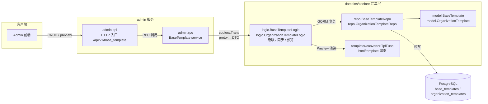
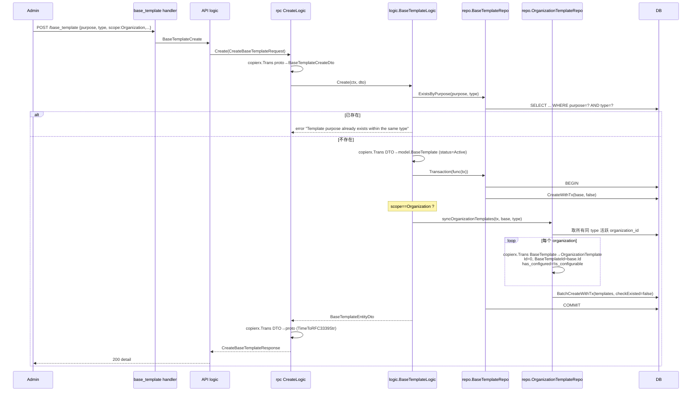
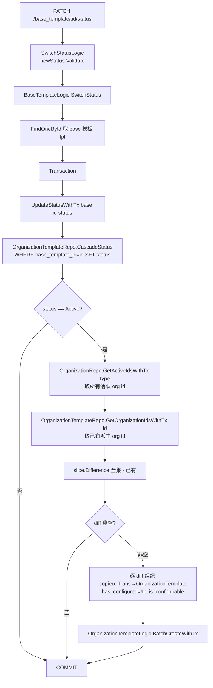
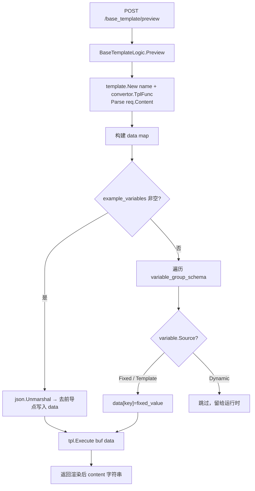

# Admin 模板 CRUD — 技术方案设计

> **来源**：`tasks/20260123_admin_template_crud.md`（重组为规范设计）｜ **版本**：1.0 ｜ **日期**：2026-01-23 ｜ **分支**：`6-admin-template-crud`（源 task 指定；实现已落地于主干）
>
> 本文以**已落地代码**为权威。源设计草稿与实现的差异在 §10 附录逐项标注。

---

## 1. 背景

系统需要支持邮件与合同模板的集中管理：管理员创建**基础模板**（如借款方默认邮件模板、Pre-Approval Letter），再由各组织基于基础模板派生出可定制的**组织模板**。历史上缺少统一的管理入口，模板内容、变量架构、启用状态分散，组织侧无法高效继承管理员侧的变更。

核心问题：

- 管理员侧没有对基础模板的完整增删改查与状态切换能力。
- 基础模板与组织模板是**一对多派生**关系：基础模板的启用/禁用、删除、内容修正需要级联传导到所有派生组织模板，且必须保证一致性。
- 模板内容含动态变量（`{{ .borrowerName }}`、`[[ .system.organization.Name ]]`），需要一个可描述的**变量架构**供前端渲染表单与后端预览。

---

## 2. 目标与非目标

### 2.1 目标

| # | 目标 |
|---|------|
| G1 | 管理员可对基础模板完成**创建 / 更新 / 详情 / 分页 / 状态切换 / 删除**全生命周期管理。 |
| G2 | 基础模板的**状态切换与删除**在单事务内级联传导到所有派生组织模板，保证一致性。 |
| G3 | 支持 **scope=Organization** 的基础模板：创建/激活时自动为所有同类型活跃组织**同步派生**组织模板。 |
| G4 | 提供**预览**端点：用 Go `html/template` + 示例变量渲染模板内容，前端所见即所得。 |
| G5 | 提供**重置**端点：将所有派生组织模板的内容/变量架构回退为基础模板当前值（组织级定制归零）。 |
| G6 | 模板以 `purpose`（同 `type` 内唯一）为稳定标识，`purpose`/`type` 创建后不可更改。 |

### 2.2 非目标

- 模板版本控制与历史审计（无 versions 表）。
- 组织级模板定制界面与分发流程（admin 侧不负责）。
- 模板导入/导出、富文本编辑器集成。
- 不引入数据库触发器，级联全部由应用层 + 单事务完成。

---

## 3. 总体方案

### 3.1 系统架构



API 层只做路由/校验/类型转换，业务逻辑下沉到 `domains/zeebee/logic`，由 admin.rpc 与 lender 服务复用（符合「共享领域优先」宪法）。

### 3.2 功能架构

系统由三组能力组成：

- **基础 CRUD**：`Create / Update / Detail / Page`，统一走 `copierx.Trans` 在 proto ↔ DTO ↔ Model 间转换。
- **级联操作**：`SwitchStatus / Delete`，在单个数据库事务内同步传导到 `organization_templates`；`Reset` 把派生模板回退到基础模板。
- **派生同步（scope 驱动）**：当 `scope=Organization` 时，创建/激活/作用域变更会调用 `syncOrganizationTemplates`，为所有同 `type` 活跃组织克隆派生模板；`scope=System` 仅级联状态、不主动派生。

### 3.3 模块划分

| 模块 | 路径 | 职责 |
|------|------|------|
| API 路由 | `app/admin/api/admin.api`（`base_template` service block） | 8 个端点定义、`/api/v1` 前缀、`AuthMiddleware` |
| API handler | `app/admin/api/internal/handler/base_template/base_template_{create,update,detail,page,switch_status,delete,preview,reset}_handler.go` | HTTP 入口、请求绑定、响应封装 |
| API logic | `app/admin/api/internal/logic/base_template/base_template_*_logic.go` | 调用 RPC client、proto/类型转换 |
| RPC client | `app/admin/rpc/client/basetemplate/base_template.go` | 8 个 RPC 方法的客户端桩 |
| RPC service | `app/admin/rpc/pb/admin_base_template.proto` | `service BaseTemplate`：Create/Update/Detail/Page/SwitchStatus/Delete/Preview/Reset |
| RPC logic | `app/admin/rpc/internal/logic/basetemplate/{create,update,detail,page,switch_status,delete,preview,reset}_logic.go` | proto→DTO 转换、委托共享 logic |
| 共享业务逻辑 | `domains/zeebee/logic/base_template_logic.go` | Create/Update/Detail/Page/SwitchStatus/Delete/Preview/syncOrganizationTemplates |
| 组织模板逻辑 | `domains/zeebee/logic/organization_template_logic.go` | BatchCreateWithTx / ResetByBaseTemplateId / mergeTemplateVariableGroup |
| 仓储 | `domains/zeebee/repo/base_template.go`、`repo/organization_template.go` | GORM 查询、`*WithTx` 事务变体、CascadeStatus / CascadeDelete |
| 模型 | `domains/zeebee/model/base_template.go`、`model/organization_template.go` | GORM 实体、TableName、BeforeValidate、RemoveRelationships |
| DTO | `domains/zeebee/data/dto/base_template.go`、`dto/template.go` | BaseTemplateCreate/Update/Preview/Page DTO、TemplateVariableGroup |
| 常量 | `domains/zeebee/constants/template.go` | TemplateCategory / TemplateVariableSource / Type / Format / BaseTemplateScope |
| 迁移 | `deploy/zeebee/sql/20260123144148_create_template_table.sql` | 建表 + ALTER + 种子数据 |

> **设计纪律**：RPC logic 仅做 `copierx.Trans` 与委托；级联/同步/渲染全部在 `domains/zeebee/logic`，不泄漏到 admin.rpc 内部，保证 lender 等服务可复用。

### 3.4 关键概念

- **基础模板（BaseTemplate） vs 组织模板（OrganizationTemplate）**：一对多派生。组织模板通过 `base_template_id` 反向定位源头（逻辑外键，DB 层无 FK 约束，见 §10）。
- **purpose（稳定标识）**：模板的业务语义键（如 `preApprovedLetter`、`preApprovedLetterEmailTemplate`），在**同一 `type` 内唯一**（`ExistsByPurpose` 校验 `purpose + type`）。`purpose` 与 `type` 在 `UpdateBaseTemplateRequestData` 中被省略，故创建后不可更改。
- **scope（System / Organization）**：决定模板的派生策略。`System` = 平台级、不主动派生组织模板；`Organization` = 创建/激活时为所有同类型活跃组织克隆一份组织模板。
- **variable_group_schema（JSONB）**：模板变量的结构化描述，驱动前端表单渲染与 Preview 数据装配。结构见 §4.2。
- **example_variables（JSONB）**：预览用的示例变量值（如 `{"salesPrice": 8888}`），Preview 时注入 `html/template` 数据 map。
- **is_configurable / has_configured**：`is_configurable`（基础模板）声明是否允许组织定制；派生时 `organization_template.has_configured = !base_template.is_configurable`（不可配置模板派生即视为已敲定）。

---

## 4. 数据模型与存储

### 4.1 数据表

**(a）`base_templates`**（`deploy/zeebee/sql/20260123144148_create_template_table.sql`）

| 列 | 类型 | 说明 |
|----|------|------|
| `id` | serial PK | |
| `created_at` / `updated_at` | timestamptz | 默认 `now()` |
| `is_del` | int2 | 默认 0（注：删除走**硬删**，`is_del` 未被 delete 使用） |
| `name` | varchar(100) | 索引 `idx_base_tpl_name` |
| `type` | varchar(20) | `Borrower` / `Lender` |
| `category` | varchar(20) | `Email` / `Contract` |
| `purpose` | varchar(100) | 稳定标识，索引 `idx_base_tpl_purpose`，同 `type` 内唯一 |
| `content` | text | 模板内容（`html/template` 语法） |
| `variable_group_schema` | jsonb | 默认 `'{}'`，变量架构 |
| `status` | varchar(20) | 默认 `'Active'`；`Active` / `Disabled` |
| `description` | varchar(255) | |
| `example_variables` | jsonb | 默认 `'{}'`（ALTER 追加） |
| `scope` | varchar(20) | 默认 `'System'`；`System` / `Organization`（ALTER 追加） |
| `is_configurable` | boolean | 模型层字段，控制派生模板是否允许组织定制 |

种子数据：`preApproved`（Lender/Contract，scope=Organization）、`preApprovedLetterEmail`（Lender/Email，scope=Organization）。

**(b）`organization_templates`**

| 列 | 类型 | 说明 |
|----|------|------|
| `id` | serial PK | |
| `created_at` / `updated_at` | timestamptz | |
| `is_del` | int2 | |
| `organization_id` | int4 | 索引 `idx_org_tpl_org_id` |
| `base_template_id` | int4 | 派生源头，索引 `idx_org_base_tpl_id`（ALTER 追加，逻辑外键） |
| `name` / `type` / `category` / `purpose` | varchar | 镜像基础模板 |
| `content` | text | |
| `variable_group_schema` | jsonb | |
| `status` | varchar(20) | 默认 `'Active'` |
| `description` | varchar(255) | |
| `example_variables` | jsonb | 默认 `'{}'`（ALTER 追加） |
| `has_configured` | boolean | 模型层字段，派生时置为 `!is_configurable` |

> 迁移文件未声明 `FOREIGN KEY` 约束（源草稿曾设计 FK，见 §10）；级联完整性由应用层事务保证。

### 4.2 variable_group_schema 结构

```go
// domains/zeebee/data/dto/template.go
type TemplateVariableGroup struct {
    Name      string              `json:"name"`
    Variables []*TemplateVariable `json:"variables"`
}

type TemplateVariable struct {
    Label      string                           `json:"label"`
    Type       constants.TemplateVariableType   `json:"type"`        // String, Array, Object
    Key        string                           `json:"key"`         // 如 ".borrowerName"
    IsEditable bool                             `json:"is_editable"`
    IsRequired bool                             `json:"is_required"`
    Source     constants.TemplateVariableSource `json:"source"`      // Fixed, Dynamic, Template
    FixedValue string                           `json:"fixed_value"`
    Format     constants.TemplateVariableFormat `json:"format,omitempty"`     // Email, Phone, Currency, Input, TextArea
    Properties map[string]*TemplateVariable     `json:"properties,omitempty"` // object 类型嵌套
    Items      []*TemplateVariable              `json:"items,omitempty"`      // array 类型项目架构
}
```

- `source=Fixed` 或 `Template`：Preview 时用 `fixed_value` 注入；`source=Dynamic`：由运行时业务数据填充。
- 支持 `object`（`properties` 嵌套）与 `array`（`items` 项目架构）。
- `TemplateVariableGroup` 实现 `sql.Scanner` / `driver.Valuer`，GORM 以 jsonb 序列化（`serializer:json`）。

### 4.3 Redis / 配置

本特性**不引入 Redis 缓存**，模板读写直达 PostgreSQL。配置沿用 admin 服务既有 `app/admin/rpc/etc/*.yaml`，无新增配置项。

---

## 5. 接口设计

### 5.1 HTTP 端点（admin.api，prefix `/api/v1`）

| 方法 | 路径 | handler | 功能 |
|------|------|---------|------|
| POST | `/base_template` | `BaseTemplateCreate` | 创建基础模板（scope=Organization 时事务内同步派生） |
| PUT | `/base_template/:id` | `BaseTemplateUpdate` | 更新基础模板（scope 变更触发派生同步/状态级联） |
| GET | `/base_template/:id` | `BaseTemplateDetail` | 模板详情 |
| POST | `/base_template/page` | `BaseTemplatePage` | 分页查询（支持 keyword/type/category/status/scope 筛选） |
| PATCH | `/base_template/:id/status` | `BaseTemplateSwitchStatus` | 切换状态（事务内级联 + 激活时回填缺失派生） |
| DELETE | `/base_template/:id` | `BaseTemplateDelete` | 删除（事务内级联硬删派生 + 硬删基础） |
| POST | `/base_template/preview` | `BaseTemplatePreview` | 渲染预览（不入库） |
| POST | `/base_template/:id/reset` | `BaseTemplateReset` | 将所有派生组织模板回退到基础模板当前值 |

筛选条件（`BaseTemplatePageRequestFilter`）：`keyword`（模糊匹配 `name` 或 `purpose`）、`type`、`category`、`status`、`scope`。`keyword` 命中 `name LIKE OR purpose LIKE`（`repo/base_template.go:Page`）。

### 5.2 请求/响应 schema（proto 摘要）

```proto
// service BaseTemplate（admin_base_template.proto）
rpc Create (CreateBaseTemplateRequest)       returns (CreateBaseTemplateResponse);   // data: BaseTemplateEntity
rpc Update (UpdateBaseTemplateRequest)       returns (UpdateBaseTemplateResponse);   // data: BaseTemplateEntity
rpc Detail  (GetBaseTemplateRequest)         returns (GetBaseTemplateResponse);      // data: BaseTemplateEntity
rpc Page    (BaseTemplatePageRequest)        returns (BaseTemplatePageResponse);     // data.list: BaseTemplatePageEntity
rpc SwitchStatus (SwitchBaseTemplateStatusRequest) returns (proto.EmptyResponse);
rpc Delete (DeleteBaseTemplateRequest)       returns (proto.EmptyResponse);
rpc Preview (BaseTemplatePreviewRequest)     returns (BaseTemplatePreviewResponse);  // data.content: 渲染结果
rpc Reset   (proto.IdRequest)                returns (proto.EmptyResponse);
```

`CreateBaseTemplateRequestData` 字段：`name, type, category, purpose, content, variable_group_schema, description, example_variables, scope, is_configurable`。

`UpdateBaseTemplateRequestData` 字段：`id, name, category, content, variable_group_schema, description, example_variables, scope, is_configurable`（**省略 `purpose` 与 `type` → 不可更改**）。

`BaseTemplatePageEntity`（列表轻量视图）：`id, name, type, category, purpose, status, description, scope, is_configurable, created_at, updated_at`。

---

## 6. 核心流程

### 6.1 创建 + 派生同步（scope=Organization）



> `Update` 同理：先加载 `existing`（记 `oldScope`），事务内 `UpdateOneByIdWithTx`；若 `oldScope != req.Scope`：`Organization` → `syncOrganizationTemplates(checkExisted=true)`；`System` → `CascadeStatus(Active)`。字段更新采用「先 copy 再整体写回」，`purpose`/`type` 不在更新字段中故保持不变。

### 6.2 SwitchStatus 级联 + 激活回填



要点：

- 级联在**单个事务**内完成：基础状态更新 + 组织模板状态批量更新（`UPDATE organization_templates SET status=? WHERE base_template_id=?`）。
- 仅当切到 `Active` 时额外**回填缺失派生**：把同 `type` 下还没有派生模板的活跃组织补齐，保证「启用即覆盖所有组织」语义。
- `Delete` 流程对称：`Transaction` → `OrganizationTemplateRepo.CascadeDelete`（`DELETE WHERE base_template_id=?`，硬删）→ `BaseTemplateRepo.DeleteWithTx`（硬删基础模板）。

### 6.3 Preview 渲染



> Preview **不入库**，纯内存渲染：`html/template` + `convertor.TplFunc()` 自定义函数；`Fixed`/`Template` 源变量用 `fixed_value`，`Dynamic` 源变量在预览阶段不填充。

### 6.4 Reset 回退派生

`POST /base_template/:id/reset` → `OrganizationTemplateLogic.ResetByBaseTemplateId`：

1. `BaseTemplateRepo.Detail(ctx, id, withPreload=true)` 取基础模板及其 `OrganizationTemplates`。
2. 事务内遍历每个派生组织模板，把 `Content / VariableGroupSchema(经 mergeTemplateVariableGroup) / ExampleVariables / Name / Purpose / Description / Category / HasConfigured` 重置为基础模板当前值，`UpdateOneByIdWithTx` 逐条回写。

语义：组织侧对派生模板的定制被覆盖回基础模板的权威值。

---

## 7. 风险与权衡

| 风险 | 权衡 | 缓解 |
|------|------|------|
| **级联数据一致性** | 应用层级联（非 DB 触发器）简、可复用；代价：部分成功风险 | 状态切换/删除/同步**全部在单个 GORM 事务**内（`Transaction(func(tx))`），失败整体回滚 |
| **硬删不可恢复** | 删除走 `DeleteWithTx` 硬删，保留 `is_del` 列未用 | 删除前由前端二次确认；未来若需审计可改软删 |
| **无 DB 外键约束** | 迁移未建 FK，灵活、易跨库；代价：一致性靠应用层 | `base_template_id` 建索引 + 级联事务 + Reset/同步覆盖 |
| **激活即全量派生** | `scope=Organization` 启用时为所有同 type 活跃组织克隆，可能批量插入 | 放在事务内；组织规模受控；增量回填（仅 diff 组织） |
| **purpose 并发冲突** | 同 type 内 purpose 唯一靠应用层 `ExistsByPurpose` 校验 | 建议补 UNIQUE 索引 `(purpose, type)` 作为兜底（见 §10） |
| **content 体积** | text 列无显式上限 | 设计约束 10MB（源草稿），建议接口层 `MaxBytesReader` 闸 |
| **Preview 模板注入** | `html/template` 自动转义；但 `convertor.TplFunc` 暴露函数面 | 预览入参仅管理员可控；生产渲染走同一引擎 |

---

## 8. 实现要点

### 8.1 关键不变量（改动前必读）

1. **purpose / type 创建后不可变**：`UpdateBaseTemplateRequestData` 不携带两字段；Update 以 `existing` 为基线 copy，禁止外部改写。
2. **级联 = 单事务**：SwitchStatus / Delete / syncOrganizationTemplates 必须在 `BaseTemplateRepo.Transaction` 内，不得跨事务。
3. **scope 驱动派生**：`syncOrganizationTemplates` 只在 `scope==Organization` 调用；`System` 仅级联状态。
4. **has_configured 派生公式**：`organization_template.has_configured = !base_template.is_configurable`（创建、激活回填、Reset 均遵守）。
5. **Preview 不入库**：只读装配 `data` map，`Dynamic` 变量不参与预览。

### 8.2 构建顺序

1. 迁移：`deploy/zeebee/sql/20260123144148_create_template_table.sql`（建表 + ALTER scope/example_variables + 种子）。
2. 模型 / DTO / 常量：`model/{base_template,organization_template}.go`、`data/dto/{base_template,template}.go`、`constants/template.go`。
3. 仓储：`repo/base_template.go`（Create/Detail/Update/UpdateStatus(*Tx)/Delete(*Tx)/Page/ExistsByPurpose）、`repo/organization_template.go`（CascadeStatus/CascadeDelete/GetOrganizationIdsWithTx）。
4. 共享逻辑：`logic/base_template_logic.go`、`logic/organization_template_logic.go`（BatchCreateWithTx/ResetByBaseTemplateId/mergeTemplateVariableGroup）。
5. Proto + `make create-service admin` 重生成：`admin_base_template.proto` → RPC server/client。
6. RPC logic → API logic → handler → 路由注册。
7. 端到端 build、golangci-lint。

### 8.3 测试覆盖

| 层 | 测试 |
|----|------|
| 仓储 | `ExistsByPurpose` 唯一性；`Page` 各筛选组合；`CascadeStatus`/`CascadeDelete` 事务回滚 |
| 级联 | SwitchStatus：Active 时回填 diff 组织、Disabled 时仅级联；Delete：派生与基础在同一事务 |
| 同步 | scope=Organization 创建 → 派生模板数量 = 同 type 活跃组织数；scope 切换 Update 触发同步 |
| Reset | 派生模板内容/变量架构回退到基础；`has_configured` 跟随 `!is_configurable` |
| Preview | `Fixed`/`Template` 变量注入；`Dynamic` 跳过；`example_variables` JSON 解析；模板语法错误返回 error |
| 校验 | purpose 重复 → 拒绝；`status.Validate` / `scope.Validate` 非法枚举 → 拒绝 |

---

## 9. 验证规则约束（来自源设计，落地参考）

| 字段 | 验证规则 |
|------|----------|
| `name` | 必填，1-100 字符 |
| `type` | 必填，`Borrower` / `Lender` |
| `category` | 必填，`Email` / `Contract` |
| `purpose` | 必填，1-100 字符，同 `type` 内唯一，**创建后不可更改** |
| `content` | 必填，设计上限 10MB（建议接口层闸） |
| `status` | `Active` / `Disabled` |
| `variable_group_schema` | 有效 JSONB，支持嵌套 object/array |
| `scope` | `System` / `Organization` |

> 源草稿中「`tag` 字段」在实现中即 `purpose`；「type+category 内唯一」实现为 `purpose + type` 内唯一（见 §10）。

---

## 10. 附录：与源设计草稿的差异（以代码为准）

| 项 | 源草稿 | 实际代码 |
|----|--------|----------|
| 标识字段 | `tag`（type+category 内唯一、不可改） | **`purpose`**（`purpose + type` 内唯一，`ExistsByPurpose`）；`purpose`/`type` 在 Update proto 中省略 → 不可改 |
| 删除语义 | 软删除（`is_del`） | **硬删**（`DeleteWithTx` / `CascadeDelete` 均 `DELETE`） |
| 状态切换方法 | `PUT .../status` | **`PATCH .../status`** |
| 端点前缀 | `/admin/v1/base_template` | **`/api/v1/base_template`** |
| 端点集合 | 6 个（无 preview/reset） | **8 个**（新增 `POST /base_template/preview`、`POST /base_template/:id/reset`） |
| 派生机制 | 仅状态/删除级联 | **scope 驱动派生**：`scope=Organization` 时 Create/Update-scope-change/激活回填主动克隆组织模板 |
| DB 外键 | `FOREIGN KEY` 引用 organizations / base_templates | **无 FK 约束**，仅 `base_template_id` 索引（逻辑外键） |
| 新增字段 | — | `scope`、`example_variables`、`is_configurable`（base）/ `has_configured`（org） |
| 分支 | `feat-backend-template` → `6-admin-template-crud` | 已落地主干（当前检出分支：`004-word-file-parse`，与本特性无关） |
