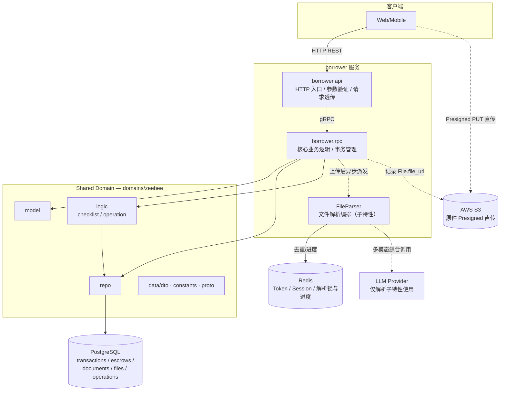
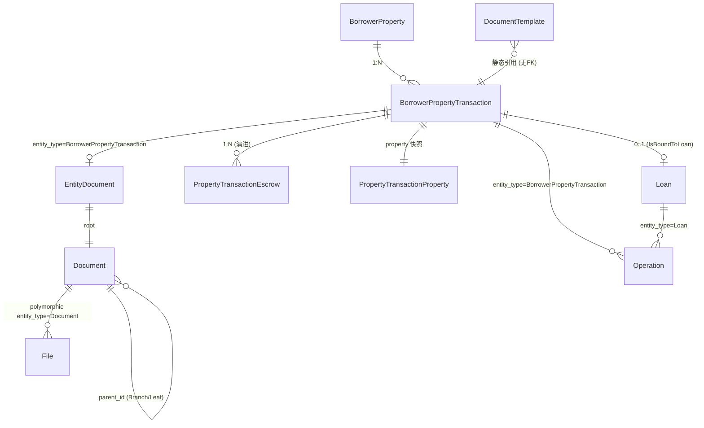
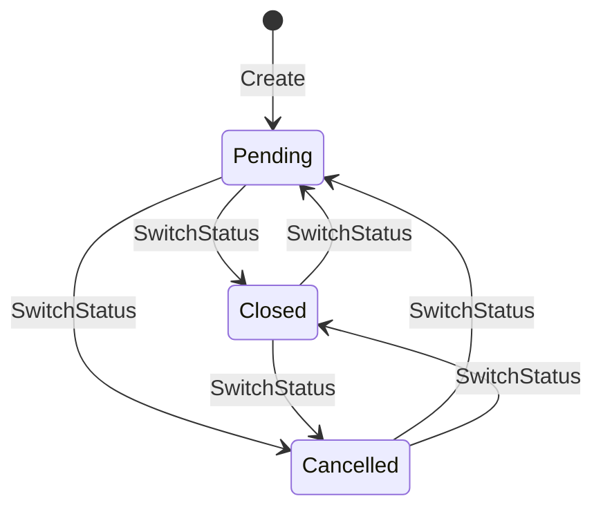
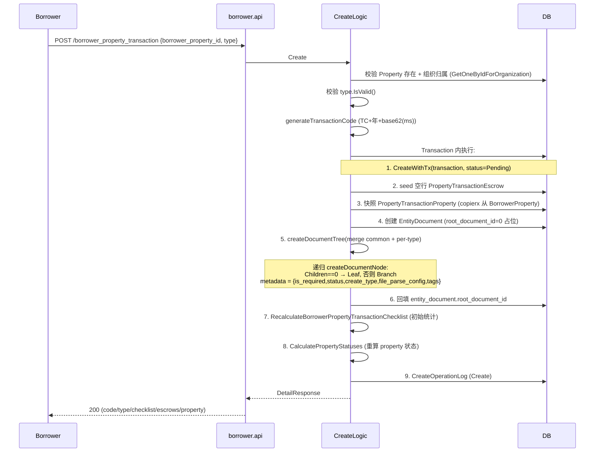
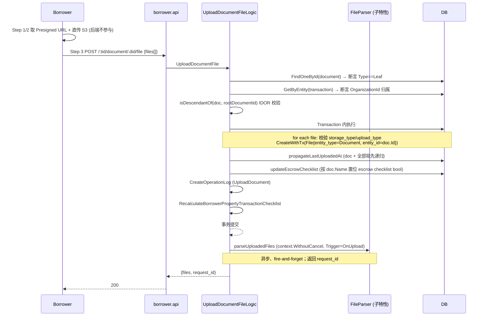
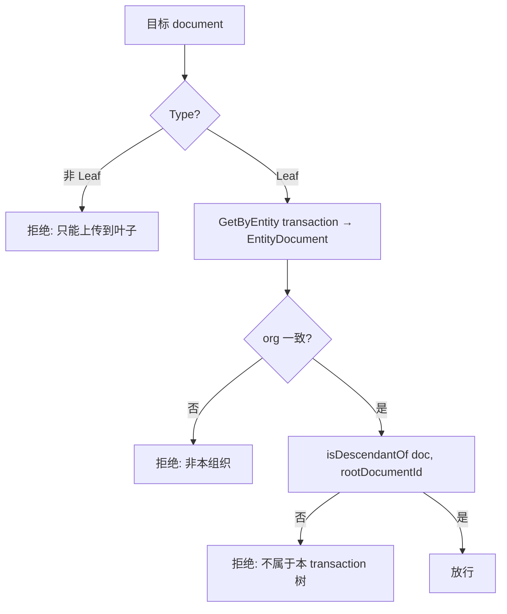
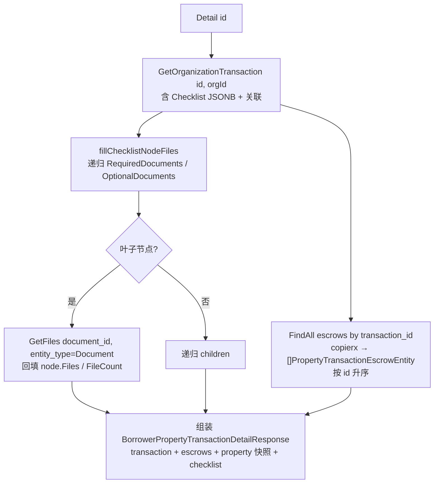
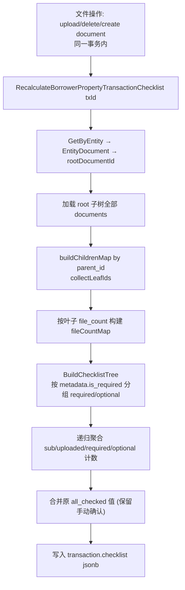
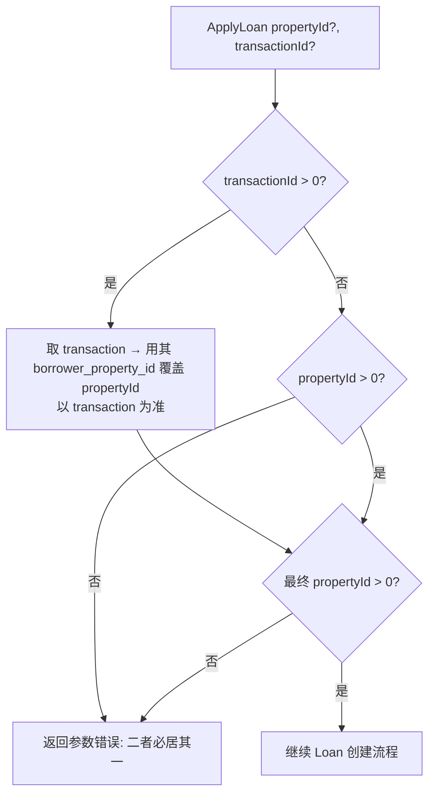

# Borrower Property Transaction — 技术方案设计

> **来源**：`tasks/20260519_borrower_transaction.md`（需求，重组为规范设计，内容实质保留） ｜ **版本**：1.0 ｜ **日期**：2026-05-19 ｜ **分支**：`001-borrower-property-transaction`
>
> 本文为 Borrower Property Transaction **父特性**（交易实体、通用文档树、Checklist、Loan 关联、操作日志）的技术方案。文件内容自动解析（escrow / rpa 回写、Word 转 PDF、异步编排）是建立在本文档树与 escrow 模型之上的**子特性**，其深度设计见 [`borrower_property_transaction_file_parse/tech_doc.md`](../20260715_borrower_property_transaction_file_parse/tech_doc.md)，本文仅在 §3.4 / §7 给出衔接要点，不重复其细节。
>
> 事实型内容（SQL、端点、字段、决策表）以**已落地代码**为准；与原 v3 草稿（2026-05-26）的差异在文中以 `> 注` 标注。

---

## 1. 背景

Zeebee 平台为贷款经纪人（Loan Officer）管理借款人（Borrower）的资产（Property）和贷款（Loan）流程。在引入本特性之前，系统只支持 Property 与 Loan 的直接关联，但缺少对**交易过程（Transaction）**本身的管理。

实际业务中，贷款申请前需要为 Property 准备大量交易文件（合同、托管、保险、过户包等），这些文件的准备进度直接影响贷款审批。因此需要一个独立的 Transaction 模块来：

- 管理交易生命周期（Pending / Closed / Cancelled）；
- 基于模板组织一份**结构化的通用文档树**，统一追踪所需文件的准备进度（Checklist）；
- 让 Loan 通过 Transaction 间接关联 Property（Apply 时 Property 与 Transaction 二选一）；
- 对全部业务变更记录统一的操作审计日志。

---

## 2. 目标与非目标

### 2.1 目标

| # | 目标 |
|---|------|
| G1 | **Transaction 管理** — 为 Property 添加 Transaction 实体，支持完整生命周期管理（CRUD + 状态切换 + 分页搜索 + 下拉）。 |
| G2 | **通用文档系统** — 基于模板的文档树管理，支持文件上传/删除，可复用于其他业务实体。 |
| G3 | **Checklist 自动统计** — 按 required/optional 分组自动统计文档上传进度，文件操作即重算。 |
| G4 | **Loan 关联** — Loan 可通过 Transaction 间接关联 Property（Apply 二选一，Draft 灵活）。 |
| G5 | **操作审计** — 统一 `operations` 表，通过 `entity_type` + `entity_id` 多态关联，记录所有业务变更。 |
| G6 | **Transaction 分页搜索** — 支持按 Property 地址 keyword 模糊匹配 + type + status 筛选。 |

### 2.2 非目标

- 不做 Google Drive 文件集成的完整逻辑（数据模型已预留 `external_id` / `upload_type=Google Drive`，逻辑本期不实现）。
- 不做 Document Template CRUD 管理（模板结构手动配置入库）。
- 不做操作日志的实时推送/通知。
- 不做文件内容自动解析（该子特性由独立的 file-parse TechDoc 承担，见上文链接）。

---

## 3. 总体方案

### 3.1 系统架构



模块遵循项目整体分层：`API Handler → API Logic → RPC Call → RPC Logic → Repository → Model → Database`。文件解析编排器（`FileParser`）作为 RPC 层的一个可选旁路，在文件上传提交后异步触发，不阻塞上传响应——其完整设计见 file-parse TechDoc。

### 3.2 功能架构

系统由五个功能模块组成：

**A. Transaction 管理**
Create 选择 Property + Type，自动生成 code 并按模板递归生成文档树；Detail 聚合交易、文档树（以 Checklist 形态）、escrows、property 快照；Update 仅开放限定字段；Delete 软删除（需未绑定 Loan，递归清理 Document/File/Escrow）；SwitchStatus 三态任意切换；All 返回下拉；Page 分页搜索。

**B. 通用文档系统（基于模板）**
创建 Transaction 时从 `document_templates` 按 type 加载 `structure`，合并 `common` + per-type 节点后递归创建文档目录树；写操作（Create Document / Upload File / Delete File）嵌套在 transaction 路由下以便归属校验与操作日志。

**C. Checklist 自动统计**
每次文件操作（上传/删除/创建 document）在同一 DB 事务内 write-on-update 重算；`all_checked` 为手动确认字段，重算时保留原值。

**D. Loan 关联**
Apply Loan：property 与 transaction 二选一（XOR），同时提供以 transaction 为准（从 transaction 反推 property）；Draft Loan：灵活策略，可只提供其一或都不提供。

**E. 操作日志**
统一 `operations` 表，通过 `entity_type` + `entity_id` 多态关联 Transaction 与 Loan；提供 Stats（按类型统计）和 List（列表，按 `created_at DESC`）两种查询。

### 3.3 模块划分

| 模块 | 路径 | 职责 |
|------|------|------|
| Transaction RPC Logic | `app/borrower/rpc/internal/logic/borrowerpropertytransaction/` | 17 个 logic：create / detail / update / delete / switch_status / all / page / update_checklist / create_document / upload_document_file / delete_document_file / operation_list / operation_stats / list_by_borrower_property / parse_file / parse_file_result |
| Document RPC Logic | `app/borrower/rpc/internal/logic/document/` | detail / leaf_list / files（通用文档读路径） |
| API Handler | `app/borrower/api/internal/handler/borrower_property_transaction/` | 15 个 handler，HTTP 入口 |
| API Logic | `app/borrower/api/internal/logic/borrower_property_transaction/` | 参数验证、RPC 透传、响应整合 |
| API Desc | `app/borrower/api/desc/borrower_property_transaction.api` | 端点与类型定义 |
| Proto | `app/borrower/rpc/pb/borrower.proto` | `BorrowerPropertyTransaction` service |
| Transaction Model | `domains/zeebee/model/borrower_property_transaction.go` | `BorrowerPropertyTransaction`（含 Checklist jsonb、Escrows 1:N、Property 快照） |
| Escrow Model | `domains/zeebee/model/property_transaction_escrow.go` | `PropertyTransactionEscrow` |
| Property 快照 Model | `domains/zeebee/model/property_transaction_property.go` | `PropertyTransactionProperty`（建交易时快照 property） |
| Document Model | `domains/zeebee/model/document.go` | `Document`（邻接表，Children/Files 关系） |
| EntityDocument Model | `domains/zeebee/model/entity_document.go` | `EntityDocument`（entity ↔ root document 绑定） |
| Operation Model | `domains/zeebee/model/operation.go` | `Operation`（多态日志） |
| DocumentTemplate Model | `domains/zeebee/model/document_template.go` | 模板 `structure`（`DocumentTemplateStructureMap`） |
| Transaction Repo | `domains/zeebee/repo/borrower_property_transaction.go` | CRUD + `IsBoundToLoan` + `GetOrganizationTransaction` |
| Checklist Logic | `app/borrower/rpc/internal/biz_helper/borrower_property_transaction.go` | `RecalculateBorrowerPropertyTransactionChecklist` / `BuildChecklistTree` |
| Operation Logic | `app/borrower/rpc/internal/logic/.../OperationLogic` | `CreateOperationLog`（多态写日志） |
| Transaction Constants | `domains/zeebee/constants/borrower_property_transaction.go` | Type / Status 枚举与 `IsValid` |
| Transaction DTO | `domains/zeebee/data/dto/borrower_property_transaction.go` | Checklist / Page DTO |
| Migration | `deploy/zeebee/sql/20260520151433_borrower_transaction.sql` | 初始 schema |
| Seeds | `specs/001-borrower-property-transaction/seeds/001_document_templates.sql` | 模板种子数据 |

### 3.4 关键概念

**Transaction 生命周期**
Type ∈ {`Purchase`, `Sale`, `Re-finance`, `Change Title`, `Assignment`}；Status ∈ {`Pending`, `Closed`, `Cancelled`}，三态可任意双向切换、无前置约束。Code 规则：`TC` + 年份2位 + base62(毫秒时间戳)，例 `TC26ttdhd10`，由 `UNIQUE` 索引兜底碰撞。

**通用文档树（邻接表）**
`documents` 行按 `parent_id` 物化为树：`Root`（level 0）→ `Branch`（文件夹）→ `Leaf`（可挂文件的叶子）。`entity_documents` 表把 entity（如 transaction）绑定到其根 document。每行 `metadata` jsonb 携带 `{is_required, status, create_type, file_parse_config, tags}`。建交易时把 template 的 `file_parse_config` + `tags` 快照进各节点的 `metadata`。

> 模板机制：创建 Transaction 时从 `document_templates.structure`（`map[string][]DocumentTemplateStructure`）取 `common` + per-type（key 为小写 type）合并，递归创建。

**Escrow（托管）**
`property_transaction_escrows` 挂在 transaction 下，记录 escrow 公司 / officer / 自有 checklist（`has_wire_instruction` 等 bool 标志）。建交易时 seed 一行空 escrow。

> 注（代码演进）：v3 草稿记为 1:1；当前 model 已是 1:N（`BorrowerPropertyTransaction.Escrows []*PropertyTransactionEscrow`），`Detail` 加载全部 escrows 按 id 排序，表上为 `no` 列保留 btree 为未来 1:N 扩展。

**Property 快照**
`property_transaction_properties` 在建交易时从 `BorrowerProperty` 复制一份（地址、户型、面积等），使交易持有创建时刻的 property 影像，与 property 后续变更解耦。

**Checklist（缓存 JSONB）**
`borrower_property_transactions.checklist` 以 `required_documents` / `optional_documents` 两棵子树缓存进度统计（total / uploaded 计数），write-on-update 重算；`all_checked` 为手动确认位、重算保留。

**file_parse_config（解析子特性衔接）**
每个叶子 `metadata.file_parse_config.rules` 声明「该文件夹/文件用哪个 parser、何时触发、取哪些文件」。该配置的 schema、路由语义、回写规则、异步编排全部属于文件解析子特性——详见 [`borrower_property_transaction_file_parse/tech_doc.md`](../20260715_borrower_property_transaction_file_parse/tech_doc.md)。本文仅在 §6.2 / §7 涉及其触发点。

---

## 4. 数据模型与存储

### 4.1 Entity 关系



### 4.2 新增表

#### borrower_property_transactions

```sql
CREATE TABLE "public"."borrower_property_transactions" (
  "id" serial,
  "borrower_property_id" int4 NOT NULL DEFAULT 0,
  "organization_id" int4 NOT NULL DEFAULT 0,
  "code" varchar(20) NOT NULL DEFAULT '',
  "type" varchar(20) NOT NULL DEFAULT 'Purchase',
  "status" varchar(20) NOT NULL DEFAULT 'Pending',
  "coe_date" date,
  "purchase_amount" decimal(10,2) NOT NULL DEFAULT 0,
  "emd_amount" decimal(10,2) NOT NULL DEFAULT 0,
  "property_type" varchar(50) NOT NULL DEFAULT '',
  "pm" varchar(255) NOT NULL DEFAULT '',
  "strategy" varchar(100) NOT NULL DEFAULT '',
  "note" varchar(255) NOT NULL DEFAULT '',
  "checklist" jsonb NOT NULL DEFAULT '{}'::jsonb,
  "created_at" timestamptz NOT NULL DEFAULT now(),
  "updated_at" timestamptz NOT NULL DEFAULT now(),
  "is_del" int2 NOT NULL DEFAULT 0,
  PRIMARY KEY ("id")
);

CREATE INDEX "idx_bp_trans_property_id" ON "public"."borrower_property_transactions" ("borrower_property_id");
CREATE INDEX "idx_bp_trans_org_id" ON "public"."borrower_property_transactions" ("organization_id");
CREATE UNIQUE INDEX "idx_bp_trans_code" ON "public"."borrower_property_transactions" ("code");
```

> 注（代码演进，解析子特性引入）：当前 model 已新增列并在解析子特性里回写：`title_holder varchar(100)`（纯手动）、`contract_date date`、`emd_due_date date`、`contingency_removal_date date`（rpa 回写）、`tc varchar(50)`（纯手动）、`cost_allocation varchar(255)`（纯手动）。`strategy varchar(100)` 在代码中已演进为 `business_strategy text[]`（`pq.StringArray`）——model 字段名与列名同步变更。

#### operations

```sql
CREATE TABLE "public"."operations" (
  "id" serial,
  "entity_id" int4 NOT NULL DEFAULT 0,
  "entity_type" varchar(100) NOT NULL DEFAULT '',
  "operator_id" int4 NOT NULL DEFAULT 0,
  "operator_name" varchar(50) NOT NULL DEFAULT '',
  "operator_type" varchar(50) NOT NULL DEFAULT '',
  "operation" varchar(50) NOT NULL DEFAULT '',
  "note" varchar(255) NOT NULL DEFAULT '',
  "metadata" jsonb NOT NULL DEFAULT '{}',
  "organization_id" int4 NOT NULL DEFAULT 0,
  "created_at" timestamptz NOT NULL DEFAULT now(),
  "updated_at" timestamptz NOT NULL DEFAULT now(),
  "is_del" int2 NOT NULL DEFAULT 0,
  PRIMARY KEY ("id")
);

CREATE INDEX "idx_operation_entity" ON "public"."operations" ("entity_id", "entity_type");
CREATE INDEX "idx_operation_org_id" ON "public"."operations" ("organization_id");
```

#### entity_documents

```sql
CREATE TABLE "public"."entity_documents" (
  "id" serial,
  "entity_type" varchar(20) NOT NULL DEFAULT '',
  "entity_id" int4 NOT NULL DEFAULT 0,
  "root_document_id" int4 NOT NULL DEFAULT 0,
  "created_at" timestamptz NOT NULL DEFAULT now(),
  "updated_at" timestamptz NOT NULL DEFAULT now(),
  "is_del" int2 NOT NULL DEFAULT 0,
  PRIMARY KEY ("id")
);

CREATE INDEX "idx_entity_doc_entity" ON "public"."entity_documents" ("entity_type", "entity_id");
CREATE INDEX "idx_entity_doc_root_id" ON "public"."entity_documents" ("root_document_id");
```

> 注（代码演进）：`entity_documents` 已新增 `organization_id` 列用于组织归属校验（upload 时 `entityDoc.OrganizationId != claim.OrganizationId` 拒绝）。

#### documents

```sql
CREATE TABLE "public"."documents" (
  "id" serial,
  "parent_id" int4 NOT NULL DEFAULT 0,
  "type" varchar(20) NOT NULL DEFAULT '',
  "name" varchar(255) NOT NULL DEFAULT '',
  "level" int4 NOT NULL DEFAULT 0,
  "sort_order" int4 NOT NULL DEFAULT 0,
  "last_uploaded_at" timestamptz,
  "metadata" jsonb NOT NULL DEFAULT '{}',
  "created_at" timestamptz NOT NULL DEFAULT now(),
  "updated_at" timestamptz NOT NULL DEFAULT now(),
  "is_del" int2 NOT NULL DEFAULT 0,
  PRIMARY KEY ("id")
);

CREATE INDEX "idx_doc_pid" ON "public"."documents" ("parent_id");
CREATE INDEX "idx_doc_name" ON "public"."documents" ("name");
```

> 注（代码演进）：`documents` 已新增 `entity_document_id` 列，把每行直接归属到 `entity_documents.id`（建树时写入），便于跨树归属判定。

#### document_templates

```sql
CREATE TABLE "public"."document_templates" (
  "id" serial,
  "name" varchar(255) NOT NULL DEFAULT '',
  "type" varchar(20) NOT NULL DEFAULT '',
  "structure" json NOT NULL DEFAULT '{}',
  "status" varchar(20) NOT NULL DEFAULT '',
  "created_at" timestamptz NOT NULL DEFAULT now(),
  "updated_at" timestamptz NOT NULL DEFAULT now(),
  "is_del" int2 NOT NULL DEFAULT 0,
  PRIMARY KEY ("id")
);
```

> 解析子特性在模板 `structure` 各节点上新增 `file_parse_config` + `tags`，建交易时快照进 document `metadata`。例：Wire Instructions 叶子 `{"file_parse_config":{"rules":[{"parser":"escrow_info","trigger":"Upload","source":"Files"}]}}`；Contract 文件夹 `{"file_parse_config":{"rules":[{"parser":"rpa","trigger":"Manual","source":"Directory"}]}}`。详见 file-parse TechDoc。

#### property_transaction_escrows（解析子特性引入，已部署）

```sql
CREATE TABLE "property_transaction_escrows" (
  "id" serial PRIMARY KEY,
  "borrower_property_transaction_id" int4 NOT NULL,
  "no"             varchar(50),
  "escrow_company" varchar(100),
  "officer_name"   varchar(30),
  "officer_phone"  varchar(20),
  "officer_email"  varchar(50),
  "checklist"      jsonb NOT NULL DEFAULT '{}'
);
CREATE INDEX "bpt_escrow_transaction_id" ON ... (borrower_property_transaction_id);
CREATE INDEX "bpt_escrow_no"             ON ... (no);  -- 为未来 1:N 预留
```

#### property_transaction_properties（代码演进新增，property 快照）

存放建交易时刻从 `borrower_properties` 复制的 property 影像（unit / property_type / living_area_sqft / lot_area_sqft / bedrooms / bathrooms / address jsonb），通过 `borrower_property_transaction_id` 归属。

### 4.3 修改的表

```sql
-- files 表扩展
ALTER TABLE "public"."files"
  ADD COLUMN "file_name" varchar(255) NOT NULL DEFAULT '',
  ADD COLUMN "storage_type" varchar(20) NOT NULL DEFAULT 'Aws S3',
  ADD COLUMN "external_id" varchar(255) NOT NULL DEFAULT '',
  ADD COLUMN "upload_type" varchar(20) NOT NULL DEFAULT 'Manual';
CREATE INDEX "idx_files_external_id" ON "public"."files" ("external_id");

-- loans 表扩展
ALTER TABLE public.loans
  ADD COLUMN borrower_property_transaction_id int4 DEFAULT 0 NOT NULL;
CREATE INDEX idx_loan_borrower_property_trans_id ON public.loans (borrower_property_transaction_id);
```

> 注（代码演进）：`files` 表另增 `drive_synced_at`（Google Drive 同步标记），`Detail` 转 DTO 时需 `SqlTimePtrToStr` 才能保住该字段不丢。

### 4.4 状态机



三状态（Pending/Closed/Cancelled）任意双向切换，无前置约束（`SwitchStatus` 仅校验目标 status 合法）。

### 4.5 Checklist JSONB 结构

```json
{
  "all_checked": true,
  "total_document_count": 34,
  "total_required_document_count": 29,
  "total_optional_document_count": 5,
  "total_required_updated_document_count": 0,
  "total_optional_updated_document_count": 0,
  "required_documents": [
    {
      "name": "Contract", "document_id": 266, "is_required": true,
      "sub_document_count": 6, "uploaded_document_count": 0,
      "children": [
        {"name": "Original RPA", "document_id": 267, "is_required": true, "sub_document_count": 0, "uploaded_document_count": 0},
        {"name": "Assignment Agreement AOAA", "document_id": 268, "is_required": true, "sub_document_count": 0, "uploaded_document_count": 0},
        {"name": "Counter Offer", "document_id": 269, "is_required": true, "sub_document_count": 0, "uploaded_document_count": 0},
        {"name": "Addendum (Extension)", "document_id": 270, "is_required": true, "sub_document_count": 0, "uploaded_document_count": 0},
        {"name": "Seller financing Docs", "document_id": 271, "is_required": true, "sub_document_count": 0, "uploaded_document_count": 0},
        {"name": "JV Agreement", "document_id": 272, "is_required": true, "sub_document_count": 0, "uploaded_document_count": 0}
      ]
    },
    {"name": "Escrow", "document_id": 273, "is_required": true, "sub_document_count": 9, "uploaded_document_count": 0},
    {"name": "Disclosures", "document_id": 283, "is_required": true, "sub_document_count": 0, "uploaded_document_count": 0},
    {"name": "Loan", "document_id": 284, "is_required": true, "sub_document_count": 4, "uploaded_document_count": 0},
    {"name": "Insurance", "document_id": 289, "is_required": true, "sub_document_count": 4, "uploaded_document_count": 0},
    {"name": "Closing Package", "document_id": 294, "is_required": true, "sub_document_count": 5, "uploaded_document_count": 0}
  ],
  "optional_documents": [
    {"name": "1031", "document_id": 300, "is_required": false, "sub_document_count": 1, "uploaded_document_count": 0},
    {"name": "Lease", "document_id": 302, "is_required": false, "sub_document_count": 2, "uploaded_document_count": 0},
    {"name": "HOA", "document_id": 305, "is_required": false, "sub_document_count": 1, "uploaded_document_count": 0},
    {"name": "Solar", "document_id": 307, "is_required": false, "sub_document_count": 1, "uploaded_document_count": 0}
  ]
}
```

> 上面给出结构骨架与 Contract 分支的完整 6 叶子（含全部 document_id）作为示例；完整 34 节点树（Escrow 9 叶 / Loan 4 叶 / Insurance 4 叶 / Closing Package 5 叶 + 4 个 optional 分支的子节点）与原 v3 草稿一致，因篇幅此处折叠。Checklist node 另含 `required_document_count` / `optional_document_count` / `file_count` / `files` / `file_parse_config` / `tags` 字段（后者用于解析子特性前端渲染）。

### 4.6 Document metadata JSONB 结构

```json
{
  "is_required": true,
  "status": "Pending",
  "create_type": "System",
  "file_parse_config": { "rules": [] },
  "tags": []
}
```

### 4.7 Redis

本父特性自身不依赖 Redis 键（仅 Token/Session 复用）。文件解析子特性在 Redis 上承载去重锁 / 进度 / 续跑 / files checkpoint——见 file-parse TechDoc §4.2。

### 4.8 配置

`borrower.rpc` 配置（`app/borrower/config/config.go` 的 `RpcConf`）：`DbConf` / `AwsS3Conf` / `RedisConf` / `JwtAuth` / `TemplateConf` / `CasbinConf` 等。解析子特性新增的 `PdfGeneratorBaseUrl` 与 `LlmConf` 也挂在此处（详见 file-parse TechDoc §4.3）。

### 4.9 技术选型

| 组件 | 技术 | 说明 |
|------|------|------|
| Web 框架 | go-zero | API Gateway + RPC Server |
| ORM | GORM | 数据库操作 |
| 数据库 | PostgreSQL | 关系型存储 |
| 文件存储 | AWS S3 | Presigned URL 直传 |
| 缓存 | Redis | Token/Session（+ 解析子特性的锁/进度） |
| 数据转换 | `copierx.Trans` | DTO↔Model↔BO↔Proto |
| ID 生成 | Serial (PG) | 自增主键 |
| Code 生成 | base62 | Transaction 唯一标识（`TC`+年2位+base62(ms)） |

---

## 5. 接口设计

### 5.1 Transaction 端点

所有端点前缀 `/api/v1`，鉴权中间件 `AuthMiddleware`。Proto Service：`BorrowerPropertyTransaction`。

| 操作 | Method | 路由 | RPC | 说明 |
|------|--------|------|-----|------|
| Create | POST | `/borrower_property_transaction` | `Create` | body `{borrower_property_id, type}` → 生成 code + 文档树 + 初始 checklist |
| Detail | GET | `/borrower_property_transaction/:id` | `Detail` | 聚合 transaction + checklist（含 files）+ escrows + property 快照 |
| Update | PUT | `/borrower_property_transaction/:id` | `Update` | 仅开放限定字段（见下） |
| Delete | DELETE | `/borrower_property_transaction/:id` | `Delete` | 前置：未绑定 Loan（`IsBoundToLoan`），递归清理 |
| SwitchStatus | PATCH | `/borrower_property_transaction/:id/status` | `SwitchStatus` | body `{status}` ∈ {Pending, Closed, Cancelled} |
| All | GET | `/borrower_property_transaction/all` | `All` | 下拉选项列表 |
| Page | POST | `/borrower_property_transaction/page` | `Page` | 分页搜索 |
| UpdateChecklist | PATCH | `/borrower_property_transaction/:id/checklist` | `UpdateChecklist` | 手动确认 `all_checked`，统计字段保留 |

> 注（方法差异）：v3 草稿记 `SwitchStatus` / `UpdateChecklist` 为 `PUT`；代码实际为 `PATCH`。

**Update 可编辑字段**：`coe_date`, `purchase_amount`, `emd_amount`, `pm`, `business_strategy`, `note`, `title_holder`, `contract_date`, `emd_due_date`, `contingency_removal_date`, `tc`, `cost_allocation`, `escrows[]`, `property`。

> 注（字段演进）：`property_type` / `strategy` 已分别下放到 `property` 快照与 `business_strategy []string`（多选策略枚举）。

**Create 请求字段**：

| 字段 | 类型 | 必填 | 说明 |
|------|------|------|------|
| `borrower_property_id` | int64 | yes | 关联 Property |
| `type` | string | yes | `oneof=Purchase Sale Re-finance 'Change Title' Assignment` |

**Page 请求**：

| Filter 字段 | 类型 | 必填 | 说明 |
|-------------|------|------|------|
| `keyword` | string | no | 模糊匹配 Property 地址（address1/city/state） |
| `type` | string | no | 精确匹配 Transaction Type |
| `status` | string | no | 精确匹配 Transaction Status |

Page 响应：`id, type, status, coe_date, created_at, updated_at, address`（完整 address 对象）。

**OperationStats 响应**：`{total, items: [{type, count}]}`。
**OperationList 请求**：`operation_type?`, `start_date?`, `end_date?`（form query）；响应按 `created_at DESC`。

### 5.2 Document 端点（嵌套在 transaction 路由下）

| 操作 | Method | 路由 | RPC | 说明 |
|------|--------|------|-----|------|
| CreateDocument | POST | `/borrower_property_transaction/:transaction_id/document` | `CreateDocument` | 创建叶子节点同级 document；同 level 内 name 不重复；禁止创建非叶子节点 |
| UploadFile | POST | `/borrower_property_transaction/:transaction_id/document/:document_id/file` | `UploadDocumentFile` | 仅叶子；`storage_type ∈ {Aws S3, Google Drive}`；`upload_type ∈ {Manual, Google Drive}`；上传后异步派发解析 |
| DeleteFile | DELETE | `/borrower_property_transaction/:transaction_id/file/:file_id` | `DeleteDocumentFile` | 仅限 `upload_type=Manual` |

**路由策略**：写操作嵌套在 transaction 路由下（便于归属校验 `isDescendantOf` 与操作日志）；通用文件读路径独立：`GET /document/:id/files`（`DocumentFiles`）。

> 注（路由演进）：v3 草稿设计了独立读路径 `/document/tree/:entity_type/:entity_id` 与 `/document/leaf/:entity_type/:entity_id`；代码实际把文档树收敛进 Transaction Detail 响应（以 Checklist 两棵子树 + 叶子 `files` 呈现），独立读路径仅保留 `/document/:id/files`。

### 5.3 Operation 端点

| 操作 | Method | 路由 | RPC |
|------|--------|------|-----|
| OperationStats | GET | `/borrower_property_transaction/:transaction_id/operations/stats` | `OperationStats` |
| OperationList | GET | `/borrower_property_transaction/:transaction_id/operations` | `OperationList` |

> 注（路径差异）：v3 草稿路径为 `/property-transaction/:id/operations/...`；代码实际统一在 `/borrower_property_transaction/:transaction_id/operations/...` 下。

### 5.4 Loan 变更

| 接口 | 变更 | 说明 |
|------|------|------|
| Apply Loan | 新增字段 `borrower_property_transaction_id` | XOR 校验；同时提供 property + transaction 时**以 transaction 为准**（从 transaction 反推 property） |
| Save Draft | 新增字段 `borrower_property_transaction_id` | 灵活策略，可只提供其一或都不提供 |
| Update Draft | 新增字段 `borrower_property_transaction_id` | — |

Apply 实现（`apply_loan_logic.go`）：当 `BorrowerPropertyTransactionId > 0` 时，取 transaction → 用 `transaction.BorrowerPropertyId` 覆盖 `LoanProperty.BorrowerPropertyId`；若最终 property 仍为 0 则报错。

### 5.5 解析端点（子特性，列此以便索引）

| 操作 | Method | 路由 | RPC |
|------|--------|------|-----|
| ParseFile | POST | `/borrower_property_transaction/:id/parse` | `ParseFileExtract` |
| ParseFileResult | GET | `/borrower_property_transaction/:id/parse/result` | `GetFileExtractProgress` |

> 详见 file-parse TechDoc §5。本父特性仅提供触发点（上传后异步派发）与数据底座（document 树 / escrow 行 / transaction 合同字段）。

---

## 6. 核心流程

### 6.1 创建 Transaction（文档树构建）



### 6.2 文件上传（含解析派发触发点）

前端直传 S3，后端仅负责生成 Presigned URL、记录 File、重算 Checklist，并在事务提交后异步派发解析。



> `updateEscrowChecklist` 通过 `checklist.SetByName(doc.Name, true)` 把上传文档名映射到 escrow checklist 的 bool 位（如 "Wire Instructions" → `has_wire_instruction`），非 escrow 文档名直接跳过。

### 6.3 文档树与归属判定（IDOR 防护）



`isDescendantOf` 沿 `parent_id` 上溯至 root 比对，防止跨 transaction 的 IDOR。

### 6.4 Detail 组装（文档树 → Checklist + 文件回填）



> 文档树在 Detail 里以 `checklist.required_documents` / `optional_documents` 两棵子树呈现，叶子节点直接内嵌 `files[]`——前端无需再调独立 tree 端点。

### 6.5 Checklist 重算（write-on-update）



- `readNodeMetadata` 从 `metadata` 解析 `is_required` / `file_parse_config` / `tags`，缺省时取默认（required=true、无 rules、无 tags）。
- `countUploadedLeaves` 按 `required` 维度统计 `FileCount > 0` 的叶子数。
- `all_checked` 不参与自动统计，保留原值。

### 6.6 Loan Apply（Property / Transaction 二选一）



> v3 草稿描述为「二者恰好其一」的 XOR；代码实现为「transaction 优先，二者皆空则报错」——语义等价（同时提供时 transaction 覆盖 property，并非报错）。

---

## 7. 业务规则

### 7.1 操作约束矩阵

| 操作 | 约束 | 实现 |
|------|------|------|
| Create | 同一 Property 可创建多个同类型 Transaction；type 须 `IsValid` | `Create` |
| Update | 仅开放限定字段（§5.1）；`business_strategy` 多选枚举校验 | `Update` |
| Delete | **须未绑定 Loan**（`IsBoundToLoan`）；递归删除 Document / File / Escrow；全程在事务内 | `Delete` |
| SwitchStatus | 三态任意双向切换，仅校验目标 status 合法 | `SwitchStatus` |
| CreateDocument | 仅叶子节点同级追加；同 level 内 name 不重复；禁止创建非叶子 | `CreateDocument` |
| UploadFile | 仅 Leaf；须通过 `isDescendantOf` 归属判定；`storage_type` / `upload_type` 枚举校验 | `UploadDocumentFile` |
| DeleteFile | 仅 `upload_type=Manual` 可删 | `DeleteDocumentFile` |

### 7.2 归属与多租户隔离（IDOR）

- 所有读写均带 `claim.OrganizationId` 过滤（`GetOneByIdForOrganization` / `GetOrganizationTransaction`）。
- 文件上传三重校验：document 是 Leaf → `EntityDocument.OrganizationId` 与 claim 一致 → `isDescendantOf(doc, rootDocumentId)`。
- 操作日志按 `organization_id` 索引（`idx_operation_org_id`）。

### 7.3 Escrow 规则

- 建交易时 seed **一行**空 escrow（`Create` 内 `PropertyTransactionEscrowRepo.CreateWithTx`）。
- 上传文档时 `updateEscrowChecklist` 按 doc.Name 置位 escrow checklist 的 bool 标志。
- 解析子特性（escrow_info parser）按 skip-empty 更新「主 escrow 行（min-id）」——详见 file-parse TechDoc。
- 模型已演进为 1:N（`Escrows []`），Detail 加载全部并按 id 升序；表上 `no` btree 为未来 1:N 保留。

### 7.4 Checklist 回写语义

- 自动统计字段（total / uploaded 计数）write-on-update 全量重算、覆盖原值。
- `all_checked` 为**手动确认位**，重算时保留原值（仅 `UpdateChecklist` 端点可改）。

### 7.5 Loan 关联语义

- Apply：transaction 优先；二者皆空报错。
- Draft：灵活，可只提供其一或都不提供。
- 新字段 `borrower_property_transaction_id` `DEFAULT 0`，向后兼容；XOR 仅在有 transaction 时生效。

---

## 8. 风险与权衡

### 8.1 数据一致性

| 风险 | 等级 | 说明 | 应对 |
|------|------|------|------|
| 文档树递归删除 | 中 | 删除 Transaction 需递归清理 Document + File + Escrow，可能遗漏 | 使用事务包裹；递归删除前 `IsBoundToLoan` 校验 |
| Checklist 统计不准 | 中 | 并发文件操作可能导致统计偏差 | 当前阶段并发低，write-on-update 可接受；后续可加乐观锁 |
| Code 碰撞 | 低 | base62(毫秒时间戳) 理论可能碰撞 | `idx_bp_trans_code` UNIQUE 兜底，插入失败重试 |

### 8.2 性能

| 风险 | 等级 | 说明 | 应对 |
|------|------|------|------|
| 文档树递归查询 | 中 | Detail 加载整棵树 + 回填叶子文件，节点多时可能慢 | 模板结构固定（~50 节点）、深度有限（3 层），当前可接受 |
| 分页搜索 JOIN | 低 | LEFT JOIN `borrower_properties` 匹配地址 | JSONB 地址字段无索引，大数据量时需评估 GIN 索引 |
| Checklist 递归计算 | 低 | 每次文件操作触发全树遍历 | 文件操作频率低，树深度有限 |

### 8.3 兼容性

| 风险 | 等级 | 说明 | 应对 |
|------|------|------|------|
| 现有 Loan 流程 | 中 | Apply/Draft 接口变更影响现有逻辑 | 新字段 `DEFAULT 0` 向后兼容；XOR 仅在有 transaction 时生效 |
| 现有 loan_operations | 低 | 新 `operations` 表与旧 `loan_operations` 并存 | 不迁移旧数据，新旧表独立使用（R1/R6） |
| File 表扩展 | 低 | 新增列 DEFAULT 值 | `ALTER TABLE ADD COLUMN DEFAULT` 无锁 |

### 8.4 运维

| 风险 | 等级 | 说明 | 应对 |
|------|------|------|------|
| 种子数据更新 | 低 | 模板结构变更需更新种子 SQL | 开发环境重新 seed，生产单独 migration |
| S3 文件清理 | 中 | 删除 File 记录后需同步删除 S3 对象 | 软删除 + 异步清理策略，避免阻塞请求 |

---

## 9. 实现要点

### 9.1 核心决策（原 v3 草稿决策表，保留）

| ID | 决策 | 备选方案 | 拒绝原因 |
|----|------|----------|----------|
| R1 | 新建独立 `operations` 表 | 复用 `loan_operations` | 通用设计，支持多 entity_type |
| R2 | 模板递归创建文档树 | — | — |
| R3 | Presigned URL 直传 S3 | 服务端中转 | 避免服务端瓶颈 |
| R4 | base62(毫秒时间戳) 生成 Code | UUID | 更短、可读性更好 |
| R5 | 仅允许叶子节点同级扩展 | 开放任意层级创建 | 保持树深度不变 |
| R6 | 保留旧 `loan_operations` 不动 | 迁移到 `operations` | 避免迁移风险 |
| R7 | write-on-update 计算 Checklist | 实时计算 / 定时批处理 | 实时开销大，批处理有延迟 |
| R8 | metadata jsonb 存 `is_required` | 独立列 | 避免 schema 频繁变更 |
| R9 | common + per-type 模板结构 | 单一模板 | 不同 type 需差异化文档 |
| R10 | Apply XOR / Draft 灵活 | 统一策略 | Apply 需严格，Draft 需灵活 |
| R11 | Stats + List 拆分两个接口 | 单一接口 | 前端两种展示需求 |

### 9.2 关键不变量（改动前必读）

1. **文档树归属**：每个 `documents` 行归属到 `entity_document_id`；写操作须经 `isDescendantOf` + 组织校验，防 IDOR。
2. **Checklist 写时机**：所有文件操作（upload/delete/create document）必须在**同一事务内**调 `RecalculateBorrowerPropertyTransactionChecklist`；`all_checked` 永不被自动统计覆盖。
3. **Delete 前置**：`IsBoundToLoan == false` 才可删；删除递归覆盖 Document / File / Escrow，事务包裹。
4. **Loan Apply 优先级**：transaction > property；二者皆空报错。
5. **上传后解析为旁路**：`parseUploadedFiles` 用 `context.WithoutCancel` 脱离请求生命周期，fire-and-forget；解析失败不影响上传响应（子特性 G6）。

### 9.3 构建顺序

1. Migration：`borrower_property_transactions` / `operations` / `entity_documents` / `documents` / `document_templates` + `files` / `loans` 扩列。
2. 模型与仓储：`model/*` + `repo/*`（transaction / document / entity_document / operation）。
3. Domain logic：`biz_helper/borrower_property_transaction.go`（Checklist 重算）+ operation logic。
4. Proto + `make create-service borrower` 重生成；新增 RPC logic（17 个）。
5. API desc + handler/logic（15 个）。
6. 种子数据：`document_templates`（common + per-type）。

### 9.4 测试覆盖

| 层 | 测试要点 |
|----|---------|
| 创建 | code 生成与唯一性；模板合并（common + per-type）；文档树递归构建（Branch/Leaf 判定）；escrow/property 快照 seed；初始 checklist |
| 上传 | Leaf 校验；`isDescendantOf` IDOR 拒绝；`last_uploaded_at` 祖先传播；`updateEscrowChecklist` 按名置位；checklist 重算 |
| 删除 | `IsBoundToLoan` 前置；递归清理 Document/File/Escrow；事务原子性 |
| Checklist | required/optional 分组聚合；`all_checked` 保留；`readNodeMetadata` 缺省值 |
| 分页 | keyword 模糊匹配 address1/city/state；type/status 精确筛选 |
| Loan | Apply transaction 覆盖 property；二者皆空报错；Draft 灵活 |

### 9.5 关键文件索引

| 层 | 路径 |
|----|------|
| Migration | `deploy/zeebee/sql/20260520151433_borrower_transaction.sql` |
| Seeds | `specs/001-borrower-property-transaction/seeds/001_document_templates.sql` |
| Proto | `app/borrower/rpc/pb/borrower.proto` |
| API Desc | `app/borrower/api/desc/borrower_property_transaction.api` |
| Transaction Model | `domains/zeebee/model/borrower_property_transaction.go` |
| Escrow Model | `domains/zeebee/model/property_transaction_escrow.go` |
| Property 快照 Model | `domains/zeebee/model/property_transaction_property.go` |
| Document Model | `domains/zeebee/model/document.go` |
| Transaction Repo | `domains/zeebee/repo/borrower_property_transaction.go` |
| Transaction DTO | `domains/zeebee/data/dto/borrower_property_transaction.go` |
| Checklist Logic | `app/borrower/rpc/internal/biz_helper/borrower_property_transaction.go` |
| Transaction Constants | `domains/zeebee/constants/borrower_property_transaction.go` |
| RPC Logic | `app/borrower/rpc/internal/logic/borrowerpropertytransaction/` |
| API Handler | `app/borrower/api/internal/handler/borrower_property_transaction/` |
| 路由注册 | `app/borrower/api/internal/handler/routes.go` |
| Config | `app/borrower/config/config.go` |

---

## 10. 附录：与 v3 草稿的差异（以代码为准）

| 项 | v3 草稿 | 实际代码 |
|----|---------|----------|
| Escrow 基数 | 1:1 | model 已 **1:N**（`Escrows []`），Detail 加载全部按 id 升序；`no` btree 为 1:N 预留 |
| 策略字段 | `strategy varchar(100)` | **`business_strategy text[]`**（`pq.StringArray`，多选枚举） |
| 合同字段列 | （未含） | 新增 `title_holder` / `contract_date` / `emd_due_date` / `contingency_removal_date` / `tc` / `cost_allocation`（解析子特性回写） |
| Property 快照 | （未含） | 新增 `property_transaction_properties` 表 + model，建交易时从 BorrowerProperty 复制 |
| `entity_documents` | 无组织列 | 新增 `organization_id`（归属校验） |
| `documents` | 无直接归属列 | 新增 `entity_document_id`（跨树归属判定） |
| SwitchStatus / UpdateChecklist 方法 | `PUT` | **`PATCH`** |
| Operations 路径 | `/property-transaction/:id/operations` | `/borrower_property_transaction/:transaction_id/operations` |
| DeleteFile 路径 | `/.../document/:did/file/:fid` | `/borrower_property_transaction/:transaction_id/file/:file_id` |
| Document 独立读路径 | `/document/tree/:entity_type/:entity_id` + `/document/leaf/...` | 收敛进 Transaction Detail（checklist 子树内嵌 files）；独立读仅 `/document/:id/files` |
| Apply Loan 语义 | 「二者恰好其一」XOR | transaction 优先覆盖 property；二者皆空才报错（语义等价） |

### 澄清记录

| 日期 | 议题 | 结论 |
|------|------|------|
| 2026-05-19 | 初始需求 | 确定 Transaction 基本功能和 Document 模板结构 |
| 2026-05-20 | Document 树约束 | 允许叶子节点同级追加，checklist 分组统计 |
| 2026-05-22 | 分页搜索设计 | property 地址返回完整对象，keyword 模糊匹配 address1/city/state |
| 2026-05-25 | Loan 二选一 | Apply XOR，Draft 灵活 |
| 2026-05-26 | 操作记录 API | 拆分 Stats + List，模板使用 common + per-type map |
