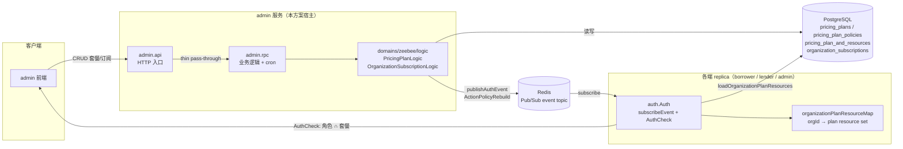
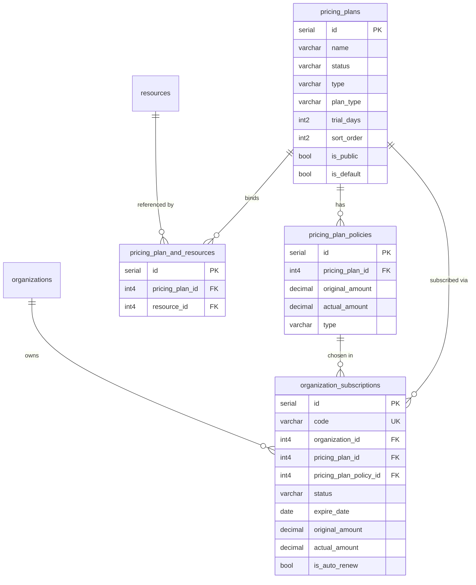
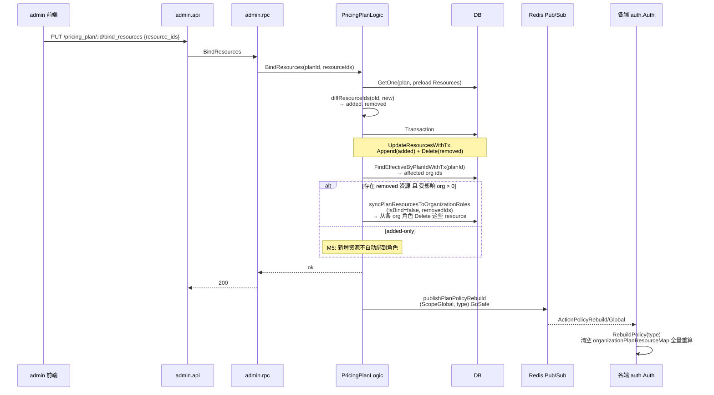
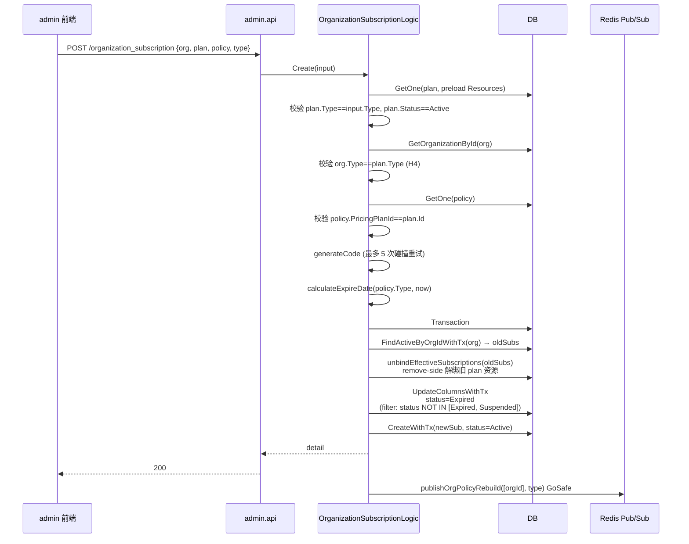
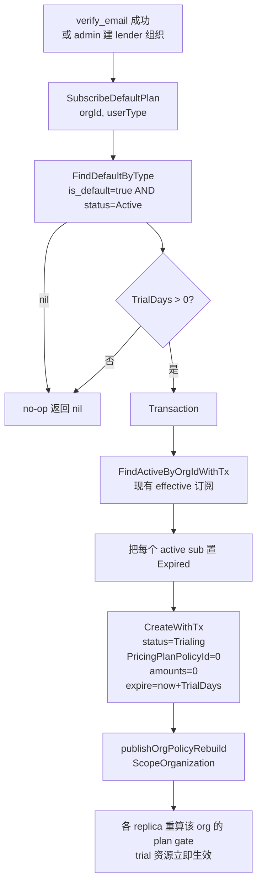
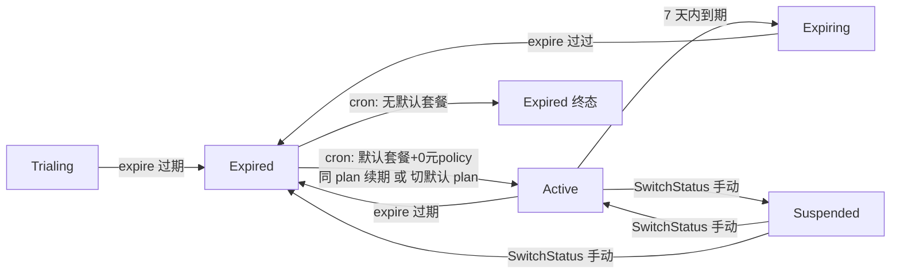
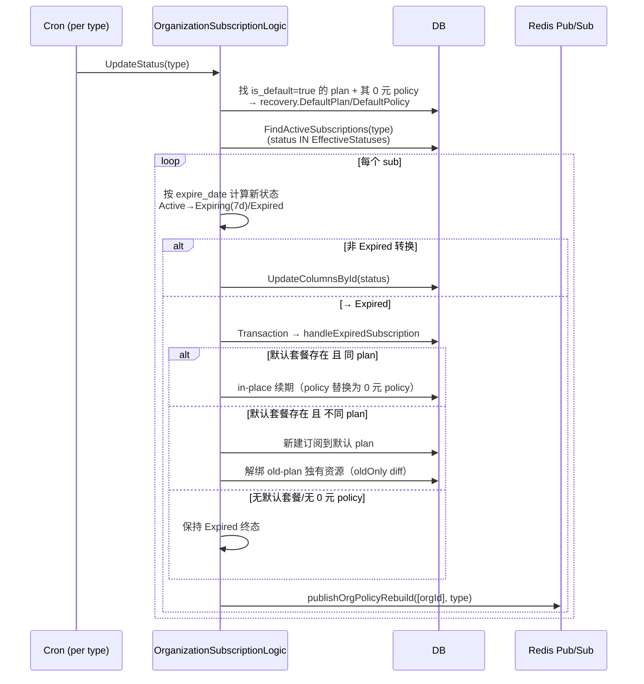
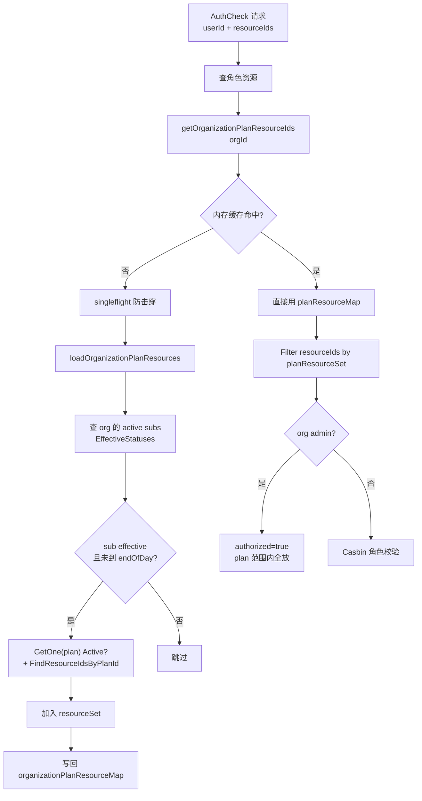

# 套餐管理（Pricing Plan & Subscription） — 技术方案设计

> 本文为 SaaS 多租户套餐与订阅管理的设计方案，所有结论以**已落地代码**为准；与早期 task 草稿的差异在文中标注。
>
> **来源**：`tasks/20260609_pricing_plan.md`（需求/早期设计）、`app/admin/api/desc/pricing_plan*.api`、`organization_subscription.api`、`app/admin/rpc/pb/admin_pricing_plan*.proto`、`admin_organization_subscription.proto`、`domains/zeebee/{model,repo,logic,auth,constants}`。
>
> **版本**：1.0 ｜ **日期**：2026-06-09

---

## 1. 背景

现有 SaaS 系统包含 Borrower / Lender / Admin 三端，已有角色与资源权限管理（Casbin）。组织可访问的功能由「角色资源」控制，但缺少一个**组织级、与计费挂钩的功能门控层**：组织买了什么套餐、套餐覆盖哪些资源、订阅是否生效、何时过期/续期，这些都没有结构化表达。结果是：

1. 功能控制只能在角色层做，无法按组织整体限流/限能。
2. 计费维度（月/季/年、标准/定制、试用期）散在业务代码里，不可配置。
3. 组织激活后没有默认能力——要么全开，要么全关，缺少「试用期 → 转正」这种状态流转。

本方案新增 **套餐管理（Pricing Plan） + 订阅管理（Organization Subscription）** 两个紧耦合模块，把组织级功能边界下沉为「套餐资源」，并把它作为角色权限的**门控前置层**（gate）：`最终权限 = 角色资源 ∩ 套餐资源`。

---

## 2. 目标与非目标

### 2.1 目标

| # | 目标 |
|---|------|
| G1 | **组织级功能控制**：套餐绑定资源（菜单/按钮等），动态圈定组织可访问功能范围。 |
| G2 | **计费策略管理**：每个套餐可定义月/季/年三种付费策略（policy），区分 `Standard` / `Custom` 两类。 |
| G3 | **订阅全生命周期**：组织可创建、续期、切换状态（Trialing / Active / Expiring / Expired / Suspended）；同组织新订阅自动使旧有效订阅失效。 |
| G4 | **试用期**：组织激活（邮箱验证 / admin 建组织）时，按默认套餐 `TrialDays` 创建 Trialing 订阅；0 元策略支持过期自恢复。 |
| G5 | **权限一致性**：套餐/订阅/绑定任何写操作 → 通过 Redis Pub/Sub 发布策略重建事件，各端 replica 重新计算「角色 ∩ 套餐」权限。 |
| G6 | **计划任务自动状态流转**：定时扫描有效订阅，按 `expire_date` 推进 Active → Expiring（7 天窗口）→ Expired；过期后用默认套餐 + 0 元策略兜底恢复访问。 |

### 2.2 非目标

- **不接支付**（目前未接入支付接口，仅支持 0 元试用，续期为 admin 端手动操作；自动续费字段 `is_auto_renew` 已建模但当前流程不真正扣款）。
- **不做加侧自动绑定**：套餐新增资源/启用套餐/订阅生效时**不自动**把资源绑到组织角色上；仅 remove-side（移除资源/禁用套餐/订阅失效）触发解绑。详见 §3.4「M5 不变量」。
- 不在本方案内重建权限缓存层（复用 `domains/zeebee/auth` 的既有 Casbin + Redis 架构）。
- 不在本方案内重构资源树（`resources` 表已存在，套餐通过 `pricing_plan_and_resources` 多对多引用）。

---

## 3. 总体方案

### 3.1 系统架构



要点：

- 套餐/订阅的**写入只发生在 admin 服务**（grep 全仓，`pricingplan` / `organizationsubscription` RPC client 仅在 admin 内被调用，无其他服务消费）。但**权限重建事件是跨服务广播**的：发布到各端 replica 订阅的 auth topic（按 `UserType` 路由：Borrower/Lender/Admin），各 replica 自行重建。
- API 层是薄壳：`PricingPlanCreateLogic` 等 api logic 仅做 `copierx.Trans` 后转发 RPC（`app/admin/api/internal/logic/pricing_plan/*.go`）；真正的业务逻辑在 domain 层 `PricingPlanLogic` / `OrganizationSubscriptionLogic`（`domains/zeebee/logic/`）。

### 3.2 功能架构

**A. 套餐管理（PricingPlan）**

- 创建/修改/删除/启停套餐；唯一性约束 `(name, type)`；`is_default` 在同一 `type` 下唯一（写时清旧默认）。
- 绑定资源（`BindResources`）：按 `ResourceIds` 增量 diff，**仅移除侧**触发对受影响组织角色的解绑 + 全局策略重建。
- 计费策略（policy）：每个套餐 N 条 `pricing_plan_policies`，`type ∈ {Monthly, Quarterly, Yearly}`；前端展示按月→季→年排序（`policyTypeOrder`）。

**B. 订阅管理（OrganizationSubscription）**

- 创建订阅：校验 plan/policy/org 类型一致 + plan 启用 → 使同组织其它有效订阅失效 → 建新订阅 + 计算初始 `expire_date`。
- 续期（`Renew`）：用当前订阅的 policy 重新计算 `expire_date`，从 `now` 或现有未过期 `expire_date`（取较晚）起算。
- 手动改过期时间（`UpdateExpireDate`）：Suspended 状态保持，其它状态按新日期派生 Active/Expired。
- 切换状态（`SwitchStatus`）：任意状态切换，触发 effective 边界穿越时的解绑逻辑。
- 计划任务（`UpdateStatus`，cron）：扫描有效订阅推进状态；Expired 用默认套餐兜底恢复。

**C. 权限门控（auth gate）**

- 各 replica 启动时 `auth.Auth.subscribeEvent` 订阅 Redis event topic。
- 收到 `ActionPolicyRebuild` 后按 `Scope` 分流：`ScopeGlobal` → `RebuildPolicy(type)`；`ScopeOrganization` → `RebuildPolicyForOrganization(orgId, type)`。
- `AuthCheck` 时：先角色资源 → 再用 `getOrganizationPlanResourceIds`（in-memory 缓存 + singleflight）做 plan gate 过滤 → 管理员在 plan 范围内全放。

### 3.3 模块划分

| 模块 | 路径 | 职责 |
|------|------|------|
| API 路由 | `app/admin/api/internal/handler/{pricing_plan,pricing_plan_policy,organization_subscription}/` | go-zero 生成 handler，无业务 |
| API 逻辑 | `app/admin/api/internal/logic/{pricing_plan,pricing_plan_policy,organization_subscription}/` | 薄壳：DTO↔proto 转换 + 调 RPC |
| RPC server | `app/admin/rpc/internal/server/{pricingplan,pricingplanpolicy,organizationsubscription}/` | proto 生成的 server |
| RPC client | `app/admin/rpc/client/{pricingplan,pricingplanpolicy,organizationsubscription}/` | 其它 admin logic 调用入口 |
| Domain 逻辑 | `domains/zeebee/logic/pricing_plan_logic.go` | 套餐 CRUD + 绑定 + 启停 + 发布全局重建事件 |
| Domain 逻辑 | `domains/zeebee/logic/pricing_plan_policy_logic.go` | 策略 CRUD |
| Domain 逻辑 | `domains/zeebee/logic/organization_subscription_logic.go` | 订阅 CRUD + 续期 + 默认套餐订阅 + cron 状态流转 + 解绑 |
| Model | `domains/zeebee/model/{pricing_plan,pricing_plan_policy,pricing_plan_and_resource,organization_subscription}.go` | GORM 模型 |
| Repo | `domains/zeebee/repo/{pricing_plan,pricing_plan_policy,pricing_plan_and_resource,organization_subscription}.go` | GORM 仓储，含事务版 |
| Constants | `domains/zeebee/constants/{pricing_plan,pricing_policy,organization_subscription}.go` | 枚举：PlanType / PolicyType / SubscriptionStatus + `EffectiveStatuses` |
| Auth gate | `domains/zeebee/auth/auth.go` | plan resource 缓存 + `AuthCheck` 门控 + `RebuildPolicy{,ForOrganization}` |
| DTO | `domains/zeebee/data/dto/{pricing_plan,pricing_plan_policy,organization_subscription}.go` | 跨层传输 |

> **设计纪律**：API logic 不持业务规则，domain logic 才是单一权威；写操作完成后**异步**发布 auth 事件（`threading.GoSafe` + `context.WithoutCancel`），不阻塞返回、不影响事务。

### 3.4 关键概念

- **Plan vs Policy**：`pricing_plans` 是可售套餐（`Standard`/`Custom`）；`pricing_plan_policies` 是该套餐下的付费方式（`Monthly`/`Quarterly`/`Yearly`），含 `original_amount` / `actual_amount`。一个 plan 可有多条 policy，但「同 plan + 同 policy.type」的约束由上层保证（详见 §8.1）。
- **Subscription**：组织 (`organization_id`) 在某时刻对某 `plan + policy` 的持有关系，带 `status` + `expire_date`。`code` 是面向用户的业务编号（`SU<yyyyMMddHHmmss><5位随机>`，`uniqueIndex`，最多重试 5 次碰撞）。
- **Effective（生效）**：`constants.EffectiveStatuses = {Active, Trialing, Expiring}`。**只有 effective 订阅才赋予套餐资源访问**。`Expired` 终态、`Suspended` 暂停都失访。`IsEffective()` 是 logic/repo/auth 三层共用的单一事实源。
- **Plan gate**：`最终权限 = 角色资源 ∩ 套餐资源`。在 `AuthCheck` 实现：先查角色资源，再用 `getOrganizationPlanResourceIds` 过滤掉不在 plan 范围内的资源；管理员在 plan 范围内全放。
- **M5 不变量（关键设计决策）**：**只有 remove-side 才解绑**——禁用套餐 / 删除套餐 / 移除套餐资源 / 订阅变 ineffective 时，从组织角色上移除对应资源；**add-side 从不自动绑定**——启用套餐 / 新增套餐资源 / 订阅变 effective 时，由 admin 手动配置角色-资源绑定，重建事件只重算 gate。代价：管理员须手动维护绑定；收益：避免「自动绑定 → 意外放大权限」的事故。
- **默认套餐**：`is_default = true` 且 `status = Active` 的套餐，每个 `type` 唯一。用于：(1) 组织激活时按 `TrialDays` 自动订阅；(2) cron 在订阅过期时用其 `0 元 policy` 兜底恢复访问。
- **重建事件 Scope**：`ScopeGlobal`（套餐级变更影响该 type 下所有组织）vs `ScopeOrganization`（订阅级变更只影响单个组织）。对应 handler：`RebuildPolicy` / `RebuildPolicyForOrganization`。

---

## 4. 数据模型与存储

### 4.1 实体关系



> 用户权限最终来源 = 角色资源 ∩ 套餐资源。`is_auto_renew` 已建模但当前流程未真正扣款（见 §2.2）。

### 4.2 数据库表结构

保留早期设计的 DDL（事实来源之一）。**注意：以下 DDL 为草稿态，与代码当前列集存在差异，差异列在表后列出。**

```sql
-- pricing_plans
CREATE TABLE "public"."pricing_plans"
(
    "id"          serial,
    "created_at"  timestamptz  NOT NULL DEFAULT now(),
    "updated_at"  timestamptz  NOT NULL DEFAULT now(),
    "is_del"      int2         NOT NULL DEFAULT 0,
    "name"        varchar(100) NOT NULL DEFAULT '',
    "subtitle"    varchar(255) NOT NULL DEFAULT '',
    "description" varchar(255) NOT NULL DEFAULT '',
    "status"      varchar(50)  NOT NULL DEFAULT 'Active',
    "trial_days"  int2         NOT NULL DEFAULT 0,
    "sort_order"  int2         NOT NULL DEFAULT 6,
    "is_public"   bool         NOT NULL DEFAULT false,
    "type"        varchar(50)  NOT NULL DEFAULT '',
    "plan_type"   varchar(50)  NOT NULL DEFAULT 'Standard',
    PRIMARY KEY ("id")
);

CREATE INDEX "idx_pricing_plan_name" ON "public"."pricing_plans" USING btree (
    "name"
    );

COMMENT
ON COLUMN "public"."pricing_plans"."status" IS 'Active,Disabled';
COMMENT
ON COLUMN "public"."pricing_plans"."type" IS 'Borrower,Lender,Admin';
COMMENT
ON COLUMN "public"."无pricing_plans标题"."plan_type" IS 'Standard,Custom';

-- pricing_plan_policies
CREATE TABLE "public"."pricing_plan_policies"
(
    "id"              serial,
    "created_at"      timestamptz    NOT NULL DEFAULT now(),
    "updated_at"      timestamptz    NOT NULL DEFAULT now(),
    "pricing_plan_id" int4           NOT NULL DEFAULT 0,
    "original_amount" decimal(10, 2) NOT NULL DEFAULT 0,
    "actual_amount"   decimal(10, 2) NOT NULL DEFAULT 0,
    "type"            varchar(20)    NOT NULL DEFAULT 'Monthly',
    PRIMARY KEY ("id")
)
;

CREATE INDEX "id_pr_policy_plan_id" ON "public"."pricing_plan_policies" USING btree (
    "pricing_plan_id"
    );

COMMENT
ON COLUMN "public"."pricing_plan_policies"."type" IS 'Monthly,Quarterly,Yearly';

-- pricing_plan_and_resources
CREATE TABLE "public"."pricing_plan_and_resources"
(
    "id"              serial,
    "pricing_plan_id" int4 NOT NULL DEFAULT 0,
    "resource_id"     int4 NOT NULL DEFAULT 0,
    PRIMARY KEY ("id")
)
;

CREATE INDEX "idx_pricing_plan_resource_plan_id" ON "public"."pricing_plan_and_resources" USING btree (
    "pricing_plan_id"
    );

CREATE INDEX "idx_pricing_plan_resource_resource_id" ON "public"."pricing_plan_and_resources" USING btree (
    "resource_id"
    );

-- organization_subscriptions
CREATE TABLE "public"."organization_subscriptions"
(
    "id"                     serial,
    "created_at"             timestamptz    NOT NULL DEFAULT now(),
    "updated_at"             timestamptz    NOT NULL DEFAULT now(),
    "is_del"                 int2           NOT NULL DEFAULT 0,
    "code"                   varchar(50)    NOT NULL DEFAULT '',
    "organization_id"        int4           NOT NULL DEFAULT 0,
    "pricing_plan_id"        int4           NOT NULL DEFAULT 0,
    "pricing_plan_policy_id" int4           NOT NULL DEFAULT 0,
    "status"                 varchar(50)    NOT NULL DEFAULT 'Active',
    "expire_date"            date           NOT NULL,
    "original_amount"        decimal(10, 2) NOT NULL DEFAULT 0,
    "actual_amount"          decimal(10, 2) NOT NULL DEFAULT 0,
    "is_auto_renew"          bool           NOT NULL DEFAULT false,
    PRIMARY KEY ("id")
);

CREATE UNIQUE INDEX "idx_org_subscri_code" ON "public"."organization_subscriptions" USING btree (
    "code"
    );

CREATE INDEX "idx_org_subscr_org_id" ON "public"."organization_subscriptions" USING btree (
    "organization_id"
    );

CREATE INDEX "idx_org_subscr_plan_id" ON "public"."organization_subscriptions" USING btree (
    "pricing_plan_id"
    );

CREATE INDEX "idx_org_subscr_policy_id" ON "public"."organization_subscriptions" USING btree (
    "pricing_plan_policy_id"
    );

CREATE INDEX ON "public"."organization_subscriptions" (
    );

COMMENT
ON COLUMN "public"."organization_subscriptions"."status" IS 'Trailing,Active,Expiring,Expired,Suspended';
```

**与代码的差异（以代码为准）**

| 表 | 差异 | 代码事实 |
|----|------|----------|
| `pricing_plans` | DDL 缺 `is_default` 列 | `model.PricingPlan.IsDefault`（`gorm:"column:is_default;type:bool;..."`），Create/Update 时保证同 type 下唯一默认 |
| `organization_subscriptions.status` 枚举 | DDL 注释写成 `Trailing`（拼写错误） | 代码常量为 `Trialing`（`constants.OrganizationSubscriptionStatusTrialing`） |
| `pricing_plan_policies` | DDL 无 `is_del`，但 `model.Base` 含软删 | `DeleteWithTx` 对 policy 走 `model.Base` 的软删；`pricing_plan_and_resources` 是 join 表，硬删 |

### 4.3 Redis 与缓存

无独立 Redis 键空间（与 003/004 不同），**复用 `domains/zeebee/auth` 既有的 Redis Pub/Sub event topic**：

| 用途 | 机制 | 说明 |
|------|------|------|
| 事件总线 | `redisCli.GetClient().Subscribe(ctx, l.eventTopic)` | `auth.Auth.subscribeEvent` 启动订阅，`publishAuthEvent` 发布 |
| Plan resource 内存缓存 | `organizationPlanResourceMap: map[int64]*mapx.Map[int64, bool]` | orgId → 允许的 plan resource id set；`golang/sync/singleflight` 防击穿；`RebuildPolicyForOrganization`/`ScopeOrganization` 重建后失效 |
| Casbin 策略 | enforcer 内部 | `ActionPolicyRebuild` 触发全量或单组织重算 |

事件消息（`auth.Msg`）：

```go
type Msg struct {
    Action             Action             // PolicyRebuild / ApiReload / ResourceReload / RoleReload / AllPolicyReload
    Scope              Scope              // Global / Organization / OrganizationUser
    Type               constants.UserType // Borrower / Lender / Admin
    OrganizationId     int64
    OrganizationUserId int64
    AddedPolicies      [][]string
    RemovedPolicies    [][]string
}
```

本方案只用 `ActionPolicyRebuild` + `Scope{Global, Organization}`。

### 4.4 配置

无独立 yaml，复用 admin 服务的 `app/admin/rpc/etc/config-*.yaml`。Cron 任务在配置中声明：

```yaml
CronTaskConf:
  - Name: update_organization_subscription_status
    Schedule: "<cron expr>"   # 推进订阅状态：Active→Expiring(7d)→Expired
```

在 `app/{admin,borrower,lender}/rpc/*.go` 各自 `RegisterCronTask` 中按 `task.Name == "update_organization_subscription_status"` 注册，分别对本 type 的订阅跑 `OrganizationSubscriptionLogic.UpdateStatus`。

---

## 5. 接口设计

### 5.1 HTTP 端点（admin.api，前缀 `/api/v1`）

**Pricing Plan**（写操作需对应服务重新加载权限）

| 方法 + 路径 | 说明 |
|------|------|
| `GET /api/v1/pricing_plan/page` | 分页（`keyword`/`status`/`type`/`plan_type` 过滤，按 `sort_order` + `created_at DESC`） |
| `GET /api/v1/pricing_plan/:id` | 套餐详情（preloads `Policies`/`Resources`） |
| `POST /api/v1/pricing_plan` | 新增套餐；`(name, type)` 唯一；`is_default` 同 type 下唯一 |
| `PUT /api/v1/pricing_plan/:id` | 修改套餐（`name` 不可改） |
| `DELETE /api/v1/pricing_plan/:id` | 删除套餐；存在 effective 订阅时拒绝 |
| `PUT /api/v1/pricing_plan/:id/bind_resources` | 绑定资源（增量 diff；**仅移除侧**解绑 + 全局重建） |
| `PUT /api/v1/pricing_plan/:id/status` | 启停（`Active`/`Disabled`）；仅禁用路径触发解绑 |
| `GET /api/v1/pricing_plan/:id/resource` | 套餐下资源列表 |
| `GET /api/v1/pricing_plan/all?type=` | 下拉选项（按 `type`，`is_public` 可选过滤） |

**Pricing Plan Policy**

| 方法 + 路径 | 说明 |
|------|------|
| `POST /api/v1/pricing_plan_policy` | 新增 policy（`type` ∈ Monthly/Quarterly/Yearly，`original_amount ≥ actual_amount`） |
| `PUT /api/v1/pricing_plan_policy/:id` | 修改 |
| `DELETE /api/v1/pricing_plan_policy/:id` | 删除 |

**Organization Subscription**（写操作需对应服务重新加载权限）

| 方法 + 路径 | 说明 |
|------|------|
| `GET /api/v1/organization_subscription/page` | 分页（join org/plan/policy） |
| `GET /api/v1/organization_subscription/:id` | 详情 |
| `POST /api/v1/organization_subscription` | 创建订阅（同组织其它有效订阅置为 Expired；Suspended 保留） |
| `POST /api/v1/organization_subscription/:id/renewal` | 续期（admin 端直接重算 `expire_date`，无支付） |
| `PUT /api/v1/organization_subscription/:id/expire_date` | 手动改过期时间（Suspended 不改状态，其它按日期派生） |
| `PATCH /api/v1/organization_subscription/:id/status` | 切换状态 |

**间接触发套餐逻辑的端点**（早期设计列出，代码确证）

| 端点 | 影响 |
|------|------|
| `POST /api/v1/organization/lender`（admin 建 lender 组织） | `create_lender_logic.go:85` 调 `SubscribeDefaultPlan(Lender)` |
| `POST /api/v1/user/verify_email`（Borrower/Lender 邮箱激活组织） | `user_logic.go:772` 对每个激活 org 调 `SubscribeDefaultPlan(userType)` |
| `GET /api/v1/user/menu` | 受 plan gate 影响 |
| `GET /api/v1/resource/tree` | 限制在套餐范围内 |
| 组织禁用（`OrganizationLogic.Update`） | `organization_logic.go:259` 调 `SuspendEffectiveByOrganizationId` |

> **与早期设计的差异**：草稿提到「Borrower/Lender 验证邮箱激活组织时」选默认套餐；代码实际是 `verify_email` 对所有 type 通用地在激活后调 `SubscribeDefaultPlan`。另外 lender 端自建组织路径（`app/lender/rpc/internal/logic/organization/create_logic.go:110`）当前**注释掉了** `SubscribeDefaultPlan`，仅 admin 建 lender + verify_email 两条路径会真正订阅默认套餐。

### 5.2 RPC 列表（admin.rpc）

| Service | Method |
|---------|--------|
| `PricingPlan` | `Create` / `Update` / `Delete` / `Detail` / `Page` / `SwitchStatus` / `BindResources` / `ResourceList` / `All` |
| `PricingPlanPolicy` | `Create` / `Update` / `Delete` |
| `OrganizationSubscription` | `Create` / `Renew` / `UpdateExpireDate` / `SwitchStatus` / `Page` / `Detail` |

> 改 proto/api 后须 `make create-service admin` 重生成。

### 5.3 关键 schema

```go
// pricing_plan.api（节选）
type PricingPlanCreateRequest {
    Name     string `json:"name" validate:"required,min=1,max=100"`
    Type     string `json:"type" validate:"required,oneof=Borrower Lender Admin"`
    PlanType string `json:"plan_type" validate:"required,oneof=Standard Custom"`
    TrialDays int16 `json:"trial_days,optional"`
    SortOrder int16 `json:"sort_order,optional"`
    IsPublic  bool  `json:"is_public"`
    IsDefault bool  `json:"is_default"`
    // ...
}
type PricingPlanBindResourcesRequest {
    Id          int64   `path:"id" validate:"required,gt=0"`
    ResourceIds []int64 `json:"resource_ids" validate:"required,dive,gt=0"`
}

// organization_subscription.api（节选）
type OrganizationSubscriptionCreateRequest {
    OrganizationId      int64 `json:"organization_id"      validate:"required,gt=0"`
    PricingPlanId       int64 `json:"pricing_plan_id"       validate:"required,gt=0"`
    PricingPlanPolicyId int64 `json:"pricing_plan_policy_id" validate:"required,gt=0"`
    Type string `json:"type" validate:"required,oneof=Borrower Lender Admin"`
}
```

---

## 6. 核心流程

### 6.1 套餐绑定资源（remove-side 解绑 + 全局重建）



### 6.2 创建订阅（使旧订阅失效 + 默认套餐试用）



> `calculateExpireDate`：按 policy.type 推 N 个完整自然月（Monthly=1 / Quarterly=3 / Yearly=12），`expire = addMonthsClamped(base - 1day, N)`，day 钳到目标月最后一天（避免 Jan 31 + 1M 溢出到 3 月）。月度 Jan 1 → Jan 31；Jan 31 → Feb 28/29。

### 6.3 默认套餐试用订阅（组织激活触发）



> 「0 元策略 + 默认套餐」兜底：另见 §6.4 cron 的 `handleExpiredSubscription`——过期时若存在默认套餐 + `ActualAmount==0` 的 policy，自动续到默认套餐上，避免组织彻底失访。

### 6.4 订阅状态机 + cron 自动流转



cron（`UpdateStatus`，每 type 独立跑）流程：



### 6.5 权限门控（AuthCheck）



> 关键不变量：`isSubscriptionExpired` 把 expire_date 当作「到当天最后一秒」有效（`endOfDay = expire + 24h - 1s`），与 cron 的日级推进对齐。plan gate 是**角色权限的超集约束**：不在 plan 范围内的资源，无论角色如何配置都被拦。

---

## 7. 风险与权衡

| 风险 | 权衡 | 缓解 |
|------|------|------|
| **M5：add-side 不自动绑** | 避免意外放大权限；代价：管理员须手动配角色-资源 | 重建事件保证 gate 实时重算；订阅生效即可见，绑定靠人工 |
| **0 元策略兜底自恢复** | 保证组织不彻底失访；代价：过期后偷偷切默认套餐 | 仅当存在 `is_default + ActualAmount==0` 时触发；同 plan 续期、跨 plan 才切；解绑仅 old-only |
| **Redis Pub/Sub 易丢事件** | 解耦、跨副本广播；pub/sub 无持久化 | 副本重启后会重新订阅；`RebuildPolicy` 是幂等全量重算 |
| **plan resource 缓存与 DB 短暂不一致** | singleflight 防击穿 + 内存缓存快 | 任何写操作都广播 `ActionPolicyRebuild`，对应 scope 失效缓存 |
| **cron 每副本独立跑** | 实现简；多副本会重复扫 | 状态更新幂等（同 sub 重复推进到同状态无副作用）；重复 publish 只是多算几次 |
| **is_default 同 type 唯一靠应用层** | DB 未加部分唯一索引 | Create/Update 在事务内先清旧默认再写新默认（`UpdateColumnsWithTx`） |
| **status 拼写漂移** | 早期 DDL 注释 `Trailing`，代码常量 `Trialing` | 以代码为准；`Validate()` 强校验枚举值 |
| **自动续费未落地** | `is_auto_renew` 已建模但无支付 | 当前 admin 手动 Renew；接入支付时该字段直接复用 |

---

## 8. 实现要点

### 8.1 关键不变量（改动前必读）

1. **最终权限 = 角色资源 ∩ 套餐资源**：plan gate 在 `AuthCheck` 中是角色权限的超集约束。
2. **M5：add-side 不自动绑，remove-side 必解绑**：禁用套餐 / 删套餐 / 移资源 / 订阅变 ineffective 触发解绑；启用 / 加资源 / 订阅变 effective 不自动绑。
3. **EffectiveStatuses 单一事实源**：`constants.EffectiveStatuses = {Active, Trialing, Expiring}`，logic / repo / auth 三层共用 `IsEffective()`，不重复定义。
4. **`(name, type)` 唯一**：Create 时 `ExistsByNameAndType` 校验；name 在 Update 时不可改（api 层 `UpdateRequest` 无 name 字段）。
5. **`is_default` 同 type 唯一**：Create/Update 在事务内 `UpdateColumnsWithTx` 清旧默认。
6. **删除阻塞**：存在 effective 订阅的 plan 不可删（`Delete` → `FindEffectiveByPlanIdWithTx` → 非空拒绝）。
7. **事件异步、不污染事务**：`threading.GoSafe` + `context.WithoutCancel(ctx)`，保证事务提交后再发布，但发布失败不回滚业务。
8. **同 plan + 同 policy.type 唯一**：当前未在 DB 加约束、repo 也未显式校验，依赖上层 policy CRUD 保证（**已标红：建议加应用层校验或 DB 部分唯一索引**）。

### 8.2 构建顺序（建议）

1. 模型与迁移：`pricing_plans.is_default` 列补齐（DDL 草稿缺）；`organization_subscriptions.status` 注释订正为 `Trialing`。
2. Repo：事务版 `FindActiveByOrgIdWithTx` / `FindEffectiveByPlanIdWithTx` / `UpdateResourcesWithTx`。
3. Domain 逻辑：`PricingPlanLogic` 增删改查 + 绑定 + 启停；`OrganizationSubscriptionLogic` CRUD + 续期 + 默认订阅 + cron。
4. Auth gate：`loadOrganizationPlanResources` + `AuthCheck` 过滤 + `RebuildPolicy{,ForOrganization}`。
5. RPC + API：proto + api 描述 + `make create-service admin` 重生成。
6. Cron 注册：admin / borrower / lender 三个 rpc 各自注册 `update_organization_subscription_status`。

### 8.3 测试覆盖

| 层 | 测试 |
|----|------|
| Domain | `pricing_plan_logic_test.go` / `organization_subscription_logic_test.go`：name+type 唯一、is_default 切换、删除阻塞、renew 续期、SubscribeDefaultPlan trial 创建、calculateExpireDate 月末钳制 |
| Effective | `OrganizationSubscriptionStatus.IsEffective()` 边界（Active/Trialing/Expiring 为 true，Expired/Suspended 为 false） |
| cron | `UpdateStatus`：Active→Expiring（7d 内）→Expired；Expired + 默认套餐 → 同 plan 续期 / 跨 plan 切换 + old-only 解绑 |
| 解绑 | remove-side：`syncPlanResourcesToOrganizationRoles(IsBind=false)`；add-side 不动 |
| 缓存 | `loadOrganizationPlanResources`：无 effective sub 返回空 set；过期 sub 被过滤 |
| 枚举 | `pricing_plan_test.go`：PlanType / PolicyType / SubscriptionStatus 的 `Validate()` |

---

## 9. 附录：与早期草稿的差异（以代码为准）

| 项 | 草稿 | 实际代码 |
|----|------|----------|
| `pricing_plans.is_default` 列 | DDL 未含 | 代码有，Create/Update 保证同 type 唯一 |
| `organization_subscriptions.status` 枚举 | `Trailing`（拼写） | `Trialing`（`constants.OrganizationSubscriptionStatusTrialing`） |
| 权限刷新机制 | 「Redis Pub/Sub + Casbin」（笼统） | 具体为 `auth.Msg{Action: ActionPolicyRebuild, Scope: Global/Organization}` 经 event topic 广播，`handlePolicyRebuild` 按 scope 分流 |
| 自动续费 | 草稿描述「自动支付验证」 | 代码无支付：admin 手动 `Renew`；cron 仅推进状态 + 默认套餐兜底 |
| `verify_email` 影响面 | 仅 Borrower/Lender | 代码对所有 type 通用（`user_logic.go:772` 对每个激活 org 调） |
| lender 自建组织 | 草稿未提 | `app/lender/.../organization/create_logic.go:110` 当前**注释掉** SubscribeDefaultPlan |
| policy.type 同 plan 唯一 | 草稿描述「同一种付费方式只能有一种」 | 代码未强制（DB 无约束、repo 未校验）—— 待加应用层校验（见 §8.1 #8） |
| `expire_date` 计算 | 草稿未描述 | `addMonthsClamped`：N 自然月（含起始日），月末钳制；与草稿无冲突但更精确 |
