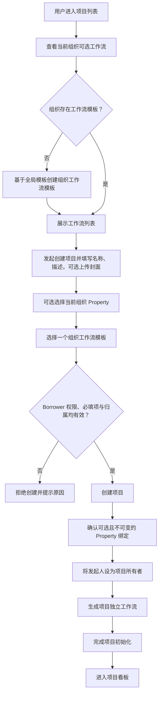
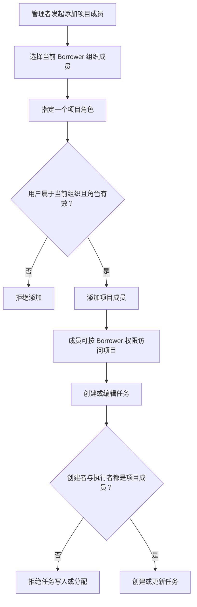
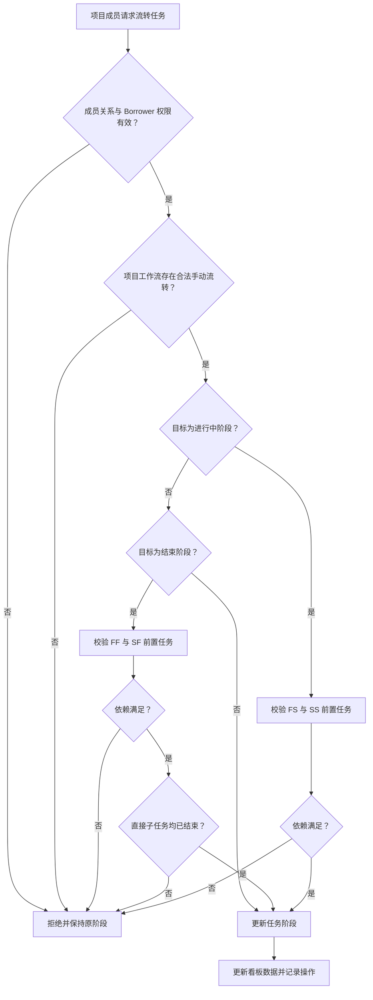
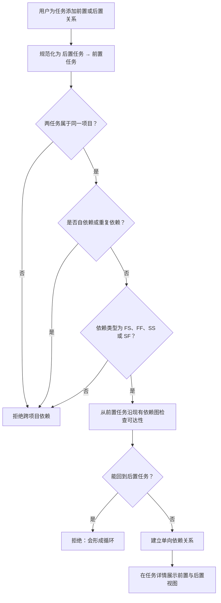
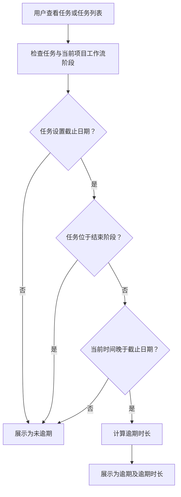

# PRD：Borrower 项目管理模块

**版本：** 1.1  
**日期：** 2026-08-14  
**状态：** 已确认

## 1. 概述

项目管理作为 Borrower 的内部模块提供，不再建设独立服务、独立账号体系、独立组织体系或独立组织角色体系。

模块复用 Borrower 已有的用户、组织、组织成员和权限管理能力，并在 Borrower 组织内提供以下业务链路：

`Borrower 组织 → 项目 → 项目工作流 → 工作流阶段 → 任务 → 子任务 / 任务依赖 / 附件`

项目创建时可选择绑定一个 Borrower Property，也可不绑定。绑定仅允许在创建时完成，后续不可新增、更换或解除。

创建项目时，用户选择一个工作流模板，系统生成该项目独立的项目工作流。项目工作流可在项目内修改，不回写原模板，也不受后续模板修改影响。

任务类型属于 Borrower 组织级配置。组织级任务类型可以新增、编辑、删除和启停；后续任务类型调整不影响已创建任务的类型展示和历史信息。

## 2. 目标

- 将项目管理整合至 Borrower，复用已有组织和权限能力。
- 支持项目与 Borrower Property 的可选、不可变关联。
- 通过工作流模板快速初始化项目，并允许项目独立调整工作流。
- 支持组织级任务类型统一管理，并保证存量任务类型稳定。
- 支持项目成员协作、任务分配、子任务和附件。
- 支持前置与后置任务关系，并阻止循环依赖。
- 支持按依赖类型阻止任务过早进入进行中或结束阶段。
- 实时展示任务逾期状态和逾期时长，不发送提醒或通知。

## 3. 本期范围

- Borrower 项目管理入口和权限衔接。
- 项目创建、查询、编辑、删除。
- 创建时可选绑定 Property，且后续不可变更。
- 项目成员管理及项目角色分配。
- 组织级工作流模板管理。
- 创建项目时生成独立项目工作流。
- 项目工作流阶段、顺序和手动流转关系维护。
- 组织级任务类型管理。
- 任务创建、编辑、删除、分配和看板展示。
- 子任务创建和管理。
- 任务附件上传、查看、下载和删除。
- 前置/后置任务关系及四类依赖校验。
- 任务手动阶段流转。
- 任务逾期状态和逾期时长实时计算。
- 我的任务和基础操作记录。

## 4. 非目标

- 独立项目管理服务、账号、登录、组织或组织级角色体系。
- 创建后修改项目 Property 绑定。
- 自动流转和定时流转；二者仍处于产品构思阶段，本期不提供相关能力。

## 5. 用户与权限边界

### 5.1 Borrower 组织权限

Borrower 组织的角色、资源权限和成员管理均由用户通过现有 Borrower 能力维护。项目管理模块只复用当前用户的组织上下文和授权结果，不自行创建或管理组织级角色。

用户能否访问项目管理菜单、创建项目、维护工作流模板、维护组织级任务类型，由 Borrower 已有权限配置决定。

### 5.2 项目成员与项目角色

项目成员必须属于当前 Borrower 组织。只有项目成员可以创建任务或作为任务执行者。

每位项目成员在一个项目中暂时只能拥有一个项目角色：

| 项目角色 | 说明 |
| --- | --- |
| 所有者 | 项目最终责任人。项目创建者默认为所有者；一个项目只能有一名所有者。 |
| 管理者 | 在 Borrower 授权范围内管理项目成员、项目配置、工作流和任务。 |
| 执行者 | 在 Borrower 授权范围内创建、处理和执行项目任务。 |

具体操作权限仍以 Borrower 的角色资源授权为准；项目角色用于约束用户在单一项目中的成员关系与可操作范围。

## 6. 用户故事

### US-001：在 Borrower 中使用项目管理

**描述：** 作为 Borrower 用户，我希望直接在当前组织中使用项目管理，以便不需要登录或切换到独立系统。

**验收标准：**

- [ ] 项目管理使用当前 Borrower 用户和组织上下文。
- [ ] 用户只能访问当前 Borrower 组织范围内的项目、任务、工作流模板和任务类型。
- [ ] 系统不创建独立账号、组织、组织成员或组织级项目角色。
- [ ] 无对应 Borrower 权限的用户不能访问受保护的项目管理功能。

### US-002：管理组织级工作流模板

**描述：** 作为有权限的 Borrower 用户，我希望维护组织级工作流模板，以便创建项目时复用标准流程。

**验收标准：**

- [ ] 用户可创建、查看、编辑、启用和停用当前组织的工作流模板。
- [ ] 每个组织可同时维护多个工作流模板。
- [ ] 模板包含名称、描述、阶段、阶段属性、阶段顺序和合法流转关系。
- [ ] 每个模板必须且只能有一个“待开始”阶段。
- [ ] 每个模板允许多个“进行中”阶段和多个“结束”阶段。
- [ ] 阶段名称可自定义，阶段属性只能为“待开始”“进行中”或“结束”。
- [ ] 每个组织始终恰好拥有一个默认工作流模板；默认模板不可停用、不可删除。
- [ ] 用户可删除或停用非默认工作流模板；设置新的默认模板时，原默认模板自动恢复为普通模板。
- [ ] 模板变更不修改已创建项目的项目工作流。

### US-003：管理组织级任务类型

**描述：** 作为有权限的 Borrower 用户，我希望管理组织级任务类型，以便统一项目任务的分类来源。

**验收标准：**

- [ ] 用户可新增、编辑、删除、启用和停用组织级任务类型。
- [ ] 任务类型至少包含名称、描述和展示颜色。
- [ ] 新建任务只能选择当前组织内已启用的任务类型。
- [ ] 编辑、停用或删除任务类型后，已创建任务保留原有任务类型信息。
- [ ] 删除已被任务使用的类型不删除或修改已有任务。

### US-004：创建项目并选择 Property 与工作流

**描述：** 作为有权限的 Borrower 用户，我希望创建项目时可选择 Property 和工作流模板，以便在正确的业务上下文中启动项目。

**验收标准：**

- [ ] 创建项目必须填写项目名称并选择一个当前组织可用的工作流模板；系统默认选中组织默认工作流模板。
- [ ] 用户打开创建项目时，系统展示当前组织可用的工作流模板；组织没有任何启用的模板时，系统自动基于全局模板创建一个组织工作流模板、设为默认模板后展示。
- [ ] 创建项目时可选择上传项目封面。
- [ ] 创建项目时可选择当前 Borrower 组织内的一个 Property。
- [ ] 创建项目时可不绑定任何 Property。
- [ ] 项目创建后不得新增、更换或解除 Property 绑定。
- [ ] 创建者自动成为该项目唯一的初始所有者。
- [ ] 系统从所选模板生成独立的项目工作流。
- [ ] 项目创建失败时，不得展示未完成的项目、项目成员或项目工作流。

### US-005：维护项目成员

**描述：** 作为有权限的项目成员，我希望将组织成员加入项目并指定项目角色，以便安排项目协作。

**验收标准：**

- [ ] 添加项目成员时，候选用户必须属于当前 Borrower 组织。
- [ ] 添加项目成员时支持按邮箱或姓名关键词搜索，快速定位当前 Borrower 组织成员；搜索范围仅限当前组织。
- [ ] 添加项目成员时必须指定所有者、管理者或执行者中的一个项目角色。
- [ ] 一个项目成员在同一项目中只能有一个项目角色。
- [ ] 一个项目必须始终保留且仅保留一名所有者。
- [ ] 移除所有者前必须先完成所有者转移。
- [ ] 所有者转移成功后，原所有者降级为任务执行者。
- [ ] 任务执行者（可多个）必须是当前项目成员。
- [ ] 创建任务的用户必须是当前项目成员。
- [ ] 移除项目成员仅解除成员关系并记录操作；其创建的任务和执行者身份记录全部保留，任务创建者、执行者展示不变。
- [ ] 成员被移出 Borrower 组织时，系统仅级联移除其组织内所有项目的成员关系；任务创建者和执行者记录保留，展示不变。
- [ ] 系统不允许添加 viewer、观察者或外部执行者角色。

### US-006：修改项目工作流

**描述：** 作为有权限的项目成员，我希望在项目内修改工作流，以便流程适应项目实际执行需要。

**验收标准：**

- [ ] 项目工作流在项目创建时由工作流模板复制生成。
- [ ] 有权限的用户可在项目内查看和修改阶段、阶段属性、阶段顺序及手动流转关系。
- [ ] 用户可为每条流转边配置允许执行者类型（所有者、管理者、任务创建者、任务执行者）；未配置时所有项目成员均可执行该流转。
- [ ] 项目工作流必须始终保留一个且仅一个待开始阶段。
- [ ] 项目工作流允许多个进行中阶段和结束阶段。
- [ ] 阶段被未删除任务引用时，系统拒绝删除该阶段。
- [ ] 项目工作流变更不回写组织级工作流模板。

### US-007：创建和维护任务、子任务与附件

**描述：** 作为项目成员，我希望创建任务、子任务并添加附件，以便管理实际工作内容。

**验收标准：**

- [ ] 新任务必须归属当前项目，并默认进入项目唯一待开始阶段。
- [ ] 任务可填写标题、描述、优先级、组织级任务类型、多名执行者、开始日期和截止日期；创建任务时优先级和当前组织已启用的任务类型为必填，一个任务可同时分配多名执行者。
- [ ] 执行者必须是当前项目成员。
- [ ] 用户可为任务创建子任务；子任务必须与父任务属于同一项目。
- [ ] 父任务处于结束阶段后，不可再创建子任务。
- [ ] 父任务进入任一结束阶段前，其未删除的直接子任务必须全部处于结束阶段。
- [ ] 有任务编辑权限的项目成员可上传、查看、下载和删除任务附件。
- [ ] 附件操作必须实时校验项目成员关系和任务权限。
- [ ] 用户在删除项目或任务前必须完成二次确认。

### US-008：维护前置与后置任务

**描述：** 作为项目成员，我希望设置前置和后置任务，以便表达任务执行顺序并避免依赖冲突。

**验收标准：**

- [ ] 用户可为任务添加、修改和删除前置任务关系。
- [ ] 用户可从后置任务视图管理同一依赖关系。
- [ ] 前置和后置仅为查看方向，不重复存储两条关系。
- [ ] 依赖任务必须属于同一个项目。
- [ ] 系统拒绝任务依赖自身。
- [ ] 系统拒绝重复的同方向依赖。
- [ ] 系统拒绝任何长度的依赖环。
- [ ] 已离开待开始阶段的任务不可新增前置依赖。
- [ ] 系统支持 FS、FF、SS、SF 四种依赖类型。

### US-009：手动流转任务并实时返回逾期状态

**描述：** 作为项目成员，我希望手动推进任务并查看逾期状态，以便掌握任务进度和时间风险。

**验收标准：**

- [ ] 用户只能按项目工作流已配置的合法流转关系手动流转任务。
- [ ] 流转边配置了允许执行者类型时，仅命中类型的项目成员可执行该流转；未配置时所有项目成员均可。
- [ ] 处于待开始阶段的任务可直接流转至结束阶段（如工作流配置了该流转边）；FS 与 SS 依赖不阻止该流转。
- [ ] 本期不展示、配置或执行自动流转与定时流转。
- [ ] FS 和 SS 依赖未满足时，系统拒绝任务进入任一进行中阶段。
- [ ] FF 和 SF 依赖未满足时，系统拒绝任务进入任一结束阶段。
- [ ] 任务进入结束阶段前仍须校验直接子任务均已结束。
- [ ] 流转失败时，任务保留在原阶段并返回具体阻断原因。
- [ ] 任务详情和任务列表实时展示有截止日期且尚未处于结束阶段任务的逾期状态。
- [ ] 逾期任务实时展示逾期时长。
- [ ] 不创建任何逾期提醒或通知。

### US-010：查看我的任务与操作记录

**描述：** 作为项目成员，我希望查看自己相关的任务和关键操作记录，以便追踪执行工作和项目变更。

**验收标准：**

- [ ] 用户仅可查询分配给本人的任务；仅由本人创建但未分配给本人的任务不属于“我的任务”。
- [ ] 我的任务支持按项目、阶段、任务类型、是否逾期和关键词筛选。
- [ ] 任务创建、编辑、成员变更、依赖变更、附件变更和阶段流转产生基础操作记录。
- [ ] 操作记录归属具体项目：任务、附件、成员、项目工作流等操作均记录在其所属项目下，支持按项目查看操作时间线。
- [ ] 操作记录至少包含操作人、操作时间、操作类型、归属项目和关联任务（如有）。
- [ ] 系统不提供评论记录或通知记录。

## 7. 功能需求

- FR-1：系统必须作为 Borrower 内部模块运行。
- FR-2：系统必须使用当前 Borrower 用户身份和组织上下文。
- FR-3：系统必须使用 Borrower 权限结果控制项目管理功能访问。
- FR-4：系统不得创建独立组织级项目角色。
- FR-5：系统必须只提供所有者、管理者和执行者三种项目角色。
- FR-6：系统必须要求项目成员属于当前 Borrower 组织。
- FR-7：系统必须要求新增项目成员时指定一个项目角色。
- FR-8：系统必须禁止非项目成员创建任务。
- FR-9：系统必须禁止将非项目成员指定为任务执行者。
- FR-10：系统必须支持创建项目时可选绑定一个当前组织的 Property。
- FR-11：系统必须禁止修改已创建项目的 Property 绑定。
- FR-12：系统必须要求创建项目时选择工作流模板。
- FR-13：系统必须为每个新项目生成独立工作流。
- FR-14：系统必须支持组织级任务类型的新增、编辑、删除和启停。
- FR-15：系统必须在任务类型调整后保留已创建任务的原有类型信息。
- FR-16：系统必须要求每个工作流只有一个待开始阶段。
- FR-17：系统必须允许多个进行中阶段。
- FR-18：系统必须允许多个结束阶段。
- FR-19：系统必须将新任务放入项目待开始阶段。
- FR-20：系统必须支持任务子任务关系。
- FR-21：系统必须支持任务附件。
- FR-22：系统必须支持 FS、FF、SS、SF 四种任务依赖类型。
- FR-23：系统必须拒绝跨项目依赖。
- FR-24：系统必须拒绝循环依赖。
- FR-25：系统必须只支持手动任务流转。
- FR-26：系统必须实时展示未完成任务的逾期状态和逾期时长。
- FR-27：系统不得提供评论功能。
- FR-28：系统不得提供通知或提醒功能。
- FR-29：系统不得实现自动或定时流转机制。
- FR-30：系统必须允许一个 Borrower 组织维护多个工作流模板。
- FR-31：系统必须允许编辑、停用和删除非默认组织工作流模板；默认模板不可停用、不可删除，每个组织始终恰好拥有一个默认模板。
- FR-32：系统必须在用户创建项目时检查当前组织是否存在启用的组织工作流模板。
- FR-33：系统必须在当前组织没有启用的模板时，自动基于全局模板创建一个组织工作流模板、设为默认模板并供用户选择。
- FR-34：系统必须允许创建项目时可选上传项目封面。
- FR-35：系统必须支持为每条流转边配置允许执行者类型（所有者、管理者、任务创建者、任务执行者）；未配置时所有项目成员均可执行该流转。
- FR-36：系统必须允许多名项目成员同时作为一个任务的执行者。
- FR-37：系统必须拒绝为已离开待开始阶段的任务新增前置依赖。
- FR-38：系统必须拒绝在处于结束阶段的父任务下创建子任务。
- FR-39：系统必须允许修改工作流阶段属性，即使阶段仍被任务引用；修改后工作流必须仍恰好保留一个待开始阶段。
- FR-40：移除项目成员或成员被移出组织时，系统必须仅解除成员关系；已创建任务的创建者和执行者记录必须原样保留，展示不受影响。
- FR-41：系统必须允许任务从待开始阶段直接流转至结束阶段；FS 与 SS 依赖仅阻止进入进行中阶段。
- FR-42：设置新的默认工作流模板时，系统必须自动解除原默认模板的默认身份。
- FR-43：创建项目时系统必须默认选中默认工作流模板。
- FR-44：系统必须支持添加项目成员时按邮箱和姓名搜索当前 Borrower 组织成员。
- FR-45：创建任务时系统必须要求优先级为 Low、Medium、High 或 Critical，且必须选择当前组织已启用的任务类型。
- FR-46：我的任务仅返回分配给当前用户的任务，不以任务创建者身份纳入结果。
- FR-47：用户删除项目或任务前必须完成二次确认。
- FR-48：用户可以在一次编辑中修改或清空任务的可编辑信息，包括描述、日期和执行者。
- FR-49：所有权转移成功后，原所有者必须降级为任务执行者。
- FR-50：不提供独立任务执行者更新和附件分页接口；执行者由任务创建或更新请求维护，附件通过任务详情读取。

## 8. 关键业务规则

1. 项目、工作流模板、任务类型、任务和附件均仅在当前 Borrower 组织内可访问。
2. 任务类型是组织级资源，不创建项目任务类型副本；后续类型变更不影响已有任务的类型信息。
3. 项目与 Property 的绑定可为空，但一经创建即不可变更。
4. 工作流阶段名称可自定义；阶段属性只能为“待开始”“进行中”“结束”。阶段属性允许修改，即使阶段仍有任务停留；修改后工作流必须仍恰好保留一个待开始阶段，属性改为“结束”时该阶段任务即刻视为已完成。
5. 任务进入任一结束阶段即视为完成；从结束阶段流转回非结束阶段时，任务恢复为未完成。
6. 依赖以“后置任务 → 前置任务”的单向关系存储；前置与后置只是同一关系的不同查询方向。
7. FS：前置任务完成后，后置任务才能开始。
8. FF：前置任务完成后，后置任务才能结束。
9. SS：前置任务开始后，后置任务才能开始。
10. SF：前置任务开始后，后置任务才能结束。
11. 前置任务“开始”指其已离开待开始阶段，进入任一进行中或结束阶段；前置任务“完成”指其位于任一结束阶段。
12. FS 与 SS 依赖仅阻止任务进入进行中阶段；工作流配置了待开始到结束的流转边时，任务可直接流转至结束阶段，FS 与 SS 不阻止该流转。
13. 当任务设置了截止日期、当前时间晚于截止日期且任务不在结束阶段时，系统实时展示逾期状态和逾期时长；逾期不触发提醒或通知。
14. 父任务进入结束阶段前，所有未删除的直接子任务必须已处于结束阶段；父任务处于结束阶段后不可再创建子任务。
15. 已离开待开始阶段的任务不可新增前置依赖。
16. 每个组织可维护多个工作流模板；创建项目时必须从当前组织的可用模板中选择一个，系统默认选中默认模板。
17. 非默认工作流模板可编辑、删除和停用；默认模板不可停用、不可删除，组织因此始终至少保留一个可用模板。
18. 用户创建项目时，若当前组织没有启用的模板，系统自动基于全局模板创建一个组织模板、设为默认模板并展示为可选模板。
19. Property 被删除后，已绑定该 Property 的项目保留原绑定信息；从项目访问 Property 详情时，按现有 Borrower 行为返回记录不存在。
20. “执行者必须是项目成员”仅在分配执行者时校验；移除项目成员或组织成员不影响存量任务的创建者和执行者展示。
21. 编辑任务时，用户可以清空描述、日期和执行者等可编辑信息。
22. “我的任务”以任务执行者关系判断，不包含仅由当前用户创建的任务。
23. 所有者转移后，原所有者的项目角色为任务执行者。

## 9. 重要与复杂流程

### 9.1 创建项目并初始化项目工作流

项目未选择 Property 时，步骤 L 不生成 Property 关联；项目创建失败时，不展示未完成的项目、项目成员或项目工作流。

### 9.2 添加项目成员并分配任务

项目成员每人只有一个项目角色；执行者不得自动加入项目，必须先被显式加入并分配角色。

### 9.3 任务手动流转与依赖校验

只有手动流转可执行。依赖或子任务校验失败时，系统应展示被阻断的原因和相关任务，且不得改变原任务阶段。

### 9.4 建立前置/后置任务关系并检测环

前置和后置是同一条依赖关系的两个查看方向。系统必须阻止任何循环依赖。

### 9.5 查询任务时实时计算逾期

逾期状态和逾期时长在用户查看任务时实时展示，不发送提醒或通知。

## 10. 成功指标

- 有权限的 Borrower 用户可在一次创建流程中完成项目、可选 Property 绑定和工作流初始化。
- 项目成员均来自当前组织，且每人只有一个项目角色。
- 非项目成员无法创建任务或被指定为任务执行者。
- 系统拒绝任何任务依赖环。
- 依赖未满足时，任务无法进入相应的进行中或结束阶段。
- 组织级任务类型变更不改变已创建任务的类型信息。
- 任务详情和任务列表能正确展示未完成任务的实时逾期状态和逾期时长。
- 本期不存在评论、通知、提醒、自动流转或定时流转入口。
