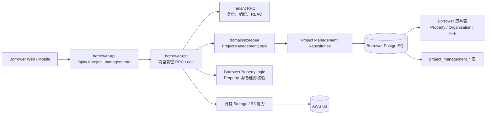
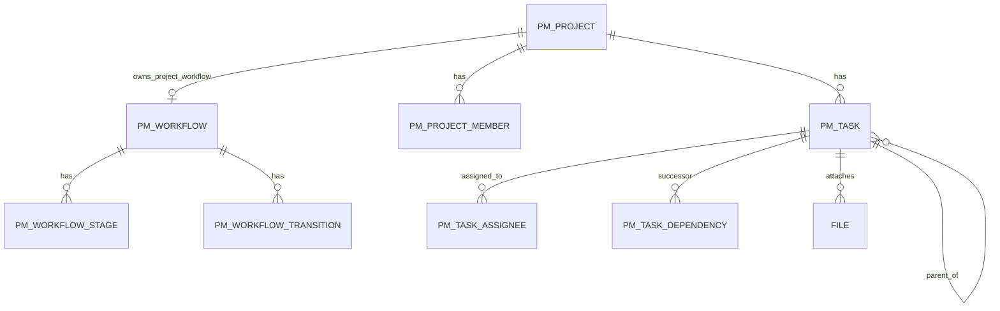
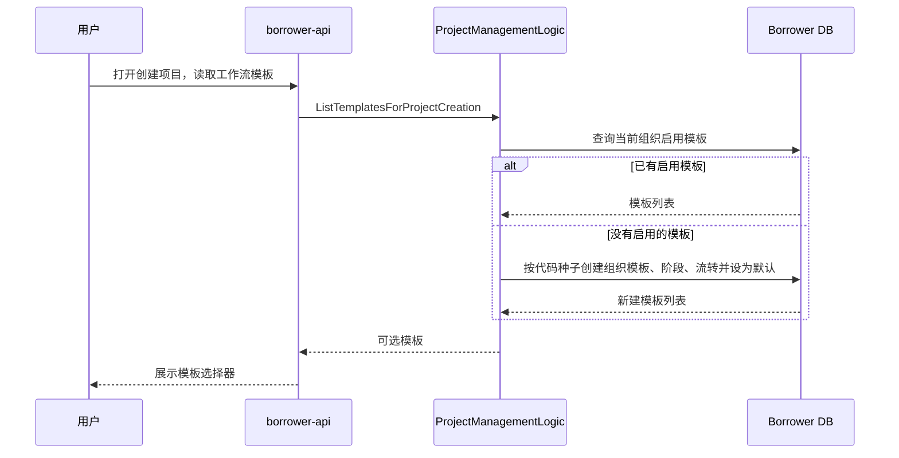
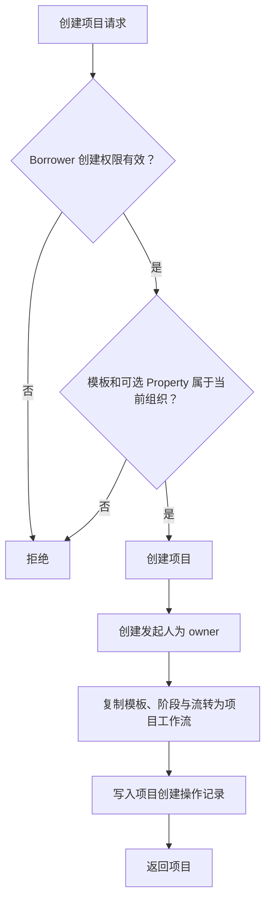
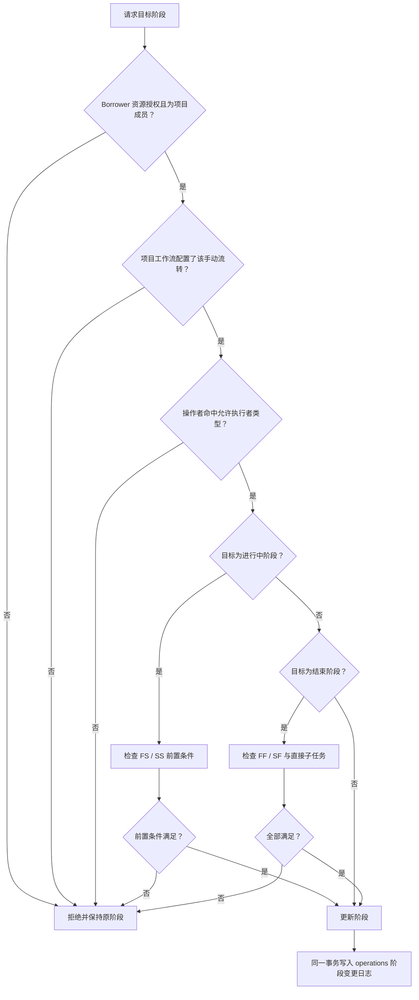
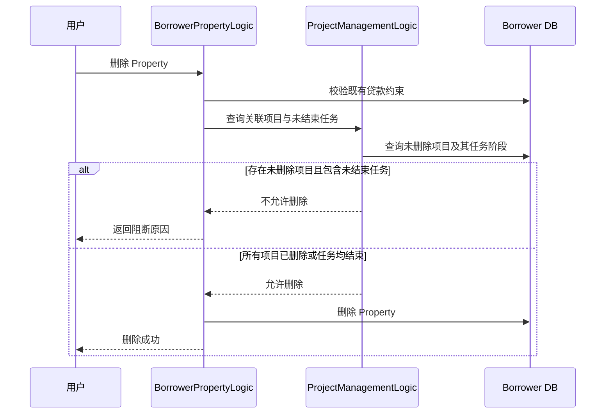

# TECH DOC：Borrower 项目管理模块

> 技术方案来源：[PRD](prd.md)  
> 版本：1.6  
> 日期：2026-08-17  
> 状态：已确认

## 1. 方案摘要

项目管理扩展现有 Borrower 服务，遵循现有 API → RPC → domains/zeebee/logic → repo → model 分层，使用 Borrower 现有数据库新增项目管理业务表。项目、Property、组织成员、权限和附件均已属于 Borrower 上下文，因此不新增微服务、独立数据库或跨服务协调。

| 决策 | 方案 | 原因 |
| --- | --- | --- |
| 服务边界 | 扩展 borrower API/RPC | 复用 Property、组织成员、Tenant 鉴权和附件能力，避免额外服务和跨服务一致性复杂度。 |
| 数据库 | Borrower 数据库新增 project_management_* 表 | Property 删除与项目创建需要一致校验；同库事务是最短且可靠的实现路径。 |
| 全局模板 | 代码内置种子模板 | 只解决存量组织首次初始化，不引入无产品需求的全局模板管理后台。 |
| 工作流存储 | 工作流、阶段、流转三表 | 模板和项目快照共用工作流定义，保留阶段与任务、流转边的关系型约束。 |
| 项目工作流 | 从组织模板复制为项目快照 | 项目可独立调整，后续模板编辑不会影响进行中的项目。 |
| 流转执行者 | 流转边配置执行者类型数组 | owner、admin、creator、executor 是固定集合；空数组表示全部可执行，无需额外关联表。 |
| 默认模板 | is_default 字段，每组织恰一个 | 创建项目默认选中；默认模板不可停用、不可删除，结构性保证组织始终有可用模板。 |
| 任务类型 | 组织级类型 + 任务历史展示字段 | 类型编辑或删除不改变已创建任务，无需项目级类型副本。 |
| 项目授权 | Borrower 资源授权与项目成员角色同时通过 | Borrower 是权限单一来源；项目角色只定义项目范围，所有者不能绕过组织授权。 |
| 操作日志 | 复用既有 operations 表 | 通用审计字段与 jsonb metadata 已覆盖项目、工作流和任务活动，无需项目专用活动表。 |
| 附件 | 复用现有 S3 与通用 File 能力 | 不重复建设上传、签名 URL 与文件记录；S3 原文件按确认范围暂不清理。 |

## 2. 系统架构



### 2.1 分层职责

| 层 | 职责 | 禁止承担的职责 |
| --- | --- | --- |
| borrower-api | 参数验证、响应转换、调用 Borrower RPC | 项目规则、依赖判断、数据库读写。 |
| borrower-rpc | Tenant 资源授权、项目成员范围校验、领域逻辑编排 | 直接 GORM 查询。 |
| domains/zeebee/logic | 项目、工作流、任务、依赖、Property 删除守卫等规则 | HTTP 或 proto 细节。 |
| domains/zeebee/repo | project_management_* 数据访问、锁定查询、递归依赖检查 | 权限判断和 UI 逻辑。 |
| common/aws_s3、model.File | 附件上传、下载、文件记录 | 项目成员或任务权限判断。 |

### 2.2 建议目录

```text
backend/
├── app/borrower/
│   ├── api/
│   │   ├── desc/project_management_*.api
│   │   └── internal/logic/project_management_*/
│   └── rpc/
│       ├── pb/borrower_project_management_*.proto
│       └── internal/logic/projectmanagement*/
└── domains/zeebee/
    ├── model/project_management_*.go
    ├── repo/project_management_*.go
    ├── logic/project_management_*.go
    └── data/dto/project_management_*.go
```

项目管理继续使用 Borrower 的启动配置、数据库连接、Tenant 客户端和 S3 配置；不新增 app/project 服务或独立运行配置。

## 3. 数据模型

### 3.1 核心表

| 表 | 关键字段 | 约束与用途                                                                                                                                                                                                                          |
| --- | --- |-------------------------------------------------------------------------------------------------------------------------------------------------------------------------------------------------------------------------------------|
| project_management_workflows | id, kind, organization_id?, project_id?, name, description, enabled, is_default, source_template_id?, source_template_name | kind 为 organization_template 或 project；组织模板关联 organization_id，项目快照关联 project_id；一项目恰好一个未删除项目工作流；is_default 仅对组织模板有效，每个组织恰好一个默认模板，默认模板不可停用、不可删除。 |
| project_management_workflow_stages | workflow_id, name, phase, sort_order | phase 为 pending、in_progress、finished；每个工作流恰好一个 pending。                                                                                                                                                                  |
| project_management_workflow_transitions | workflow_id, from_stage_id, to_stage_id, allowed_actor_types | 手动流转边；allowed_actor_types 为数组：为空时所有项目成员可执行，非空时仅允许 owner、admin、creator、executor 且无重复，命中任一类型即可执行。                                                                                                                          |
| project_management_projects | organization_id, property_id?, name, description, cover_url?, owner_user_id | property_id 创建后不可改，允许为空；cover_url 直接存储封面图片 URL，可选。                                                                                                                                                                                                |
| project_management_project_members | project_id, organization_user_id, role | 唯一成员关系；角色为 owner/admin/executor；每项目一名 owner。                                                                                                                                                                       |
| project_management_task_types | organization_id, name, description, color, enabled | 组织级任务类型。                                                                                                                                                                                                                    |
| project_management_tasks | project_id, organization_id, parent_task_id?, stage_id, phase, creator_organization_user_id, title, description, priority, start_at?, end_at?, task_type_id, task_type_name, task_type_color | `phase` 保存当前阶段属性，用于查询逾期和已完成任务；创建任务时 priority 与 task_type_id 必填，创建者不可变，用于 creator 流转权限；类型名称和颜色用于历史展示；父子任务必须同项目。 |
| project_management_task_assignees | task_id, organization_user_id | 执行者必须是当前项目成员。                                                                                                                                                                                                          |
| project_management_task_dependencies | successor_task_id, predecessor_task_id, dependency_type | 只存后置→前置；类型为 FS/FF/SS/SF；禁止自依赖、重复和环。                                                                                                                                                                           |
| operations（既有） | entity_type, entity_id, operator_*, operation, note, metadata, organization_id | 复用为追加式审计日志；操作记录为项目级：entity_type 使用 ProjectManagementOrganization（模板、任务类型）与 ProjectManagementProject（项目及成员、项目工作流、任务、子任务、依赖、附件、流转，entity_id 为项目 ID）两个值，任务等具体上下文放入 metadata；不新增 project_management_task_activities。                                                                                                                          |

任务附件不新增专用表，复用现有 model.File：

- 新增 FileEntityTypeProjectManagementTask；
- entity_id 为任务 ID；
- 文件上传、签名 URL 和文件元数据规则继续沿用 Borrower 当前实现；
- 删除任务或项目时删除相关 File 记录，不删除 S3 原对象。

### 3.2 关系图



### 3.3 索引与不变量

- projects(organization_id, property_id, deleted_at)：Property 删除守卫和组织隔离。
- project_members(project_id, organization_user_id)：成员访问和执行者校验。
- tasks(project_id, stage_id, deleted_at)：看板与阶段删除校验。
- tasks(project_id, parent_task_id, deleted_at)：子任务校验。
- task_dependencies(successor_task_id, predecessor_task_id) 唯一：防止重复依赖。
- 未删除的 workflows(project_id) 且 kind = project 唯一：保证一项目仅一个项目工作流。
- 未删除且 is_default 的组织模板在组织内唯一（部分唯一索引）：既是默认模板唯一性，也充当组织级种子初始化唯一标识，并发初始化时后插入事务违反约束自动回滚。
- 未删除的 workflow_stages(workflow_id, sort_order) 唯一：保证阶段顺序唯一；workflow_stages(workflow_id, phase = pending) 保证至多一个待开始阶段，领域逻辑在同一事务中保证恰好一个。
- 未删除的 workflow_transitions(workflow_id, from_stage_id, to_stage_id) 唯一：防止重复流转边；(workflow_id, from_stage_id) 与 (workflow_id, to_stage_id) 分别复合外键引用 workflow_stages(workflow_id, id)，禁止跨工作流连接阶段。
- workflow_transitions.allowed_actor_types 为 varchar 数组，允许为空（空表示所有项目成员可执行）；非空时数据库约束其为 owner、admin、creator、executor 的子集，领域逻辑拒绝重复值并规范化保存顺序。

所有项目管理表沿用现有 GORM 软删除约定。级联删除指关联业务记录级联软删除并从正常查询中消失；operations 是审计记录，不参与项目或任务的级联软删除；S3 对象按确认范围保留。

项目管理 schema 仅保留 `deploy/zeebee/sql/20260818100000_project_management.sql`；该文件是已手工执行 schema 的唯一保留迁移，包含任务 `phase` 列，不再保留拆分出的后续补丁迁移。

## 4. 工作流与模板

### 4.1 代码内置全局种子模板

全局模板不入数据库，由代码常量定义，默认包含：

| 阶段 | 阶段属性   | 初始流转 | 允许执行者                                            |
| --- |------------| --- |-------------------------------------------------------|
| 待开始 | Pending    | → 进行中 | ProjectOwner、ProjectAdmin、TaskCreator、TaskExecutor |
| 进行中 | InProgress | → 暂停、已完成 | ProjectOwner、ProjectAdmin、TaskCreator、TaskExecutor     |
| 暂停 | InProgress | → 进行中、已完成 | ProjectOwner、ProjectAdmin、TaskCreator、TaskExecutor     |
| 已完成 | Finished   | 不预置流转 | —                                                     |

组织首次打开创建项目所需的工作流列表时，若没有启用的模板，系统复制种子创建一个组织模板并设为默认模板。此后：

- 种子代码修改只影响以后首次初始化的组织；
- 组织模板以 kind = organization_template 保存在 project_management_workflows，非默认模板可编辑、删除和停用；默认模板不可停用、不可删除，组织因此始终至少保留一个可用模板；
- 种子模板自动成为组织默认模板；创建项目时默认选中默认模板，设置新默认模板时原默认自动恢复为普通模板；
- 项目创建必须选择一个组织模板；
- 项目工作流以 kind = project 保存，独立复制阶段与流转；项目可自行配置包括“已完成重新打开”在内的任意合法流转及每条边的允许执行者。

### 4.2 存量组织初始化时序



种子初始化在同一事务内先查询后插入；组织级唯一初始化标识由“未删除默认组织模板每组织唯一”的部分唯一索引承担，并发初始化时后插入的事务违反唯一约束自动回滚，不会产生重复种子模板。

## 5. 接口设计

接口沿用 Borrower 的 /api/v1 前缀、AuthMiddleware、统一响应格式及 API/RPC 代码生成流程。URL 的资源段统一使用单数形式，例如 `project`、`task`、`member`。所有分页或带复杂筛选条件的列表查询均使用 `POST` 方法且路径以 `/page` 结尾；仅无分页的模板下拉使用 `GET .../all`，无分页的简单筛选（如成员候选搜索）使用带查询参数的 `GET`，按 ID 获取单条资源使用 `GET`。工作流以定义聚合读写：模板和项目工作流接口均返回阶段、流转边及其允许执行者，不提供阶段或流转边的独立 CRUD。

| 模块 | 方法与路径                                                        | 说明 |
| --- |-------------------------------------------------------------------| --- |
| 工作流模板 | GET /project_management/workflow/all                              | 获取创建项目可选的完整组织模板定义；必要时按代码种子初始化。 |
| 工作流模板 | POST /project_management/workflow/page                            | 分页查询组织模板摘要；阶段和流转边仅在 all 或单条详情中返回。 |
| 工作流模板 | GET /project_management/workflow/:id                              | 获取单个组织模板完整定义（含阶段与流转边）。 |
| 工作流模板 | POST /project_management/workflow                                 | 创建 kind = organization_template 的完整工作流定义。 |
| 工作流模板 | PUT/DELETE /project_management/workflow/:id                       | 整体修改或删除组织模板；修改请求包含 stages 和 transitions，可设置新的默认模板；默认模板不可停用或删除。 |
| 项目 | POST /project_management/project/page                             | 项目分页查询；仅返回项目工作流摘要，不嵌入完整阶段与流转配置。 |
| 项目 | POST /project_management/project                                  | 创建项目；请求必须携带 workflow_template_id，在同一事务中复制模板、阶段、流转及 allowed_actor_types 为项目工作流快照。 |
| 项目 | GET/PUT/DELETE /project_management/project/:id                    | 查看、编辑基础信息、级联删除；删除二次确认仅在前端完成，工作流通过专用接口读取和修改。 |
| 项目成员 | POST /project_management/project/:id/member/page                  | 项目成员分页查询。 |
| 项目成员 | GET /project_management/project_member/candidate?project_id=&purpose=&keyword= | 候选搜索；purpose 为 AddMember、TransferOwner 或 ProjectMember，按用途返回可添加成员或现有成员。 |
| 项目成员 | POST /project_management/project/:id/member                       | 添加项目成员。 |
| 项目成员 | PUT/DELETE /project_management/project_member/:id                 | 改角色、移除成员。 |
| 项目成员 | POST /project_management/project/:id/owner                        | 转移所有者；原所有者降级为 TaskExecutor。 |
| 项目工作流 | GET /project_management/project/:id/workflow                      | 返回 kind = project 的完整工作流定义、来源模板信息、阶段、流转边及 allowed_actor_types。 |
| 项目工作流 | PUT /project_management/project/:id/workflow                      | 整体修改项目工作流；可调整阶段、流转边和 allowed_actor_types，不影响来源组织模板。 |
| 任务类型 | POST /project_management/task_type/page                           | 组织级任务类型分页查询。 |
| 任务类型 | POST /project_management/task_type                                | 创建组织级任务类型。 |
| 任务类型 | PUT/DELETE /project_management/task_type/:id                      | 编辑、删除或停用；不回写历史任务。 |
| 任务 | POST /project_management/task/page                                | 看板分页查询；filter.project_id 必填，按当前项目工作流的阶段顺序分组。 |
| 任务 | POST /project_management/task                                     | 创建任务或子任务；project_id、title、priority、task_type_id 必填，stage_id 由服务端写入唯一 Pending 阶段。 |
| 任务 | GET/PUT/DELETE /project_management/task/:id                       | 详情、编辑、级联删除；详情和删除必须带 project_id，删除二次确认仅在前端完成，stage_id 不通过编辑接口直接修改。 |
| 阶段流转 | POST /project_management/task/:id/transition                      | 请求 target_stage_id；服务端根据当前 stage_id 查询流转边，并校验 allowed_actor_types 与依赖规则。 |
| 依赖 | POST /project_management/task/:id/dependency/page                 | 前置依赖分页查询。 |
| 依赖 | POST /project_management/task/:id/dependency                      | 创建前置关系。 |
| 依赖 | PUT/DELETE /project_management/task/:id/dependency/:dependency_id | 修改类型或删除关系。 |
| 附件 | POST /project_management/task/:id/attachment                      | 登记按既有 Borrower 规则上传的附件。 |
| 附件 | DELETE /project_management/task/:id/attachment/:file_id           | 删除附件记录，不删除 S3 对象。 |
| 我的任务 | POST /project_management/task/my                                  | 按项目、阶段、类型、逾期和关键词分页查询；仅返回分配给当前用户的任务。 |
| 操作记录 | POST /operation/page                                               | 项目操作时间线分页查询；filter.entity_type=ProjectManagementProject、filter.entity_id=project_id，任务等上下文经 task_id 过滤。 |

### 5.1 工作流定义契约

`WorkflowDefinition` 是模板和项目工作流接口共用的读写模型；客户端不感知底层三张表。项目工作流响应额外包含只读的 `source_template_id` 和 `source_template_name`。

```json
{
  "id": 12,
  "name": "标准项目流程",
  "description": "",
  "enabled": true,
  "stages": [
    {"id": 101, "name": "待开始", "phase": "pending", "sort_order": 10},
    {"id": 102, "name": "进行中", "phase": "in_progress", "sort_order": 20}
  ],
  "transitions": [
    {
      "id": 201,
      "from_stage_id": 101,
      "to_stage_id": 102,
      "allowed_actor_types": ["owner", "admin", "creator", "executor"]
    }
  ]
}
```

- `allowed_actor_types` 允许为空数组：为空时所有项目成员均可执行该边；非空时只允许 `owner`、`admin`、`creator`、`executor` 且不允许重复，任一身份命中即允许执行。
- 新建项目时只接受 `workflow_template_id`，不接受内嵌工作流定义；项目工作流由服务端复制，防止客户端伪造模板来源或跨组织阶段。
- `PUT /project_management/project/:id/workflow` 使用完整定义替换当前项目工作流配置；客户端不得修改工作流 `kind`、`project_id` 或来源模板字段。删除仍被未删除任务引用的阶段时，系统拒绝并提示该阶段存在任务。阶段属性允许修改，即使阶段仍有任务停留，但修改后必须仍恰好保留一个待开始阶段；属性改为结束时该阶段任务即刻视为已完成。
- `POST /project_management/task/:id/transition` 只接受 `target_stage_id`；客户端不得传递或声明自己的 owner、admin、creator、executor 身份。

### 5.2 关键输入校验

- 创建项目：名称非空、模板属于当前组织、Property 属于当前组织且未删除，允许为项目添加封面。
- 添加成员：目标为当前组织成员；指定一个项目角色；允许批量添加项目成员；候选搜索按邮箱或姓名模糊匹配当前组织成员，排除已是项目成员的用户。
- 创建任务：创建者、执行者均是项目成员；父任务、阶段属于当前项目；priority 必填且仅为 Low、Medium、High、Critical，task_type_id 必填且类型属于当前组织并已启用。
- 更新任务：前端完整提交全部可编辑字段；空字符串、空日期和空执行者列表分别清空描述、日期和执行者，执行者集合随更新请求整体替换；不提供独立执行者更新接口。
- 修改工作流：阶段属性合法；待开始阶段恰好一个；流转边两端属于同一工作流；allowed_actor_types 值合法且无重复（可为空数组）；被未删除任务引用的阶段不可删除，阶段属性可改但改后仍须恰好一个待开始阶段。
- 任务流转：操作者为当前项目成员，且命中流转边 allowed_actor_types 中至少一种身份；owner/admin 来自项目成员角色，creator 来自任务创建者，executor 来自任务执行者，项目owner与admin具有所有权限。
- 创建依赖：两任务同项目、不相同、无重复、无环；后置任务必须仍处于待开始阶段。
- 创建子任务：父任务未处于结束阶段；子任务与父任务同项目。
- 删除或停用模板：默认模板不可删除或停用；非默认模板无数量限制，可用性由默认模板保证。
- 删除 Property：除既有贷款校验外，关联项目必须均已删除，或每个未删除关联项目的全部任务均处于结束阶段。

## 6. 核心业务逻辑

删除项目或任务前的二次确认由前端负责，后端删除请求不接收确认字段。

### 6.1 创建项目



项目创建与工作流快照在同一数据库事务中完成，避免出现项目存在但没有工作流、或工作流存在但没有项目的不可用状态。

### 6.2 任务手动流转



- 目标为进行中阶段时：FS 要求前置结束，SS 要求前置离开待开始。
- 目标为结束阶段时：FF 要求前置结束，SF 要求前置离开待开始。
- 是否可从已完成阶段重新打开，不写死，由项目工作流的用户配置边决定。
- 暂停属于进行中阶段，仍参与逾期判断。
- allowed_actor_types 为空时所有项目成员可执行，非空时命中任一类型即可；owner/admin 为项目成员角色，creator 为 creator_organization_user_id，executor 为当前 task_assignees 记录。所有类型判定都不能绕过 Borrower 资源授权和当前项目成员校验。
- 流转事务先以 SELECT ... FOR UPDATE 锁定任务行，再执行依赖与子任务校验和阶段更新；创建依赖的事务锁定两端任务行，防止并发流转或并发加依赖绕过校验。
- 操作日志为项目级：以 ProjectManagementProject 为 entity_type、项目 ID 为 entity_id；metadata 记录 task_id、workflow_id、阶段前后快照和命中的执行者类型。

### 6.3 任务依赖无环校验

新增后置任务 → 前置任务边前，查询前置任务是否已可达后置任务；若可达，再新增该边将形成环，因此拒绝。同时要求后置任务仍处于待开始阶段；已离开待开始阶段的任务不再接受新前置依赖，避免依赖校验被追溯绕过。

PostgreSQL 使用递归 CTE 完成可达性检查，原因如
- 仅读取本次依赖相关的图，不需把项目全部依赖加载到 RPC 进程；
- 可在同一数据库事务中完成检查和写入，避免并发创建相反依赖时绕过校验；
- 任务量增长后仍可使用索引缩小递归搜索范围。

### 6.4 Property 删除守卫



Property 删除后不保存项目侧展示快照；后续跳转 Property 详情时按现有 Borrower 行为返回记录不存在。

### 6.5 删除级联

| 发起删除 | 级联删除的业务记录 | 不处理的内容 |
| --- | --- | --- |
| 项目 | 项目工作流、成员、任务树、执行者、依赖、附件记录 | S3 原文件、operations 审计记录。 |
| 任务 | 子任务树、执行者、入边/出边依赖、附件记录 | S3 原文件、operations 审计记录。 |
| 附件 | 对应 File 记录 | S3 原文件。 |
| 组织工作流模板 | 模板及阶段/流转；默认模板不可删除或停用 | 已创建项目的工作流快照。 |

### 6.6 项目成员移除

移除项目成员在同一事务中仅删除成员关系并写入 operations 留痕；其创建任务的 creator_organization_user_id 和全部执行者记录原样保留，任务创建者与执行者展示不受影响。“执行者必须是当前项目成员”仅在分配时校验，存量记录不回溯清理。移除后该成员不再具备项目内操作资格，也不能被新任务指定为执行者。

Borrower 组织成员被移出组织时，仅级联移除其组织内所有项目的成员关系，创建者与执行者记录同样保留。

## 7. 权限与安全

每次操作均执行两道不可替代的检查：

1. Borrower 资源授权：通过既有 Tenant/RBAC 链路确认当前用户拥有项目管理操作权限。
2. 项目范围校验：确认用户为项目成员，并满足项目角色、所有者唯一性和任务关系约束。

关键规则：

- 项目所有者不绕过 Borrower 资源授权；
- 任务创建者和执行者必须是项目成员；
- 流转边按 allowed_actor_types 授予：空数组时所有项目成员可执行，非空时须命中至少一个配置类型；该判定是必要条件，不替代资源授权和项目成员校验；
- 模板、任务类型、项目和任务查询以当前组织为范围；
- 客户端不能指定任意 organization_id；
- 查看、下载、登记或删除附件前均校验任务和项目访问权限；
- 上传限制、文件类型和存储方式沿用现有 Borrower 附件规则。

## 8. 逾期计算

逾期是派生状态，不落库、不发提醒、不启动定时任务。

```text
isOverdue = endAt exists
         && currentTime > endAt
         && currentStage.phase != finished

overdueDuration = currentTime - endAt
```

任务详情、看板和我的任务使用同一规则展示逾期状态。已完成任务无论完成时间是否晚于截止日期，均不显示为当前逾期。

## 9. 错误契约

Borrower 业务接口使用统一响应体，业务成功和失败的 HTTP 状态均为 `200`；客户端必须读取响应体的 `code` 与 `message`，不能依据 HTTP 状态判断业务结果。

```json
{"code": 400, "message": "invalid workflow transition"}
```

| 场景 | HTTP 状态 | response.code | 客户端含义 |
| --- | ---: | ---: | --- |
| 身份凭证无效或过期 | 200 | 401 | 重新认证。 |
| 组织、资源或项目成员权限不足 | 200 | 403 | 重新选择组织、申请资源权限或加入项目。 |
| 当前项目成员不属于流转边允许执行者类型 | 200 | 403 | 由项目 owner 或 admin 调整流转配置，或由允许的成员执行。 |
| 模板、项目、任务、Property 不属于当前组织或不存在 | 200 | 404 | 资源不存在。 |
| 输入字段非法、删除被任务使用的阶段、停用或删除默认工作流模板 | 200 | 400 | 修正输入，先处理该阶段任务，或先更换默认模板。 |
| 依赖重复、自依赖、形成环，或依赖/子任务未满足阶段流转 | 200 | 400 | 调整任务依赖或处理阻断任务后再流转。 |
| 删除关联未结束任务项目的 Property | 200 | 400 | 先结束任务或删除项目。 |

## 10. 测试策略

| 范围 | 重点场景 |
| --- | --- |
| 领域单元测试 | 阶段属性唯一性、流转边、allowed_actor_types、FS/FF/SS/SF、逾期、任务类型历史信息。 |
| 仓储集成测试 | 同组织约束、跨工作流流转边拒绝、递归依赖环检测、并发相反边、模板初始化只生成一次。 |
| Borrower RPC 集成测试 | 资源授权、项目成员关系或流转执行者类型任一不满足时拒绝；Property 删除守卫。 |
| API 集成测试 | 创建项目、模板列表补齐、任务看板、附件记录、我的任务筛选、阶段流转操作日志。 |
| 删除测试 | 删除任务/项目的级联记录；operations 审计记录保留；S3 原对象不被删除。 |
| 回归测试 | 既有 Property 删除贷款校验仍有效；既有附件上传规则不变。 |

## 11. 实施顺序

1. 建立项目管理模型、仓储、迁移和基础领域逻辑。
2. 实现组织级工作流模板、代码种子模板和存量组织懒初始化。
3. 实现项目、项目成员、项目工作流快照和 Property 删除守卫。
4. 实现组织级任务类型和任务类型历史信息。
5. 实现任务、子任务、执行者、附件记录和 operations 操作日志复用。
6. 实现手动流转、依赖规则、环检测和逾期派生状态。
7. 实现级联删除、我的任务、API/RPC 定义与端到端测试。

## 12. 风险与明确取舍

| 风险或取舍 | 处理 |
| --- | --- |
| 项目删除后 S3 对象保留 | 按确认范围接受对象残留；后续如需清理，再单独设计生命周期任务。 |
| 全局种子模板代码修改不会迁移既有组织 | 预期行为；组织模板和项目工作流均为独立配置。 |
| Property 删除规则需要扫描关联项目任务 | 在同一 Borrower 数据库中通过索引和聚合查询完成，避免跨服务调用。 |
| 用户可配置已完成重新打开 | 不把已完成视为不可逆终态；以项目流转边为唯一授权依据。 |
| 操作日志复用 operations | 项目时间线按 entity_type + entity_id（项目 ID）直接查询；如需高频按任务过滤，再为 metadata.task_id 增加表达式索引。 |
| 不提供通知与自动流转 | 删除定时任务、通知表和异步工作流复杂度，后续按独立需求补充。 |
| 附件两步流产生孤儿文件 | 先上传后登记，未登记的 S3 对象残留；按确认范围接受，后续如需对账再设计清理任务。 |
| 附件 URL 为公开永久链接 | 沿用现有 Borrower S3 公开机制，无过期时间；链接泄露即永久可访问。若附件未来承载敏感材料，需独立立项改造私有桶与签名 URL。 |
| Property 删除后项目保留失效链接 | 项目仍展示原绑定信息，跳转 Property 详情按既有行为返回记录不存在。 |
