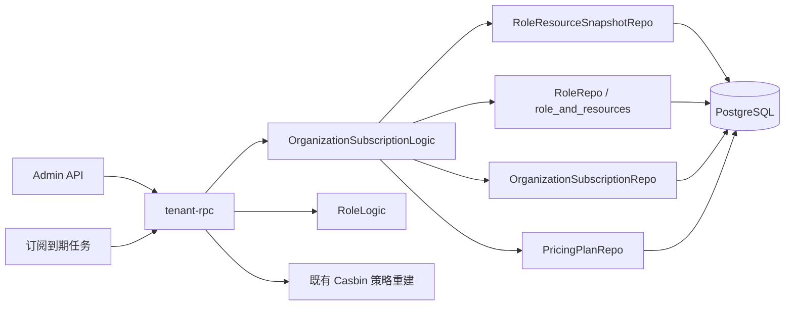

# TECH DOC：组织套餐角色权限快照与恢复

> 技术方案来源：[PRD](prd.md)  
> 版本：1.0  
> 日期：2026-09-10  
> 状态：已确认，待实现

## 1. 背景与根因

当前 `OrganizationSubscriptionLogic` 在订阅变为无效时，经 `syncSubscriptionEffect` 或 `syncPlanResourcesToOrganizationRoles` 从组织所有角色删除套餐资源。订阅重新变为有效时不会回写原有资源。定时到期从旧套餐切到默认套餐时也只删除旧套餐独有资源。

这使普通角色的自定义资源关系（`role_and_resources`）丢失。套餐资源管理本身也只会删除已移出套餐的资源，并且刻意不会自动授予刚加入套餐的资源；新方案必须保持该规则。

## 2. 方案摘要

| 决策 | 方案 | 原因 |
| --- | --- | --- |
| 快照表 | `role_resource_snapshots` 单行 JSONB `resources` | 每项保存 `resource_id` 与 `data_scope`；套餐切换时按角色整体读写，不需要每个资源一行。 |
| 服务边界 | Tenant RPC → `domains/zeebee/logic` | Tenant 已是订阅、RBAC 和 Casbin 的唯一权威，无需新服务。 |
| 恢复算法 | 当前角色权限与目标套餐交集，再并入历史与目标套餐交集 | 保留重叠权限，恢复历史配置，且不会超出套餐当前范围。 |
| 新套餐 | 仅保留当前与新套餐交集 | 延续“套餐新增资源不自动授权”的现有产品规则。 |
| `Admin` 与 owner | `Admin` 跳过快照与角色资源裁剪；owner 的有效权限按组织归属处理 | `Admin` 仅以 `role.Name == constants.AdminRoleName` 识别；owner 以 `organizations.owner_id == currentUserId` 识别。owner 所在普通角色仍是共享配置，参与快照与裁剪。两者均先经过套餐门禁。 |
| 一致性 | 单事务写 DB，提交后复用策略重建 | 避免半完成角色资源或发布失败前的权限刷新。 |

## 3. 系统架构



### 3.1 分层职责

| 层 | 职责 | 不承担的职责 |
| --- | --- | --- |
| admin API / RPC 薄代理 | 保持既有订阅接口和请求转换 | 快照计算、数据库读写。 |
| tenant RPC | 输入验证、组织/套餐类型解析、调用领域逻辑 | 直接 GORM 查询。 |
| `OrganizationSubscriptionLogic` | 单有效套餐校验、快照、恢复、订阅状态编排、提交后策略重建 | HTTP/Proto 细节。 |
| `RoleLogic` | Create/Update 时校验普通角色非公开资源属于当前有效套餐；删除角色时协调快照清理 | 跨订阅切换编排。 |
| `PricingPlanLogic` | 删除套餐时协调快照清理；保留资源绑定语义 | 订阅切换。 |
| repo / model | 持久化快照、订阅和角色资源关系 | 授权决策。 |

### 3.2 建议目录

```text
backend/
├── domains/zeebee/
│   ├── model/role_resource_snapshot.go
│   ├── repo/role_resource_snapshot.go
│   └── logic/
│       ├── organization_subscription_logic.go
│       ├── role_logic.go
│       └── pricing_plan_logic.go
└── app/tenant/rpc/internal/logic/
    ├── organizationsubscription/
    └── role/
```

不需要新增 HTTP schema、Proto、RPC 服务、配置或依赖。

## 4. 设计原则

- 只保存普通角色；仅 `role.Name == constants.AdminRoleName` 不生成快照、切换时不改其角色资源关联。owner 不是角色，必须以 `organizations.owner_id == currentUserId` 判断；owner 所在普通角色是共享配置，仍参与快照与裁剪。owner 与 `Admin` 的有效访问权均先经过套餐门禁。
- 快照是“曾配置权限”的记忆，不是套餐资源的副本；恢复永远受套餐**当前**资源集合约束。
- 离开当前套餐时捕获快照，进入目标套餐时恢复或最小化裁剪；不在日常角色更新流程同步快照。
- 既有普通角色资源分配校验与鉴权门禁继续以当前有效套餐为边界；快照不会使任何套餐外资源可被分配或访问。
- 所有数据库修改在一个事务中完成；Casbin 重建在提交成功后按组织和用户类型发布。
- 不引入新服务、缓存、消息表或第三方依赖。

## 5. 数据模型

新增 `domains/zeebee/model/role_resource_snapshot.go`，表名为 `role_resource_snapshots`：

| 字段 | 类型 / 约束 | 说明 |
| --- | --- | --- |
| `id`、审计字段 | 复用 `model.Base` | 与现有模型统一。 |
| `organization_id` | `int4 NOT NULL` | 所属组织。 |
| `pricing_plan_id` | `int4 NOT NULL` | 快照对应套餐。 |
| `role_id` | `int4 NOT NULL` | 角色 ID；角色重建不继承旧记录。 |
| `resources` | `jsonb NOT NULL DEFAULT '[]'` | `[]RoleResourceSnapshotResource`，每项为 `resource_id` 与 `data_scope`，使用 `serializer:json`。 |

数据库约束及索引：

- 不创建 `(organization_id, pricing_plan_id, role_id)` 联合唯一索引。表复用 `model.Base` 的 `is_del` 软删除约定，不能让历史软删除记录阻塞同一业务键的新快照。
- 按现有表规范为 `organization_id`、`pricing_plan_id`、`role_id` 分别创建普通 B-tree 索引，服务组织+套餐读取、角色删除和套餐删除清理。
- 不建立资源 ID 外键或 JSONB/Gin 索引。资源仅作为整组读取、集合运算后写回，且恢复时重新按套餐当前资源过滤；额外索引没有查询收益。
- 显式实现 `TableName() string { return "role_resource_snapshots" }`，并维持项目现有 GORM 模型建表/迁移方式；测试模型注册列表必须加入新模型。

新增 `RoleResourceSnapshotRepo`，保持现有 `BaseRepo` 约定，最小方法集：

- `SaveWithTx(ctx, tx, snapshot)`：按 `organization_id`、`pricing_plan_id`、`role_id` 查询未软删除记录；找到则更新 `resources`，未找到则创建。不得先删除原快照，也不得使用 `ON CONFLICT` 或联合唯一索引实现 upsert。
- `FindByOrganizationAndPlanWithTx(ctx, tx, organizationID, planID)`：一次读取目标套餐所有角色快照。
- `DeleteByRoleIdWithTx(ctx, tx, roleId)`。
- `DeleteByPricingPlanIdWithTx(ctx, tx, pricingPlanId)`。

不需要 DTO、HTTP API 或 Proto 变更：快照完全是 tenant 领域内部状态。

## 6. 集合定义

对一个普通角色 `r`：

```text
R(r) = 角色当前拥有的非公开资源 ID 集合
P(plan) = 该套餐当前绑定的非公开资源 ID 集合
H(r, plan) = 历史快照 resources 中的 resource_id；不存在则为空集
```

仅 `role.Name == constants.AdminRoleName` 跳过角色资源快照与写回流程。owner 由 `organizations.owner_id == 当前用户 UserId` 判定，而不是由角色名称判定；owner 所在普通角色仍参与本流程。读取菜单和执行 API 鉴权时，先按当前有效套餐过滤，再将 owner 与 `Admin` 作为可访问套餐内全部可用资源的特权用户；公开资源不按套餐裁剪。

### 6.1 离开来源套餐

```text
snapshot(r, oldPlan) = R(r) ∩ P(oldPlan)
```

即使交集为空，也保存/覆盖为空数组，确保它代表“该角色在该套餐下明确没有任何套餐内权限”，而不是“没有历史”。保存时仅查询未软删除记录；若此前记录已软删除，则按项目现有软删除语义创建新记录。

### 6.2 进入有历史的目标套餐

```text
target(r) = (R(r) ∩ P(targetPlan)) ∪ (H(r, targetPlan) ∩ P(targetPlan))
```

实现先计算差集并从 `role_and_resources` 删除不在 `target(r)` 的非公开资源，再追加 `target(r)` 中缺少的资源。该做法不是整体替换：套餐交集内的当前权限保留，历史只补回曾有权限。

示例：角色在套餐 A 下拥有 `{a,b,c,e}`；套餐 B 的历史快照为 `{b,c,d}`；`P(B)` 包含 `{b,c,d,e}`。切换到 B 后，`R(r) ∩ P(B) = {b,c,e}`，`H(r,B) ∩ P(B) = {b,c,d}`，最终权限为 `{b,c,d,e}`。`e` 因仍在 B 的当前范围内而保留，`d` 由 B 的历史快照补回。

### 6.3 首次进入无历史的目标套餐

```text
target(r) = R(r) ∩ P(targetPlan)
```

不自动追加 `P(targetPlan)` 中的任何新资源。目标套餐日后被离开时，才按 6.1 创建它的首个快照。

### 6.4 同套餐重新生效

订阅已在前一事务实际变为无效后，再同套餐恢复时，视为“进入有历史的目标套餐”，套用 6.2。这覆盖失效后续费、被暂停后启用以及手工重新激活。定时任务在同一事务内将同一套餐从到期状态直接更新为默认策略时，不视为离开后恢复，不回放历史快照，以保留管理员在该套餐内的日常权限编辑。

## 7. 单有效套餐约束

组织只能订阅与其 `Organization.Type` 相同的 `PricingPlan.Type`；Borrower 组织不可订阅 Lender 套餐，反之亦然。

同一组织在任意时刻只能存在一个有效订阅。有效状态的具体枚举必须复用 `OrganizationSubscriptionStatus.IsEffective()` 的定义。领域逻辑在创建、重新激活或自动替换前，在同一事务中锁定组织与其有效订阅，确认目标套餐类型，先处理来源套餐后再激活目标套餐。此功能不为软删除表增加联合唯一索引或部分唯一索引；单有效套餐由订阅领域流程维持。

套餐到期但数据库状态尚未被任务改为 `Expired` 的记录不应与新订阅并存；定时处理必须在同一事务中先标记旧订阅失效，再创建或激活目标订阅。

## 8. 事务编排

新增内部编排助手（建议位于 `organization_subscription_logic.go`，避免单实现接口或新服务）：

```text
snapshotPlanRolesWithTx(orgID, plan)
applyPlanRolesWithTx(orgID, targetPlan)
transitionPlanWithTx(orgID, oldSubscription?, targetSubscription/targetPlan)
```

`snapshotPlanRolesWithTx` 一次预加载组织中 `role.Name != constants.AdminRoleName` 的角色及其资源，按 6.1 查询未删除快照后更新或创建。`applyPlanRolesWithTx` 一次读取目标套餐快照和角色资源，按 6.2 或 6.3 计算集合，再通过现有 Role Repo 资源关联更新方法写回；保留 `Admin` 角色资源关联不变。owner 不是此处可筛选的角色属性：owner 共用的普通角色仍须处理，以免其他成员经该角色保留套餐外资源。

`transitionPlanWithTx` 是订阅有效边界改变的唯一角色资源写路径：它取代现有 `syncSubscriptionEffect`、`unbindEffectiveSubscriptions` 和 `handleExpiredSubscription` 内直接调用 `syncPlanResourcesToOrganizationRoles` 的做法。旧套餐离开时保存并裁剪普通角色；目标套餐生效时恢复/最小化保留普通角色。任何调用方不得绕过该编排而直接解绑角色资源。

所有下列写入在一个 `OrganizationSubscriptionRepo.Transaction` 内完成：

1. 锁定/读取当前有效订阅、来源套餐、目标套餐及其资源；校验组织类型、套餐状态、套餐类型和单有效订阅约束。
2. 若离开来源套餐，按组织、来源套餐和角色查询未删除快照；存在则更新，不存在则创建来源套餐普通角色快照。
3. 更新来源订阅为无效（或对同套餐恢复保留其记录），创建/更新目标订阅。
4. 对目标套餐执行普通角色权限裁剪与历史恢复。
5. 写入角色资源关联与快照。
6. 提交后发布该组织、该用户类型的策略重建；任意步骤失败则回滚且不发布。

现有 `publishOrgPolicyRebuild` / `publishPlanPolicyRebuild` 是唯一策略刷新入口，应继续复用。不要在事务中直接操作 Casbin。

## 9. 接入点

| 现有路径 | 新行为 |
| --- | --- |
| `OrganizationSubscriptionLogic.Create` | 以 `transitionPlanWithTx` 关闭当前有效订阅；先保存来源套餐快照，再使目标套餐生效并恢复/最小化保留。 |
| `OrganizationSubscriptionLogic.Renew` | 无效订阅重新生效必须走 `transitionPlanWithTx`。若另一套餐已有效，先按切换处理该来源套餐，避免 Expired 旧订阅续费后与默认套餐并存。 |
| `OrganizationSubscriptionLogic.UpdateExpireDate` | 有效→无效时保存来源快照并裁剪；无效→有效时走 `transitionPlanWithTx` 恢复或切换，不能仅调用 remove-side 同步。 |
| `OrganizationSubscriptionLogic.SwitchStatus` | 与 `UpdateExpireDate` 使用相同的有效边界编排；手工暂停保存+裁剪，手工启用恢复/切换并校验单有效套餐。 |
| `OrganizationSubscriptionLogic.SuspendEffectiveByOrganizationId` | 在暂停前对当前有效套餐保存普通角色快照，再裁剪普通角色；不直接调用全角色解绑逻辑。 |
| `handleExpiredSubscription` 自动降级 | 在旧订阅标记过期及默认套餐创建前通过 `transitionPlanWithTx` 保存旧套餐；默认套餐有快照则恢复，无快照则执行最小化保留。 |
| `syncSubscriptionEffect` / `unbindEffectiveSubscriptions` | 重构为调用 `transitionPlanWithTx` 或移除其角色资源副作用；不得保留直接全角色 `syncPlanResourcesToOrganizationRoles` 解绑。 |
| `syncPlanResourcesToOrganizationRoles` | 所有仍保留的调用方只对 `role.Name != constants.AdminRoleName` 的角色更新资源关联，避免套餐资源删除、套餐停用或订阅暂停重置 `Admin` 角色配置。 |
| 套餐资源 `BindResources` | 保持“套餐新增资源不自动授予”的语义；套餐删除资源时仅从普通角色移除。`Admin` 角色关联保留，但其菜单/API 鉴定仍被当前套餐门禁限制。 |
| `RoleLogic.Delete` | 删除角色及其资源关联的同一事务中删除全部该角色快照。 |
| `PricingPlanLogic.Delete` | 删除套餐前/删除事务内删除该套餐的全部角色快照；现有“有效订阅不可删除”校验保持。 |
| `RoleLogic.Create` / `RoleLogic.Update` | 在写角色及资源关联前校验所有请求资源：资源存在、类型匹配、状态可用；非公开资源还必须属于组织当前有效套餐。任一资源不合法即整体返回错误，不再以 `FilterMap` 静默丢弃；不修改历史快照。 |
| `ResourceLogic.GetUserResources` / `auth.CheckAuthorization` | 使用 `OrganizationRepo` 读取组织，按 `organization.OwnerId == currentUserId` 识别 owner；先应用当前有效套餐资源过滤，再让 owner 与 `Admin` 走套餐内全资源的特权分支。不得仅靠角色名识别 owner，也不得使 owner 绕过套餐门禁。 |

## 10. 权限与边界

- 只处理角色 `Type` 与组织套餐类型一致且 `role.Name != constants.AdminRoleName` 的普通角色。
- owner 的判定谓词固定为 `organization.OwnerId == currentUserId`：`OwnerId` 是用户 ID，创建组织时来自 `claim.UserId`，应与当前 `OrganizationUser.UserId` / claim 的 `UserId` 比较，不得与 `OrganizationUser.Id` 比较。owner 不是可在 `roles` 表过滤的角色；其共享的普通角色仍参与快照与角色资源关联写回。
- `Admin` 是唯一由 `constants.AdminRoleName` 定义、可跳过快照和角色资源关联写回的保留角色。owner 与 `Admin` 的特权分支只能在当前套餐资源过滤之后执行，不能绕过套餐门禁。
- 公开资源不属于套餐权益，既不快照也不因套餐切换删除。
- 普通角色日常创建或更新资源关联时，先验证全部请求 ID，不得以 `FilterMap` 静默丢弃不存在、类型不符、已停用或套餐外资源；非公开资源必须属于当前有效套餐。鉴权/菜单读取继续按当前有效套餐过滤所有角色。快照表只参与套餐切换时的集合计算，不是第二个授权来源。该“静默忽略改为显式报错”是明确的兼容性行为变更。
- 快照中的已删除资源、已禁用资源或已从套餐移除资源，恢复时都因当前 `P(plan)` 过滤而不会写回。
- 角色在离开某套餐后被删除：删除快照；同名新角色因 ID 不同不会继承旧权限。
- 套餐删除：删除快照；未来新建同名套餐因 ID 不同不会继承旧权限。

## 11. 测试与验收矩阵

在 `domains/zeebee/logic` 及 tenant RPC 的现有订阅/角色测试中补充以下最小回归集：

| 场景 | 断言 |
| --- | --- |
| 套餐过期后同套餐续费 | 快照前普通角色的套餐内资源恢复；`Admin` 角色资源关联不变，但所有用户菜单/API 鉴定仍仅允许当前套餐资源。 |
| owner（零有效角色）访问资源 | 以 `organizations.owner_id == claim.UserId` 识别；可访问当前套餐内资源，访问套餐外资源被拒绝；其共用普通角色在切换时仍按快照规则处理。 |
| A → B → A，A 有历史 | A 当前范围外资源被移除；A 历史且仍在 A 的资源恢复；A 后来新增但未保存的资源不授予。 |
| A → B，B 无历史 | 普通角色仅保留与 B 相交的当前资源，不追加 B 独有资源。 |
| 历史资源已从套餐移除 | 快照仍含该 ID 时也不恢复。 |
| 套餐资源新增 | 不向普通角色自动授予。 |
| 暂停有效订阅 | 删除角色资源前生成快照，后续重新激活可恢复。 |
| 自动过期降级 | 默认套餐不同于来源套餐时，来源套餐快照存在且默认套餐按其历史/无历史规则处理；同套餐定时续期不回放旧快照。 |
| 修改到期日 / 手工切换状态 | 有效→无效会保存+裁剪；无效→有效会恢复/切换；不会遗漏快照或产生两个有效订阅。 |
| 角色创建 / 更新请求含非法资源 | 缺失、错误类型、已停用或非公开套餐外资源使整个请求报错；不创建/更新任何角色资源关联。 |
| 错误套餐类型 | 请求失败且不创建订阅、不写快照、不改角色资源。 |
| 并发创建/激活 | 至多一个有效订阅，另一请求失败或串行观察到已更新状态。 |
| 删除角色 / 套餐 | 关联快照在同事务消失。 |
| 任一步骤数据库错误 | 订阅、快照和 `role_and_resources` 均回滚，未发布策略重建。 |

验证命令以受影响包为最小范围：

```bash
rtk go test ./domains/zeebee/logic/... -count=1
rtk go test ./app/tenant/rpc/internal/logic/organizationsubscription/... ./app/tenant/rpc/internal/logic/role/... -count=1
rtk git diff --check
```

## 12. 迁移与发布

1. 新增 `deploy/zeebee/sql/<timestamp>_create_role_resource_snapshots.sql`。DDL 按既有生产迁移规范创建 `role_resource_snapshots`：`id`、`created_at`、`updated_at`、`is_del`、`organization_id`、`pricing_plan_id`、`role_id`、`resources jsonb NOT NULL DEFAULT '[]'`，并为后三个 ID 分别创建普通索引；不写联合唯一索引。
2. 生产环境不依赖 GORM `AutoMigrate`；仅在 `app/tenant/rpc/internal/logic/testutil/testutil.go` 的 `tenantModels()` 注册 `model.RoleResourceSnapshot`，使 SQLite 测试建表覆盖新模型。
3. 上线前只读检查组织是否存在多个有效订阅；若发现违规数据，先由运营/数据修复为单一有效订阅。
4. 功能发布后，存量组织第一次离开其当前套餐时才形成首个快照；它们首次进入没有历史的套餐遵循最小化保留规则。
5. 发布后监控订阅切换事务错误及策略重建错误，确保两者未出现持续不一致。

## 13. 刻意未做

- 没有为资源 ID 建明细历史表：一次角色-套餐快照只在切换时整体读取/覆盖，单行 JSONB 更贴合访问模式。
- 没有在每次角色权限编辑时同步快照：产品决策是以套餐变更时的配置为准。
- 没有额外补偿队列：数据库事务成功后沿用既有策略重建机制即可。
